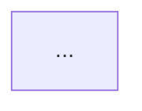

# Vulkan Course Writing Style

Applies to `docs/gpu-graphics/`. The durable course contract is [spec/docs/VKLITE_GRAPHICS_TUTORIAL.md](../../spec/docs/VKLITE_GRAPHICS_TUTORIAL.md); current status is in [the execution queue](../now/VKLITE_GRAPHICS_TUTORIAL.md).

The maintainer accepted the readability pilot on chapters 1-4; those chapters are the model for presentation, and the rules below now apply to chapters 5-16 and the epilogue as well. [12-uniform-buffers.md](../../docs/gpu-graphics/12-uniform-buffers.md) remains the model for explanatory depth.

## Voice

Simple, plain and friendly; never terse. The reader knows C but not graphics. Explain what we are doing, why, why this way, and where we are headed, one concept at a time, so the reader can generalize beyond Datoviz. Cut fluff, filler, hype, repetition and defensive caveats, never explanation. Readability work restructures explanation; it does not shorten it wholesale. Prefer short sentences and concrete words. Use "we" for shared reasoning and "you" for instructions.

Every new or revised passage must go through the `humanizer` skill, including prose written by delegated agents. Follow the shared [prose review requirements](DOCUMENTATION.md#prose-review): keep explanations simple, clear, direct and no longer than needed, while retaining useful teaching detail. Record the chapters or sections actually reviewed; earlier readability work alone is not evidence of a humanizer pass.

## Chapter shape

1. Title, italic approximate line banner, preview image. Recount the C line figure when the canonical step changes; raw-Vulkan figures remain labeled estimates.
2. Opener, no heading, two or three short paragraphs: where we are, what is missing and why it matters, what this chapter adds and what the reader will see at the end. Then "In this chapter you will:" with three to five numbered steps.
3. Concept sections before code: the one or two new ideas, intuition first, then the Vulkan term in bold at first definition, then how it maps to the program. One analogy at most per concept, only when it helps.
4. Code sections in the order the reader edits, with headings that name the goal ("Declare the slot in the pipeline layout"), not the API.
5. `## Build and run`, then the optional boxes: `??? tip "Try it"`, `??? info "Under the hood: ..."`, `??? warning "When it goes wrong"`.
6. `## What carries over`: two or three bullets on ideas that hold beyond Datoviz. Do not repeat another chapter's bullets.
7. `## Checkpoint`, listings, `Next:` line.

## Structure inside sections

- A long section may open with a short roadmap sentence or list when it helps the reader see where the section goes; do not add one to a section that is already easy to follow.
- Use a numbered list for an ordered progression (setup steps, a frame's sequence) and bullets for alternatives or parallel facts. Keep explanation in paragraphs; a list is not a substitute for saying why.
- Use tables for genuine comparisons (symptom and cause, owned and borrowed), not for prose.

## Around code

- Before each code block, say in plain words what the step does, why it is needed now, and where it goes.
- After a block whose arguments are bare numbers, flags or NULLs, read the call out in words once ("in set 0, binding 0, there is 1 descriptor, visible to the fragment shader").
- Recall earlier concepts by chapter when they return ("chapter 6's vertex buffer with a different usage flag").
- Say what is copied and what is referenced, who owns each object, and how long it must live, where it matters.
- When asynchronous work, queues or latency come up, give a rough scale with units rather than an unqualified "later". Chapter 3 explains when queued work can start and what can delay it. Light GPU operations can take microseconds or a fraction of a millisecond, and a complete frame is discussed in milliseconds; 60 FPS is about 16.7 ms and 120 FPS about 8.3 ms per frame (1000 / FPS). Present these as illustrative budgets, not measured or guaranteed submission, start or completion times. CPU and GPU stages can overlap when several frames are in flight, so their times do not simply add; waiting, execution and presentation latency differ; shader and pipeline creation at startup is separate from steady-state frame work. Later chapters refer back to chapter 3 instead of repeating it, and never state fixed GPU timings or claim that CPU-side timing measures GPU execution.
- Code is application code using existing public entrypoints: `<datoviz.h>` and `<datoviz/advanced.h>` (or narrower public headers they already cover). Do not add a course header, helper library, tutorial runtime or wrapper. `COURSE_CHECK` is an application-local macro defined and explained once in chapter 2; later chapters carry it forward without asking the reader to redefine or relearn it. Complete standalone step files retain the definition.

## Code formatting and excerpts

- Canonical step programs may use blank lines between logical groups and modest comments that name a group's purpose. Comments go on their own line above the code they describe. Prefer purpose, ownership or a dependency over narrating every function name; a brief purpose comment can summarize nearby prose so the standalone program remains readable.
- Formatting changes to a canonical program are allowed only when behavior is unchanged: same calls, arguments, resource ownership, validation, error paths, cleanup order and rendered output. Update every excerpt of that program in the same change.
- An excerpt may be split at a logical group or regrouped with neighboring code when that reads better. Excerpts appear in the program's semantic order (the order the reader edits), and each one stays verbatim in its canonical source.
- Introduce an embedded shader as readable, commented GLSL before showing its C string. In chapter 4, bind each complete GLSL block to its canonical constant with `<!-- embedded-shader: VERTEX_GLSL -->` or `<!-- embedded-shader: FRAGMENT_GLSL -->` immediately above the fence. The checker requires identical decoded shader tokens, allowing teaching comments and formatting; each shader must appear exactly once. C excerpts and external-file GLSL excerpts retain the verbatim rule. Keep the displayed C strings free of teaching comments.
- `just vulkan-course-check` must pass. Its allowed divergences are only for experiments the reader is invited to try; do not extend them to cover presentation changes.

## Figures

Each diagram is a numbered figure:

````markdown
<figure class="dvz-course-figure" id="fig-frame-timeline" markdown="1">



<figcaption>Figure 1. Plain caption that says what the figure shows.</figcaption>

</figure>
````

- Number figures within each chapter. Ids are semantic (`fig-` plus what is shown) and stay stable when figures are renumbered.
- Prose next to the figure explains it and refers to it by number; the figure never carries an idea alone.
- Use short node labels. Add Mermaid `accTitle` and `accDescr` only for diagram types that accept them.
- Add a figure where a flow or relationship is easier to see than read; do not add one to reach a count.
- Geometric and byte-layout schematics live in `docs/images/gpu-graphics/`. Regenerate them with `python3 tools/generate_course_figures.py` and verify with `--check`. The generator also supports `--manifest <path>` for a review inventory. Keep each panel's title and description, and check its values against the canonical C/GLSL when changing the lesson.
- Include these SVGs inline through the existing snippets extension, inside a `dvz-figure-panels` div with `markdown="0"`. This preserves raw SVG, lets labels inherit the active theme, and allows panels to stack on mobile. Use the `dvz-figure-panels--pairs` modifier for a two-column comparison. Keep labels readable at narrow widths and use text as well as color to explain differences.
- Label illustrative geometry and mathematical samples explicitly; they are not captures or validation of the course program. Compare lighting components with identical geometry and display scale, add their values in linear light, and apply display encoding afterwards. Short equations can use accessible HTML with subscripts and superscripts; a new math renderer is not required.


## Platform tabs and optional boxes

- Platform-specific commands and prose use content tabs labeled exactly `=== "Linux"`, `=== "macOS"` and `=== "Windows"`, in that order. Repeat identical commands under each label rather than merging labels, so the existing `content.tabs.link` setting keeps one OS selected across the site. Reuse native synchronization and browser storage rather than adding a separate platform state or cookies. The course-scoped helper may reapply the primary choice when a collapsed box opens, because native linking misses hidden labels. Without JavaScript each tab block still works on its own.
- If optional boxes contain OS tabs, wrap the first visible OS tab set in `<div id="course-platform" markdown="1">` so the scoped helper can read the primary choice when a box opens. The helper leaves route tabs and unrelated pages alone.
- Try it, Under the hood and When it goes wrong are collapsed boxes (`??? tip`, `??? info`, `??? warning`) because they are optional on a first read.
- Facts the reader needs to proceed stay in visible prose: required versions, ownership and lifetime rules, and how to enable and read validation. A collapsed box may expand on them but never be their only home.
- Keep the content of these boxes, Checkpoint and listings unless it is factually wrong or presentation requires splitting it.

## Hard constraints

- No functional change to C, GLSL or the API for presentation reasons.
- Verify every claim against `examples/c/vulkan/stepNN.c`, its shaders and the vklite headers. Do not invent API behavior.
- One source line per paragraph or list item; no hard wrapping.
- No chapter length target. Growth must come from explanation, not from restating.
