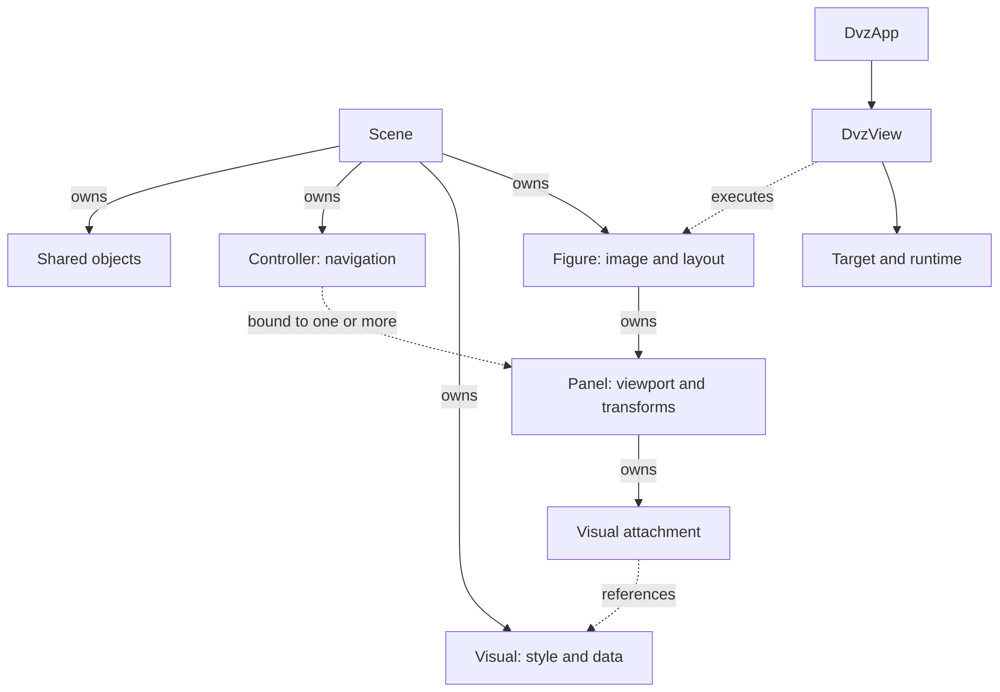

# Scene building blocks

The [Core concepts](../start/core-concepts.md) page introduces the objects used in every Datoviz scene. This page takes the next step: it explains containment, attachment, ownership, and destruction order for the same model in Python and C. The [reference](../reference/index.md) defines the exact constructors, attributes, and destruction rules.

**Audience:** new Datoviz users and agents adapting examples. **Prerequisite:** [Core concepts](../start/core-concepts.md), preferably after the [Quickstart](../start/quickstart.md).

## Containment and attachment

<figure class="dvz-course-figure" id="fig-figure-panel-visual-model-1" markdown="1">

<figcaption>Figure 1. The Scene owns retained objects. A panel attachment references a Visual; App presentation is managed separately.</figcaption>

</figure>

The scene owns each visual. A panel attachment determines where and how the visual participates in a figure. Uploading arrays does not display the visual; it becomes part of a view only after you attach it to a panel.

!!! important "One visual should contain many items"

    A visual is a rendering batch, not an individual mark. Put related points, segments, mesh instances, or other same-family items into arrays on one visual. Create another visual only when the items need a different family, panel, rendering state, coordinate treatment, or update schedule.

## Object responsibilities

| Object | Retains | Practical rule |
| --- | --- | --- |
| Scene | Figures, visuals, controllers, shared resources, interaction state, and planning state. | Destroy views/apps using it before destroying the scene. |
| Figure | Logical pixel size, background, panel layout, and one frame build for an output. | A scene may own several figures; each view renders one figure. |
| Panel | Drawing region, visual attachments, camera/view state, controller binding, and panel-local configuration. | Put related visuals in one panel when they share a view transform. |
| Visual | One render family, style, and arrays such as positions, colors, indices, or samples. | Group semantically related items of one family; do not create a visual per item. |
| Controller | Scene-side navigation state such as panzoom, arcball, fly, or turntable. | Bind it to a panel; share or link state only when panels should navigate together. |
| Adornment | Axes, labels, colorbars, legends, scale bars, guides, and readouts. | These lower through the scene path; they are not a separate overlay renderer. |
| View | A concrete native, offscreen, or hosted execution target plus runtime reuse. | It belongs to the app/runtime boundary rather than the scene object tree. |

## Visual data contracts

A visual family defines exact named attributes. An attribute contract includes dtype, shape,
cardinality, coordinate space, unit, default, and update behavior. Arrays describing the same item
must agree on item count: for a point visual, row `i` of position, color, and diameter describes the
same point.

A normal set-data call copies the input before returning. Borrowed/external resource APIs are
separate advanced contracts. Use the [visual-family reference](../reference/visual-families/index.md)
and [visual attributes](../reference/visual-attributes.md) rather than inferring an attribute from a
shader or old example.

## Typical lifetime

1. Create a scene, figure, and panel.
2. Create a visual and set family-valid arrays.
3. Attach the visual to the panel.
4. Bind navigation or add adornments if needed.
5. Create an app and a window/offscreen view, or use the managed Python run helper.
6. Render, interact, capture, or query.
7. In C, destroy app/views before the scene.

For why updates do not rebuild every object, continue to
[Retained resources](retained-resources.md). For public ownership details, use
[Objects and lifetimes](../reference/objects-and-lifetimes.md).
