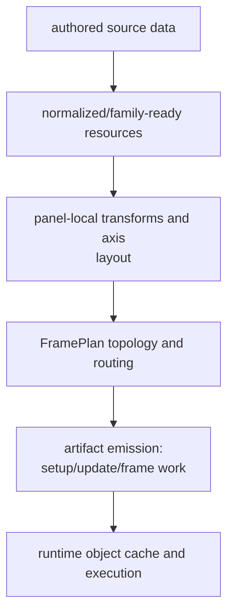

# Invalidation and caching

Invalidation records which derived facts became stale after a retained scene mutation. Caching reuses
derived or backend state while its dependencies remain valid. A redraw request schedules work; it is
not itself proof that data, a pipeline, or the frame-plan topology changed.

**Audience:** contributors changing updates, layout, controllers, axes, or planning, and developers
investigating unexpected reuploads. **Prerequisite:** [Retained resources](retained-resources.md).

## Keep four ideas separate

| Idea | Meaning |
| --- | --- |
| Dirty scope | A semantic dependency is stale: resource data, normalization, panel transform, axis layout, capability result, plan topology, or readback routing. |
| Redraw | A view should produce another frame. |
| Upload | The next plan must write changed bytes to an execution resource. |
| Plan rebuild | Logical nodes, dependencies, targets, routing, or stage participation changed. |

A mutation may cause several of these, but they are not synonyms. For example, panning redraws and
updates panel transforms; it should not upload every point or rebuild stable render topology.

## Dependency layers

<figure class="dvz-course-figure" id="fig-invalidation-and-caching-1" markdown="1">

<figcaption>Figure 1. Cached work follows the dependencies from source data to runtime execution.</figcaption>

</figure>

Invalidate from the changed layer downward, not from the root by default. Runtime caches may reuse
buffers or pipelines, but they must not infer scene semantics that the plan omitted.

## Change matrix

| Change | Usually dirty | Rebuild plan when... | Should stay reusable |
| --- | --- | --- | --- |
| Same-shape data range | Resource content and upload range | Counts, topology, usage, or stage participation changes. | Panel transform, unrelated resources, compatible pipeline. |
| Style/parameter value | Visual properties and small parameter upload | Variant, pass, target, or binding shape changes. | Source data and normalization. |
| Panzoom/camera | Panel transform; redraw | A view-dependent technique or route changes topology. | Source arrays, normalized resources, stable pipelines. |
| Axis domain motion | Panel transform | Covered domain/density/formatter/layout requires regenerated tick resources. | Data visual and unrelated panels. |
| Visual attach/add/remove | Scene structure and plan | Normally: membership and draw routing changed. | Unreferenced independent resources. |
| Resize | Viewport/target-dependent state | Attachment size/sample/target topology changes. | Retained visual data. |
| Capability change | Adaptation result | Selected variant, targets, stages, or routing changes. | Authored source data. |
| Capture/query request | Readback routing and frame work | A target or pass must be introduced or removed. | Normalized data unless representation differs. |

## Setup, update, and frame emission

Resolved dirtiness becomes three packet phases. `setup` creates, recreates, or destroys retained
execution objects. `update` changes content without changing identity or dependency shape. `frame`
encodes transient passes, draws, dispatches, copies, submits, and readback metadata. A same-shape
change should normally avoid setup; a frame packet must never rely on an unknown resource id.

The artifact carries `resource_version` and `frame_index` so a retained runtime can reject stale or
out-of-order packet sets. These counters guard execution order; they do not own scene lifetime.

## Diagnosing excess or missing work

Record the mutation, expected dirty scopes, emitted packet phases, and whether the plan cache was
reused. A useful diagnostic explains *why* an axis regenerated, a target was recreated, or a setup
packet appeared. Timing alone cannot distinguish an unnecessary upload from slow execution.

## Sources of truth

- [Invalidation contract](https://github.com/datoviz/datoviz/blob/main/spec/scene/pipeline/INVALIDATION_AND_CACHING.md)
- [FramePlan contract](https://github.com/datoviz/datoviz/blob/main/spec/scene/pipeline/FRAME_PLAN.md)
- [DRP2 packet phases](https://github.com/datoviz/datoviz/blob/main/spec/drp2/PACKETS.md)
- [Profile rendering performance](../how-to/profile-performance.md)
