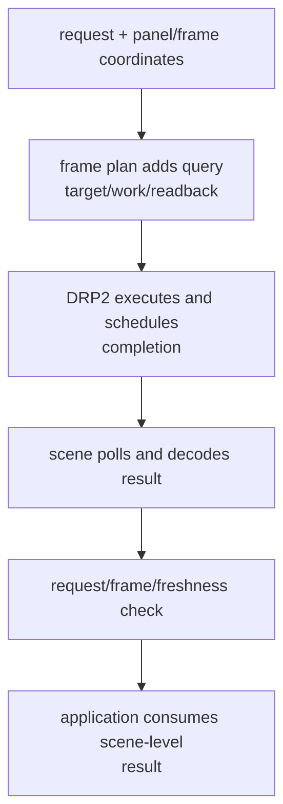

# Queries, picking, and probing

Queries connect a rendered frame back to retained scene meaning. Picking asks which item was
rendered; probing asks what sampled value corresponds to a coordinate; readback retrieves GPU output
such as pixels or typed buffer data. Support is visual-, query-, and backend-specific.

At the application level, you create a request and consume a result. Datoviz handles the render target, asynchronous completion, and translation from backend output to scene identities.

**Audience:** application developers adding picking, probing, or readback. **Prerequisite:** [Scene building blocks](figure-panel-visual-model.md) and the [Interaction model](interaction-model.md).

Use the [Queries reference](../reference/queries.md) for exact request/result types and freshness rules, and the How-To pages for [picking](../how-to/pick-items.md) or [probing](../how-to/probe-fields.md).

## Three questions

| Operation | Question | Result should describe |
| --- | --- | --- |
| Pick | “Which rendered item is under this pixel or region?” | Scene visual/item/instance identity, optional link key, and relevant coordinates. |
| Probe | “What value is represented here?” | Texel/voxel/sample identity, source or displayed value, and coordinate metadata. |
| Readback | “What bytes or values did the GPU produce?” | A typed/ranged result associated with a frame and request. |

Backend object ids are never the public answer. Runtime payloads must be decoded back to stable
scene identities before application selection, linking, or annotation uses them.

## Request and result lifecycle

<figure class="dvz-course-figure" id="fig-query-pick-probe-model-1" markdown="1">

<figcaption>Figure 1. A query result is decoded and checked against its request and frame before the application uses it.</figcaption>

</figure>

Readback can complete after later input has arrived. Hover therefore follows latest-request-wins:
a result must carry enough request/frame identity to discard stale work. Click or explicit probe
requests may use different acceptance rules, but freshness must be stated rather than assumed.
Browser WebGPU results are asynchronous; native paths also require explicit completion and lifetime
handling.

## Coordinate and visual semantics

Query planning uses the same panel viewport, transforms, sampled-field metadata, clipping, depth,
and visual-family rules as rendering. This matters for discarded marker pixels, path strokes,
transparency, image orientation, integer label fields, and volume rendering. A backend approximation
must not silently change the public meaning; an unsupported exact query should report unsupported.

Technique effects such as blending or multi-pass composition also require an explicit query policy.
“Frontmost opaque item” is not automatically equivalent to “largest transparent contribution.”

## Ownership

The scene owns requests, freshness policy, decoded identities, and retained selection/hover state.
The frame artifact owns the emitted command and payload snapshot. The runtime owns GPU execution and
temporary readback resources. Copy result data that must outlive the release point documented by its
API.

## Status boundary

Do not infer parity across all visual families or backends. Check the [Feature status](../reference/feature-status.md),
[Queries reference](../reference/queries.md), and [WebGPU subset](../reference/webgpu-subset.md) for
the promoted slice. CPU sampling of retained data may be useful application logic, but it is not
evidence that a rendered GPU probe path is supported.

## Sources of truth

- [GPU query system](https://github.com/datoviz/datoviz/blob/main/spec/scene/interaction/GPU_QUERY_SYSTEM.md)
- [Picking semantics](https://github.com/datoviz/datoviz/blob/main/spec/scene/interaction/PICKING.md)
- [Selection semantics](https://github.com/datoviz/datoviz/blob/main/spec/scene/interaction/SELECTION.md)
