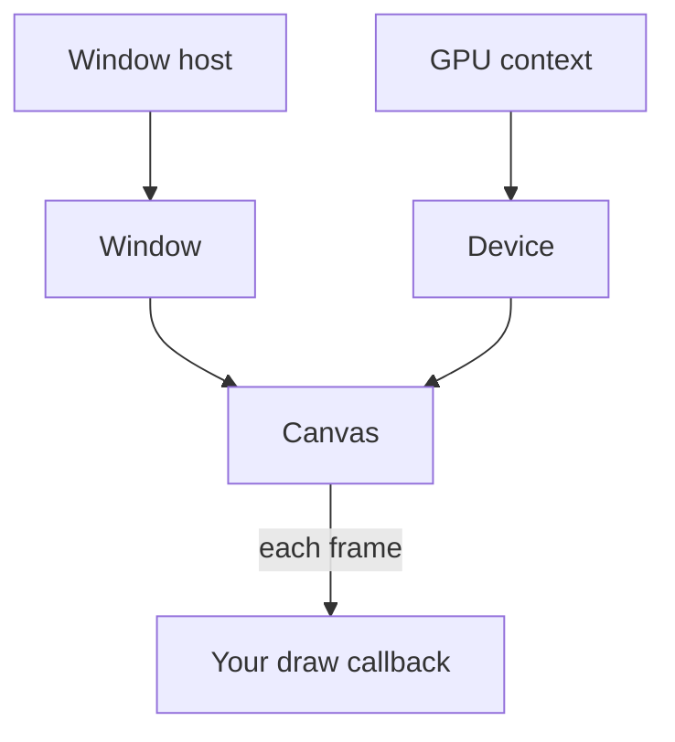

# 2. Your first window

*About 150 lines of C; raw Vulkan would need about 900.*


Chapter 1 gave you a build that links Datoviz, but the program never touched the GPU. Now it does. By the end of this chapter, your program opens a resizable window, fills it with a color you choose, and keeps drawing until you close it. With one command-line flag, the same program renders to a PNG file instead. Keep that option throughout the course: it lets you check each chapter without a window.

A colored window is little to show for 150 lines, but almost all of them are setup that every later chapter keeps unchanged. Putting a picture on screen takes several objects: a connection to the window system, a GPU, a window, and something that runs the frame loop. This chapter creates each one in turn. Chapter 3 explains what happens inside a frame; for now, the goal is a running program.

In this chapter you will:

1. choose at startup between a live window and an offscreen image;
2. create a GPU context, which selects a GPU and turns on error checking;
3. open a window and attach a canvas to it;
4. write a draw callback that clears each frame to a color;
5. run the render loop, then clean up in the right order.

## The objects between your code and the screen

Your program does not talk to the display or the GPU directly. It goes through a few objects, each with one job:

- The **window host** is the connection to the operating system's window system. It delivers keyboard, mouse, and resize events.
- The **GPU context** chooses a GPU and opens a Vulkan connection to it. Everything you create on the GPU later belongs to it.
- The **window** is the operating-system window itself.
- The **canvas** joins a window and a GPU. It owns the images you draw into and runs the frame machinery, and once per frame it calls a function you wrote.



For each object, note who owns it and how long it lives. One rule runs through the whole course: an object must not outlive the objects it was made from. The canvas uses the window and the device, so both must outlive it, and every GPU object must be destroyed before the device. The cleanup at the end of this chapter follows those arrows backwards.

## Include the headers

Each Datoviz layer has its own header. Replace the includes in `main.c` with these:

```c
#include <stdbool.h>
#include <stdio.h>
#include <string.h>

#include <datoviz.h>
#include <datoviz/canvas.h>
#include <datoviz/stream/frame_stream.h>
#include <datoviz/vk/gpu_ctx.h>
#include <datoviz/vklite.h>
#include <datoviz/window.h>
```

`vklite.h` provides typed wrappers over Vulkan objects. `canvas.h` provides the canvas, which owns the window's images and the frame loop's synchronization. `frame_stream.h` defines the `DvzStreamFrame` your draw callback receives, and `gpu_ctx.h` declares the GPU context that creates the Vulkan device. The Vulkan headers come along, so types such as `VkClearValue` need no extra include.

Add the window size and a small error-handling macro:

```c
#define WIDTH  800
#define HEIGHT 600

#define COURSE_CHECK(condition, message)                                                         \
    do                                                                                           \
    {                                                                                            \
        if (!(condition))                                                                        \
        {                                                                                        \
            fprintf(stderr, "%s\n", message);                                                   \
            goto cleanup;                                                                        \
        }                                                                                        \
    } while (0)
```

`COURSE_CHECK` prints a message and jumps to one cleanup block at the end of `main`. C has no exceptions, so this is the usual way to make every failure path release what was already created: the cleanup block runs whether the program got far or failed early. The course uses it where continuing would hide the real problem: creation, frame submission, and file output. Routine configuration calls stay unchecked.

## Choose a window or a file

You choose once, at startup, whether to render to a window or to an image, so `main` now takes arguments. Change its signature and declare the objects the cleanup block releases:

```c
int main(int argc, char** argv)
{
    int exit_code = 1;
    DvzWindowHost* host = NULL;
    DvzGpuCtx* gpu = NULL;
    DvzWindow* window = NULL;
    DvzCanvas* canvas = NULL;
    DvzCommands* commands = NULL;
    DvzRendering* rendering = NULL;
```

Below the declarations, parse `--png`:

```c
    // With --png PATH the program renders offscreen and saves an image instead of opening a window.
    const char* png_path = NULL;
    for (int i = 1; i < argc - 1; i++)
        if (strcmp(argv[i], "--png") == 0)
            png_path = argv[i + 1];
    bool live = png_path == NULL;

    DvzBackend backend = live ? DVZ_BACKEND_GLFW : DVZ_BACKEND_OFFSCREEN;
    DvzCanvasRenderMode mode =
        live ? DVZ_CANVAS_RENDER_MODE_PRESENT : DVZ_CANVAS_RENDER_MODE_OFFSCREEN;
```

The **backend** decides who provides the window. GLFW talks to the desktop; the offscreen backend provides a windowless target of the same size.

The **render mode** decides where finished frames go: to the screen, or into memory for readback.

Everything else in the program is the same in both modes. That is what makes the offscreen path useful: a run without a display gives the same image as the window, so you can check a result on any machine and compare two runs pixel by pixel.

## Connect to the window system

```c
    // The window host talks to the operating system's windowing layer.
    host = dvz_window_host();
    COURSE_CHECK(host != NULL, "window host creation failed");
```

The window host owns the connection to the platform's windowing system and the event queue you process in the render loop. You need one.

## Get a GPU

```c
    // The GPU context picks a physical device and creates the logical device and its queues.
    DvzGpuCtxConfig gpu_config = dvz_gpu_ctx_config();
    dvz_gpu_ctx_config_validation(&gpu_config, true);
    DvzResult configure_result =
        dvz_canvas_configure_gpu_ctx(host, backend, mode, &gpu_config);
    COURSE_CHECK(configure_result == DVZ_OK, "GPU configuration failed");
    gpu = dvz_gpu_ctx(&gpu_config);
    COURSE_CHECK(gpu != NULL, "no usable GPU found");
```

This is where your program gets a GPU. Read the block in order: start from a default configuration, turn on validation, let the canvas add what it needs for this backend and mode, then create the context. Two Vulkan terms matter from here on:

- A **physical device** describes one Vulkan implementation: its limits, memory types, queues, and features. It is usually a GPU, though a software renderer can appear too. The context picks one.
- A **logical device** is the live connection your program creates from it. Every resource you create later, including shader modules, pipelines, buffers, and images, belongs to this logical device and must be destroyed before it. `DvzDevice*` refers to it throughout the course.

Vulkan leaves optional capabilities off until you ask for them. `dvz_canvas_configure_gpu_ctx()` adds to the configuration the **extensions** and **features** the canvas needs, such as presentation to a window in live mode, so a GPU that lacks them is rejected when the context is created rather than later.

`dvz_gpu_ctx_config_validation()` requests the Vulkan **validation layers**. When installed, they sit between your code and the driver and report API misuse in words. Without them, a mistake may look like a blank window or a crash. Keep them on for the whole course. A missing layer shows up as `validation layer is not supported` at startup; set `DVZ_LOG_LEVEL=trace` to see the full startup log, including the layer's own messages.

Print which GPU you got:

```c
    DvzGpuInfo info = {0};
    if (dvz_gpu_ctx_gpu_info(gpu, &info))
        printf("GPU: %s\n", info.name);
```

## Open the window

```c
    DvzWindowConfig window_config = dvz_window_config();
    window_config.width = WIDTH;
    window_config.height = HEIGHT;
    window_config.title = "Modern GPU Graphics in Vulkan";
    window = dvz_window_create(host, backend, &window_config);
    COURSE_CHECK(window != NULL, "window creation failed");
```

Datoviz config structs follow one pattern: `dvz_*_config()` returns defaults, you change the fields you care about, then pass the struct to the create function.

## Create the canvas

```c
    // The canvas owns the swapchain, the per-frame images, and all frame synchronization.
    DvzCanvasConfig canvas_config = dvz_canvas_config();
    canvas_config.window = window;
    canvas_config.device = dvz_gpu_ctx_device(gpu);
    canvas_config.render_mode = mode;
    canvas = dvz_canvas_create(&canvas_config);
    COURSE_CHECK(canvas != NULL, "canvas creation failed");
```

The canvas borrows the window and the device: it does not destroy them. It owns the render targets and the frame machinery. Each frame, it lends a target and a recording command buffer to your callback, submits the finished work, and handles presentation or readback.

Vulkan cannot draw to a window directly. It needs a **surface**, its connection to an operating-system window, and a **swapchain**, a rotating set of images the display can show. The canvas renders into its own frame target, copies the result into an acquired swapchain image, and rebuilds the swapchain when the window is resized. In return, your callback runs whenever a frame is ready for recording.

## Write the draw callback

The canvas runs the frame loop machinery, so it calls you when it needs your part. You give it a function pointer and a `user_data` pointer, and it passes that pointer back on every call. That is how the callback reaches your state without global variables. The callback needs somewhere to keep that state. Add this struct above `main`:

```c
// Everything our program owns. It will grow in every chapter.
typedef struct
{
    DvzDevice* device;
    DvzCommands* commands;
    DvzRendering* rendering;
    VkClearValue clear;
} Renderer;
```

`Renderer` grows in nearly every chapter. For now, it holds the device, two small wrappers, and a clear color.

Then the callback, also above `main`:

```c
// Called once per frame by the canvas, with a command buffer we may record into.
static void draw(DvzCanvas* canvas, const DvzStreamFrame* frame, void* user_data)
{
    (void)canvas;
    Renderer* renderer = (Renderer*)user_data;

    dvz_commands_wrap_borrowed_recording(renderer->device, frame->command_buffer, renderer->commands);
    dvz_cmd_rendering_default(
        renderer->commands, frame->image_view, frame->extent.width, frame->extent.height,
        renderer->clear, renderer->rendering);
    dvz_cmd_rendering_begin(renderer->commands, renderer->rendering);
    dvz_cmd_rendering_end(renderer->commands);
    dvz_commands_unwrap(renderer->commands);
}
```

For now, read these five lines as "clear this frame's image to a color." Chapter 3 will take them apart. Nothing is drawn between `dvz_cmd_rendering_begin()` and `dvz_cmd_rendering_end()`: the color comes from the *clear*. Every triangle in this course will go between those two calls.

Create the renderer in `main`, after the canvas, and hand it to the canvas. The canvas keeps the `&renderer` pointer, which stays valid because `renderer` lives in `main` until the end:

```c
    commands = dvz_commands_create_wrapper();
    rendering = dvz_rendering_create_wrapper();
    Renderer renderer = {
        .device = dvz_gpu_ctx_device(gpu),
        .commands = commands,
        .rendering = rendering,
        .clear = {.color.float32 = {0.10f, 0.12f, 0.18f, 1.00f}},
    };
    COURSE_CHECK(commands != NULL && rendering != NULL, "renderer allocation failed");
    dvz_canvas_set_draw_callback(canvas, draw, &renderer);
```

Clear colors are floats from `0.0` to `1.0`, in red, green, blue, alpha order, not bytes from 0 to 255.

## Run the render loop

The loop is where the program spends its life:

```c
    // Process one frame attempt; READY attempts are submitted below.
    uint64_t frame_index = 0;
    while (live ? !dvz_window_should_close(window) : frame_index < 1)
    {
        dvz_window_host_poll(host);
        int status = dvz_canvas_frame(canvas);
        if (status == DVZ_CANVAS_FRAME_WAIT_SURFACE)
            continue;
        COURSE_CHECK(status == DVZ_CANVAS_FRAME_READY, "frame preparation failed");
        int submit_result = dvz_canvas_submit(canvas);
        COURSE_CHECK(submit_result == 0, "frame submission failed");
        frame_index++;
    }
    printf("rendered %llu frames\n", (unsigned long long)frame_index);
```

A live run loops until the window closes; a `--png` run needs one frame. Each iteration does three things:

1. `dvz_window_host_poll()` processes keyboard, mouse, resize, and close events. Skip it and the window stops responding.
2. `dvz_canvas_frame()` acquires the next image, opens a command buffer, and calls your `draw` callback. `DVZ_CANVAS_FRAME_WAIT_SURFACE` means the window is minimized or mid-resize, so there is nothing to draw and the loop tries again.
3. `dvz_canvas_submit()` sends the recorded commands to the GPU and, in live mode, presents the result.

Your callback records *what* to draw; `dvz_canvas_submit()` queues that work. Queued does not mean finished, or even started.

## Save the image

```c
    if (png_path != NULL)
    {
        int capture_result = dvz_canvas_capture_png(canvas, png_path);
        COURSE_CHECK(capture_result == 0, "PNG capture failed");
    }

    exit_code = 0;
```

This waits for the GPU, copies the image into CPU-readable memory, and encodes it.

## Clean up

```c
cleanup:
    // Destroy resources in dependency-safe order.
    dvz_rendering_free(rendering);
    dvz_commands_free(commands);
    dvz_canvas_destroy(canvas);
    dvz_window_destroy(window);
    dvz_window_host_destroy(host);
    uint32_t validation_errors = gpu != NULL ? dvz_gpu_ctx_error_count(gpu) : 0;
    if (gpu != NULL)
        printf("validation errors: %u\n", validation_errors);
    dvz_gpu_ctx_destroy(gpu);
    return exit_code == 0 && validation_errors == 0 ? 0 : 1;
}
```

This follows the ownership rule from the start of the chapter: the GPU context, which owns the device, goes last.

`dvz_gpu_ctx_error_count()` reports how many validation errors the layers recorded. Query it *before* destroying the context. It should print `0` in every chapter, but only if startup did not warn `validation layer is not supported`; without the layer, zero proves nothing.

## Build and run

=== "Linux and macOS"

    ```sh
    cmake --build build
    ./build/vkcourse
    ```

=== "Windows (Visual Studio)"

    ```powershell
    cmake --build build --config Release
    .\build\Release\vkcourse.exe
    ```

A dark blue window appears and stays open until you close it. Resize it: the color still fills it, because the canvas rebuilds its swapchain and your callback draws into the new image.

Then the same program, without a window:

=== "Linux and macOS"

    ```sh
    ./build/vkcourse --png chapter02.png
    ```

=== "Windows (Visual Studio)"

    ```powershell
    .\build\Release\vkcourse.exe --png chapter02.png
    ```

```
GPU: Apple M3
rendered 1 frames
validation errors: 0
```

The terminal must end with `validation errors: 0`.

!!! tip "Try it"

    1. Change the clear color to `{1.0f, 1.0f, 1.0f, 1.0f}`. The window turns white. Then try `{255.0f, 0.0f, 0.0f, 1.0f}`: the window is pure red, not brighter, because values are clamped to 1.0.
    2. Comment out `dvz_cmd_rendering_begin()` and `dvz_cmd_rendering_end()`. The window turns black. That black is worth understanding: Vulkan promises *nothing* about an image you have not written. You see black only because the canvas clears each target once before your callback first sees it.
    3. Delete `dvz_window_host_poll()` from the loop. The window still shows the color but stops responding: it no longer resizes, and the close button does nothing.
    4. Open `chapter02.png` in an image viewer that shows pixel values. The red channel is 89, not the 26 you might expect from `0.10 × 255`, because the offscreen target uses an sRGB format that encodes the value for display. Chapter 15 returns to this.

??? info "Under the hood: what you just skipped"

    A raw Vulkan program needs roughly this to reach the same dark blue window:

    - `vkCreateInstance` with the right platform extensions, plus a debug messenger for readable validation errors (about 80 lines).
    - `vkEnumeratePhysicalDevices`, then scoring each candidate for extensions, features, and queue families (about 150 lines).
    - `vkCreateDevice`, requesting queues and chaining feature structs. The canvas needs dynamic rendering, synchronization2, and timeline semaphores (about 80 lines).
    - A platform surface and a swapchain: query formats and present modes, choose an image count, create the swapchain, retrieve its images, and create a view for each (about 250 lines).
    - A command pool, command buffers, and per-frame semaphores and fences (about 100 lines).
    - The acquire, record, submit, and present sequence with the right wait stages, plus swapchain rebuilding after `VK_ERROR_OUT_OF_DATE_KHR` (about 200 lines).

    None of those 900 lines describes what you want to draw.

!!! warning "When it goes wrong"

    | Symptom | Cause and fix |
    | --- | --- |
    | `no usable GPU found` | No Vulkan driver, or one too old for the canvas's features. Check your installation with `vulkaninfo`. |
    | `canvas creation failed` in live mode but `--png` works | The window surface could not be created. Typical on a headless machine or over SSH without a display. |
    | The window stays black instead of dark blue | Your `draw` callback never ran. Check that `dvz_canvas_set_draw_callback()` runs *before* the loop. |
    | `validation errors: 3` and messages on the terminal | Read them; they name the offending call. Do not move on with a nonzero count. |
    | The window closes immediately | `dvz_canvas_frame()` returned something other than `READY` or `WAIT_SURFACE`. Print `status`. |

## What carries over

- Every GPU API starts with the same steps: choose a GPU, open a device on it, connect the device to a window, then loop over frames. WebGPU calls the pieces an adapter, a device, and a canvas context.
- Vulkan does not check your calls by default. Turn the validation layers on from the first line, and treat a nonzero error count as a bug.
- The same frame code can draw to a window or to an image in memory. The offscreen route makes results reproducible and testable.

## Checkpoint

1. What is the difference between a physical device and a logical device, and which one do the objects you create belong to?
2. Name three things the canvas does that a raw Vulkan program would do by hand.
3. Why does `dvz_canvas_frame()` sometimes return `WAIT_SURFACE`, and why is that not an error?
4. Why is the GPU context destroyed last?

??? example "Your `main.c` after chapter 2"

    ```c
    --8<-- "examples/c/vulkan/step02.c"
    ```

Next: [How a frame works](03-frame.md).
