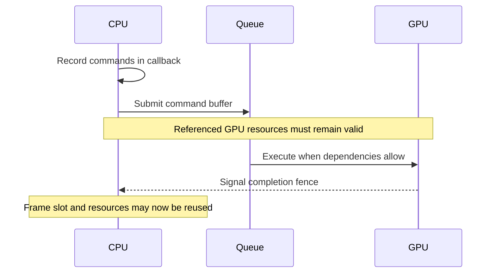

# 3. How a frame works

*About 175 lines of C; raw Vulkan would need about 1000.*

<picture>
  <source media="(prefers-reduced-motion: no-preference)" srcset="../../assets/gpu-graphics/03-frame.webp">
  
</picture>

Chapter 2 asked you to accept five lines on faith. This chapter takes them apart and adds a sixth, because together they set the shape of every frame in the course. The triangle in chapter 4 and the final lit, textured mesh both fit between the same two calls. Then you make the window pulse, which proves the loop is running rather than showing one frame forever.

## Two processors, one to-do list

A rendering program coordinates two processors. The CPU runs your C code and prepares work. The GPU executes the graphics commands and shaders that produce the image.

The CPU decides *what* to draw and writes down instructions: use this pipeline, draw these three vertices, clear to this color. It does not draw the image itself. That recorded list is a **command buffer**.

Submission puts recorded command buffers on a device queue. The GPU executes them later, asynchronously; synchronization constrains when that execution happens and when the resources it uses may be reused. By then your callback has returned, and the CPU may be preparing the next frame while the GPU works on an earlier one. The canvas keeps a few sets of per-frame resources so this overlap is possible; each set is a **frame slot** (a frame in flight). Reusing a frame slot can still make the CPU wait. Managing that overlap safely is why Vulkan needs synchronization, and why the canvas earns its keep.



This separation has two consequences that often confuse new Vulkan programmers:

- *Recording happens on the CPU; drawing happens later, on the GPU.* When `draw` returns, the commands exist but have not been submitted. `dvz_canvas_submit()` queues them.
- *GPU resources referenced by recorded commands must stay valid until execution finishes.* A submitted command buffer may still refer to buffers, images, pipelines, and descriptor sets after your callback returns, so do not destroy them while the GPU may use them. A CPU array is different: once an upload call has copied its bytes, you may reuse or free it. Each upload chapter points out that copy.

## What the canvas hands you

Your callback receives a `DvzStreamFrame*`. Three of its fields matter for now:

| Field | What it is |
| --- | --- |
| `frame->command_buffer` | A command buffer the canvas has already opened for recording. You write into it. |
| `frame->image_view` | The canvas-owned frame target. In live mode, the canvas later copies it to the acquired swapchain image. |
| `frame->extent` | Its current size in pixels. This changes when the window is resized. |

An image view is how Vulkan refers to an image for a particular use; chapter 14 makes one. The command buffer and image view are **borrowed** handles, valid only during this callback. Do not store or free them, and do not submit the command buffer yourself; the canvas does that. A later frame may use a different image view, especially after a resize.

The `extent` is a copied value, so storing it is safe, but it goes stale after a resize. Read it from each frame before recording size-dependent commands.

## The frame calls, one at a time

```c
    dvz_commands_wrap_borrowed_recording(renderer->device, frame->command_buffer, renderer->commands);
```

vklite records through a typed `DvzCommands` object, while the canvas hands you a raw Vulkan handle. This function points the `DvzCommands` wrapper you allocated at startup at that handle. It creates and owns nothing. Think of it as pointing your recording tool at the canvas's buffer. The name says both facts: the handle is *borrowed* and already *recording*.

```c
    dvz_cmd_rendering_default(
        renderer->commands, frame->image_view, frame->extent.width, frame->extent.height,
        clear, renderer->rendering);
```

This describes *where* the next commands will draw. Despite the `dvz_cmd_` prefix, it records nothing. An **attachment** is an image view used as an output of a rendering pass. Here `frame->image_view` becomes the one color attachment, with a render area, a load op of "clear", a store op of "store", and the clear value.

The load and store ops say what happens at the edges of the pass:

- The **load op** says what happens to the attachment's existing contents when the pass begins. `CLEAR` overwrites everything with the clear value; `LOAD` keeps what was there. Clearing is part of *starting to render*, which is why there is no `dvz_cmd_clear()`.
- The **store op** says whether the results survive when the pass ends. `STORE` keeps them, which you need for an image that will be shown or read back.

On mobile and tiled GPUs, discarding contents you will overwrite can save memory traffic.

```c
    dvz_cmd_rendering_begin(renderer->commands, renderer->rendering);
```

*Now* something is recorded. This opens the rendering pass described above, and later draw commands target its attachments. Description and recording are separate so you can finish configuring attachments first; in chapter 10 you add a depth attachment here.

```c
    dvz_cmd_set_viewport_scissor(renderer->commands, frame->extent);
```

This is the new line: add it right after `dvz_cmd_rendering_begin()`. The viewport maps normalized device coordinates (chapter 9 explains them) to pixels, and the scissor limits drawing to a pixel rectangle. This helper sets both to the full frame. The clear does not need them, but chapter 4's triangle will. Its pipeline declares them *dynamic*, recorded every frame rather than fixed at pipeline creation, so a resized window only needs the new extent here.

```c
    dvz_cmd_rendering_end(renderer->commands);
```

This closes the pass. Every draw call in the course goes between `dvz_cmd_rendering_begin()` and `dvz_cmd_rendering_end()`. There are no draws yet, so the frame contains only the clear.

```c
    dvz_commands_unwrap(renderer->commands);
```

This detaches your wrapper from the borrowed buffer. It does not end, reset, submit, or destroy the command buffer; the canvas owns that. Skip it and your `DvzCommands` points at a dead handle after the callback returns.

Who owns what, for this chapter:

| Value | Owner | Valid until |
| --- | --- | --- |
| `frame->command_buffer` | canvas | end of this callback |
| `frame->image_view` | canvas | end of this callback |
| `frame->extent` | copied frame value | may be stored, but a later frame may differ |
| `renderer->device` | GPU context | program teardown |
| `renderer->commands`, `renderer->rendering` | your renderer | program teardown |

## Make it move

A static color cannot tell you whether the loop runs at 60 frames per second or froze after the first frame. Drive the color from a clock.

Add `<math.h>` to the top of the file:

```c
#include <math.h>
```

`Renderer` no longer stores a clear color. It needs a start time, a fixed capture time, and an animation flag:

```c
typedef struct
{
    DvzDevice* device;
    DvzCommands* commands;
    DvzRendering* rendering;
    uint64_t start_ns;
    float capture_time;
    bool animate;
} Renderer;
```

In the callback, compute the color before recording:

```c
    // Elapsed seconds since startup. Offscreen captures use a fixed time so the image never
    // depends on how fast the machine ran.
    float t = renderer->capture_time;
    if (renderer->animate)
        t = (float)(dvz_time_monotonic_ns() - renderer->start_ns) * 1e-9f;

    VkClearValue clear = {.color.float32 = {
                              0.10f + 0.10f * sinf(t * 1.7f),
                              0.12f + 0.12f * sinf(t * 2.3f),
                              0.18f + 0.18f * sinf(t * 1.1f),
                              1.00f,
                          }};
```

Pass this local `clear` to `dvz_cmd_rendering_default()` in place of `renderer->clear`.

The timing follows two rules you will use throughout the course.

*Animate from a clock, not a frame counter.* `dvz_time_monotonic_ns()` is a monotonic nanosecond timer. Motion derived from elapsed time runs at the same speed on any display; `frame_index * 0.01f` would run nearly five times faster at 144 Hz than at 30 Hz.

*Offscreen renders use a fixed time.* Reading the clock would make every `--png` capture different. Add `float capture_time = 0.5f;` beside `png_path`, accept an optional `--time` in the argument loop, and store the value in `Renderer`:

```c
        else if (strcmp(argv[i], "--time") == 0)
            capture_time = strtof(argv[i + 1], NULL);
```

`strtof` needs `#include <stdlib.h>`. Offscreen runs freeze `t` at `0.5` unless `--time` picks another instant; that is also how the animated preview is made.

Update the initializer:

```c
    commands = dvz_commands_create_wrapper();
    rendering = dvz_rendering_create_wrapper();
    Renderer renderer = {
        .device = dvz_gpu_ctx_device(gpu),
        .commands = commands,
        .rendering = rendering,
        .start_ns = dvz_time_monotonic_ns(),
        .capture_time = capture_time,
        .animate = live,
    };
```

## Build and run

Build and run as in chapter 2. The window now drifts slowly through blues, greens, and purples. Drag an edge while it runs: the animation continues because each callback reads the new `extent`.

=== "Linux and macOS"

    ```sh
    cmake --build build
    ./build/vkcourse
    ./build/vkcourse --png chapter03.png
    ./build/vkcourse --png chapter03-again.png
    ./build/vkcourse --png later.png --time 1.5
    ```

=== "Windows (Visual Studio)"

    ```powershell
    cmake --build build --config Release
    .\build\Release\vkcourse.exe
    .\build\Release\vkcourse.exe --png chapter03.png
    .\build\Release\vkcourse.exe --png chapter03-again.png
    .\build\Release\vkcourse.exe --png later.png --time 1.5
    ```

The first two PNG files are identical; the third captures another point of the same animation. Each run ends with `validation errors: 0`.

!!! tip "Try it"

    1. Keep the previous contents. Override the load op just before beginning the pass:

        ```c
        DvzAttachment* color = dvz_rendering_color(renderer->rendering, 0);
        dvz_attachment_ops(color, VK_ATTACHMENT_LOAD_OP_LOAD, VK_ATTACHMENT_STORE_OP_STORE);
        ```

        Nothing overwrites the image now, so you see the canvas's initial black clear. Once later chapters draw, `LOAD` would keep whatever the target held from its previous use. Vulkan does not define a fresh image's contents; this works only because the canvas clears every target before first use. Write your own images before you read them.
    2. Divide the three `sinf` frequencies by 10. The window drifts almost imperceptibly.
    3. Every 60 frames, print `frame_index` divided by elapsed seconds. On a live window it is usually close to the display's refresh rate, because presentation waits for vertical sync. Some drivers and virtual displays don't wait, and you will see hundreds or thousands.
    4. Print `frame->image_view` and `frame->extent` in the callback, then resize the window. The extent changes, and the image view may too. That is why size comes from the current frame and the view is never kept.

??? info "Under the hood: the frame you did not have to orchestrate"

    In raw Vulkan, every live frame around your recording looks roughly like this:

    1. Wait on the fence for this frame slot, then reset it.
    2. Call `vkAcquireNextImageKHR` with a semaphore, and handle `VK_ERROR_OUT_OF_DATE_KHR` by rebuilding the swapchain.
    3. Reset the command buffer and call `vkBeginCommandBuffer`.
    4. Transition the frame target to the `COLOR_ATTACHMENT_OPTIMAL` image layout with the right stage masks (chapter 13 explains image layouts).
    5. Record your rendering, the only part the course asks you to write.
    6. Transition the target for transfer, copy it into the acquired swapchain image, and transition that image to `PRESENT_SRC_KHR`.
    7. Call `vkEndCommandBuffer`, then `vkQueueSubmit` waiting on the acquire semaphore and signaling a render semaphore and the fence.
    8. Call `vkQueuePresentKHR` waiting on the render semaphore, and handle an out-of-date swapchain *again*.

    `dvz_canvas_frame()` and `dvz_canvas_submit()` do this around your callback. A wrong transition or wait stage may still produce an image, or it may cause flicker, stale contents, or validation errors that are hard to decode.

!!! warning "When it goes wrong"

    | Symptom | Cause and fix |
    | --- | --- |
    | Nothing animates, one static color | `animate` is false, or `start_ns` was never set. `--png` mode is *meant* to be static. |
    | The animation runs at different speeds on two machines | The color comes from `frame_index` rather than elapsed time. |
    | Two `--png` runs differ | `t` comes from the clock in offscreen mode. |
    | Validation complains about a command buffer in the wrong state | Your code began, ended, reset, or submitted the borrowed command buffer, or recorded a draw outside a rendering pass. |

## Checkpoint

1. Which call submits the recorded commands, and why does it not tell you when the GPU starts executing them?
2. Why must you read `frame->extent` every frame instead of storing the window size once?
3. What is the difference between a load op of `CLEAR` and one of `LOAD`, and why is clearing not a command?
4. Why does offscreen mode use a fixed time instead of the clock?

??? example "Your `main.c` after chapter 3"

    ```c
    --8<-- "examples/c/vulkan/step03.c"
    ```

Next: [Your first triangle](04-triangle.md).
