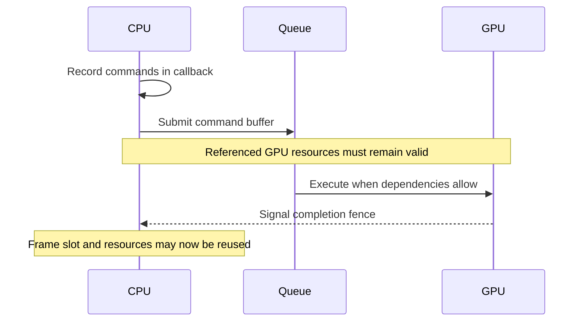

# 3. How a frame works

*About 205 lines of C; raw Vulkan would need about 1000.*

<picture>
  <source media="(prefers-reduced-motion: no-preference)" srcset="../../assets/gpu-graphics/03-frame.webp">
  
</picture>

Chapter 2 opened a window and cleared it to a color, and asked you to accept the five calls of the draw callback on faith. Those calls matter more than their size suggests: they set the shape of every frame in the course. The triangle in chapter 4 and the final lit, textured mesh both fit between two of them.

To read them, you need one idea first: the CPU and the GPU work at different times. Your callback does not draw anything. It writes down instructions that the GPU carries out later. Once that is clear, each call explains itself, and so do Vulkan's rules about how long objects must live.

This chapter takes the five calls apart and adds a sixth, which chapter 4's triangle will need. Then you make the window pulse, which proves the loop is running rather than showing one frame forever.

In this chapter you will:

1. see how the CPU records commands that the GPU executes later;
2. learn which values the canvas lends your callback, and for how long;
3. read each frame call, and add the viewport and scissor;
4. drive the clear color from a clock, with a fixed time for offscreen captures.

## Two processors, one to-do list

The CPU decides *what* to draw and writes down instructions: use this pipeline, draw these three vertices, clear to this color. It does not draw the image itself. That recorded list is a **command buffer**.

Why a list rather than direct calls? The GPU is a separate processor. If the CPU sent each instruction on its own and waited for it, each processor would spend most of its time waiting for the other. A whole frame's list, handed over at once, lets both run at full speed.

Submission puts recorded command buffers on a device **queue**, the line of work waiting for the GPU. The GPU runs them later; by then your callback has returned. The canvas manages **frame slots** (also called frames in flight): sets of per-frame resources used to record and track one frame. When several slots are available, the CPU can record the next frame while the GPU executes an earlier one. In every case, before reusing a slot, the CPU waits on a **fence**, a signal the GPU raises when it has finished that slot's work. If the GPU is still busy, that wait makes the CPU pause. Managing this safely is what Vulkan's synchronization is for, and why the canvas earns its keep.

### The time scale of a frame

"Later" describes order, not a fixed delay: the GPU can begin queued work once earlier work and its dependencies allow. How long that takes depends on the GPU, the workload and what is already queued. As a rough scale, a small GPU task may finish in microseconds or a fraction of a millisecond, while heavier work, such as a complete frame of a large scene, takes milliseconds or longer.

A useful yardstick is the **frame budget**: the average time per frame needed to sustain a frame rate, 1000 ms divided by the number of frames per second.

| Frame rate | Budget per frame |
| --- | --- |
| 60 FPS | about 16.7 ms |
| 120 FPS | about 8.3 ms |

Aim to finish comfortably within the budget, leaving room for other work and occasional slower frames. A budget is a target for steady throughput. It is not a guaranteed GPU duration, a queue wait, or a measurement of any frame. With several frames in flight, CPU and GPU work can overlap, so their times do not necessarily add up. **Latency**, the end-to-end time from recording a frame to seeing it on screen, is separate: it also includes queued work and the wait for presentation, so it can exceed one budget. One-time startup work, such as creating shaders and pipelines in chapter 4, is also separate from this steady per-frame cost.

These figures are rough scales, and timing the CPU side of a frame does not tell you how long the GPU spent on it. The Vulkan Guide's [profiling chapter](https://docs.vulkan.org/guide/latest/profiling.html) explains how to measure GPU execution.

### Follow one frame through time

<figure class="dvz-course-figure" id="fig-cpu-gpu-timeline" markdown="1">



<figcaption>Figure 1. The CPU records and submits; the GPU executes later and signals when the frame slot may be reused.</figcaption>

</figure>

Read the figure from top to bottom as time passing. It shows order, not a time scale: the spacing between arrows says nothing about how long each step takes. Between the submission and the fence, the CPU is free to do other work, but everything the recorded commands refer to is still in use.

This separation has two consequences that often confuse new Vulkan programmers:

- *Recording is not drawing.* `dvz_canvas_submit()` queues the commands after `draw` returns.
- *GPU resources referenced by recorded commands must stay valid until execution finishes.* A submitted command buffer may still refer to buffers, images, pipelines, and descriptor sets after your callback returns, so do not destroy them while the GPU may use them. A CPU array is different: once an upload call has copied its bytes, you may reuse or free it. Each upload chapter points out that copy.

## What the canvas hands you

Your callback receives a `DvzStreamFrame*`. Three of its fields matter for now:

| Field | What it is |
| --- | --- |
| `frame->command_buffer` | A command buffer the canvas has already opened for recording. You write into it. |
| `frame->image_view` | The canvas-owned frame target. In live mode, the canvas later copies it to the acquired swapchain image. |
| `frame->extent` | Its current size in pixels. This changes when the window is resized. |

An image view is how Vulkan refers to an image for a particular use; chapter 14 makes one. The command buffer and image view are **borrowed** handles, valid only during this callback. Do not store or free them, and do not submit the command buffer yourself; the canvas does that. A later frame may use a different image view, especially after a resize.

Read `frame->extent` from each frame before recording size-dependent commands.

## The frame calls, one at a time

Here are the six calls in the order they run, with the role of each:

1. **Attach** your command wrapper to the canvas's command buffer.
2. **Describe** the rendering pass: which image to draw into, and how to start and finish.
3. **Begin** the pass.
4. Set the **viewport and scissor**.
5. **End** the pass.
6. **Detach** your wrapper again.

Only three of them, begin, the viewport and scissor, and end, record anything into the command buffer. The others connect your wrapper to the canvas's buffer or describe the pass. In the code, each call now has its own short comment and a blank line around it, so you can find these six steps at a glance.

### 1. Attach the wrapper

```c
    // Attach: point our wrapper at the command buffer the canvas lends us for this frame.
    dvz_commands_wrap_borrowed_recording(
        renderer->device, frame->command_buffer, renderer->commands);
```

vklite records through a typed `DvzCommands` object, while the canvas hands you a raw Vulkan handle. This function points the `DvzCommands` wrapper you allocated at startup at that handle. It creates and owns nothing. Think of it as pointing your recording tool at the canvas's buffer. The name says both facts: the handle is *borrowed* and already *recording*.

### 2. Describe the pass

```c
    // Describe: render into this frame's image, cleared to this frame's color.
    dvz_cmd_rendering_default(
        renderer->commands, frame->image_view, frame->extent.width, frame->extent.height,
        clear, renderer->rendering);
```

This describes *where* the next commands will draw. Despite the `dvz_cmd_` prefix, it records nothing. An **attachment** is an image view used as an output of a rendering pass. Here `frame->image_view` becomes the one color attachment, with a render area, a load op of "clear", a store op of "store", and the clear value.

The `clear` argument is a local color that you compute later in this chapter, in [Make it move](#make-it-move). Until you get there, keep chapter 2's `renderer->clear`.

#### Load and store operations

The load and store ops say what happens at the edges of the pass:

- The **load op** says what happens to the attachment's existing contents when the pass begins. `CLEAR` overwrites everything with the clear value; `LOAD` keeps what was there. Clearing is part of *starting to render*, which is why there is no `dvz_cmd_clear()`.
- The **store op** says whether the results survive when the pass ends. `STORE` keeps them, which you need for an image that will be shown or read back.

On mobile and tiled GPUs, discarding contents you will overwrite can save memory traffic.

### 3. Begin the pass

```c
    // Begin the pass; the clear happens here.
    dvz_cmd_rendering_begin(renderer->commands, renderer->rendering);
```

*Now* something is recorded. This opens the rendering pass described above, and later draw commands target its attachments. Description and recording are separate so you can finish configuring attachments first; in chapter 10 you add a depth attachment here.

### 4. Set the viewport and scissor

```c
    // Cover the whole frame. The clear ignores this, but chapter 4's draw needs it.
    dvz_cmd_set_viewport_scissor(renderer->commands, frame->extent);
```

This is the new line: add it right after `dvz_cmd_rendering_begin()`. It sets two rectangles:

- The **viewport** maps normalized device coordinates, where x and y run from −1 to 1 across the frame (chapter 9 explains where they come from), to pixels.
- The **scissor** limits drawing to a pixel rectangle.

This helper sets both to the full frame. The clear does not need them, but chapter 4's triangle will. Its pipeline declares them *dynamic*, recorded every frame rather than fixed at pipeline creation, so a resized window only needs the new extent here.

### 5. End the pass

```c
    // End the pass. Every draw call goes before this line.
    dvz_cmd_rendering_end(renderer->commands);
```

This closes the pass. Every draw call in the course goes between `dvz_cmd_rendering_begin()` and `dvz_cmd_rendering_end()`. There are no draws yet, so the frame contains only the clear.

### 6. Detach the wrapper

```c
    // Detach: let go of the borrowed command buffer; the canvas submits it.
    dvz_commands_unwrap(renderer->commands);
```

This detaches your wrapper from the borrowed buffer. It does not end, reset, submit, or destroy the command buffer; the canvas owns that. Skip it and your `DvzCommands` points at a dead handle after the callback returns.

## Who owns what

Every value your callback touches has an owner and a lifetime. For this chapter:

| Value | Owner | Valid until |
| --- | --- | --- |
| `frame->command_buffer` | canvas | end of this callback |
| `frame->image_view` | canvas | end of this callback |
| `frame->extent` | copied frame value | may be stored, but a later frame may differ |
| `renderer->device` | GPU context | program teardown |
| `renderer->commands`, `renderer->rendering` | your renderer | program teardown |

## Make it move

Now put the loop to work. A static color cannot tell you whether the loop runs at 60 frames per second or froze after the first frame. Drive the color from a clock.

The timing follows two rules you will use throughout the course:

- *Animate from a clock, not a frame counter*, so motion runs at the same speed on any display.
- *Offscreen renders use a fixed time*, so every `--png` capture of the same instant is identical.

This takes three small steps: store the timing state, compute the color from elapsed time, and fix the time for offscreen captures.

### Store the timing state

Add `<math.h>` for `sinf()` and `<stdlib.h>` for `strtof()`, which you use below. The include block becomes:

```c
#include <math.h>
#include <stdbool.h>
#include <stdio.h>
#include <stdlib.h>
#include <string.h>

#include <datoviz.h>
#include <datoviz/advanced.h>
```

`Renderer` no longer stores a clear color. It needs a start time, a fixed capture time, and an animation flag:

```c
typedef struct
{
    DvzDevice* device;
    DvzCommands* commands;
    DvzRendering* rendering;
    uint64_t start_ns;
    float capture_time;
    bool animate;
} Renderer;
```

`start_ns` is the moment the program started, `capture_time` is the instant an offscreen capture shows, and `animate` chooses between the two.

### Compute the color from elapsed time

In the callback, compute the color before recording:

```c
    // Elapsed seconds since startup. Offscreen captures use a fixed time so the image never
    // depends on how fast the machine ran.
    float t = renderer->capture_time;
    if (renderer->animate)
        t = (float)(dvz_time_monotonic_ns() - renderer->start_ns) * 1e-9f;

    // Each channel swings around its chapter 2 value at its own frequency.
    VkClearValue clear = {.color.float32 = {
                              0.10f + 0.10f * sinf(t * 1.7f),
                              0.12f + 0.12f * sinf(t * 2.3f),
                              0.18f + 0.18f * sinf(t * 1.1f),
                              1.00f,
                          }};
```

Pass this local `clear` to `dvz_cmd_rendering_default()` in place of `renderer->clear`, as step 2 above already shows.

`dvz_time_monotonic_ns()` is a monotonic nanosecond timer: it only moves forward, even if the system clock is adjusted. Motion derived from elapsed time runs at the same speed on any display; `frame_index * 0.01f` would run nearly five times faster at 144 Hz than at 30 Hz.

### Fix the time for offscreen captures

Reading the clock would make every `--png` capture different. Instead, an offscreen run uses a fixed `capture_time`, which an optional `--time` argument can change. Extend the argument parsing:

```c
    // With --png PATH, render offscreen and save an image instead of opening a window.
    // With --time SECONDS, choose the instant of the animation that --png captures.
    const char* png_path = NULL;
    float capture_time = 0.5f;
    for (int i = 1; i < argc - 1; i++)
    {
        if (strcmp(argv[i], "--png") == 0)
            png_path = argv[i + 1];
        else if (strcmp(argv[i], "--time") == 0)
            capture_time = strtof(argv[i + 1], NULL);
    }
    bool live = png_path == NULL;
```

Offscreen runs freeze `t` at `0.5` unless `--time` picks another instant; that is also how the animated preview at the top of this page is made.

Then store the timing state in the renderer:

```c
    // Allocate the two recording wrappers and gather what the draw callback needs.
    // Live runs animate from the clock; --png runs freeze time at capture_time.
    commands = dvz_commands_create_wrapper();
    rendering = dvz_rendering_create_wrapper();
    Renderer renderer = {
        .device = dvz_gpu_ctx_device(gpu),
        .commands = commands,
        .rendering = rendering,
        .start_ns = dvz_time_monotonic_ns(),
        .capture_time = capture_time,
        .animate = live,
    };
```

## Build and run

Build and run as in chapter 2. The window now drifts slowly through blues, greens, and purples. Drag an edge while it runs: the color keeps filling the window at its new size, because each callback reads the new `extent`.

=== "Linux"

    ```sh
    cmake --build build
    ./build/vkcourse
    ./build/vkcourse --png chapter03.png
    ./build/vkcourse --png chapter03-again.png
    ./build/vkcourse --png later.png --time 1.5
    ```

=== "macOS"

    ```sh
    cmake --build build
    ./build/vkcourse
    ./build/vkcourse --png chapter03.png
    ./build/vkcourse --png chapter03-again.png
    ./build/vkcourse --png later.png --time 1.5
    ```

=== "Windows"

    In a Developer PowerShell for Visual Studio, with the `PATH` setup from chapter 1:

    ```powershell
    cmake --build build --config Release
    .\build\Release\vkcourse.exe
    .\build\Release\vkcourse.exe --png chapter03.png
    .\build\Release\vkcourse.exe --png chapter03-again.png
    .\build\Release\vkcourse.exe --png later.png --time 1.5
    ```

The first two PNG files are identical; the third captures another point of the same animation. Each run ends with `validation errors: 0`.

??? tip "Try it"

    1. Keep the previous contents. Override the load op just before beginning the pass:

        ```c
        DvzAttachment* color = dvz_rendering_color(renderer->rendering, 0);
        dvz_attachment_ops(color, VK_ATTACHMENT_LOAD_OP_LOAD, VK_ATTACHMENT_STORE_OP_STORE);
        ```

        Nothing overwrites the image now, so you see the canvas's initial black clear (chapter 2's Try it explains why it is black). Once later chapters draw, `LOAD` would keep whatever the target held from its previous use.
    2. Divide the three `sinf` frequencies by 10. The window drifts almost imperceptibly.
    3. Every 60 frames, print `frame_index` divided by elapsed seconds. On a live window it is usually close to the display's refresh rate, because presentation waits for vertical sync. Some drivers and virtual displays don't wait, and you will see hundreds or thousands.
    4. Print `frame->image_view` and `frame->extent` in the callback, then resize the window. The extent changes, and the image view may too. That is why size comes from the current frame and the view is never kept.

??? info "Under the hood: the frame you did not have to orchestrate"

    In raw Vulkan, every live frame around your recording looks roughly like this:

    1. Wait on the fence for this frame slot, then reset it.
    2. Call `vkAcquireNextImageKHR` with a semaphore, and handle `VK_ERROR_OUT_OF_DATE_KHR` by rebuilding the swapchain.
    3. Reset the command buffer and call `vkBeginCommandBuffer`.
    4. Transition the frame target to the `COLOR_ATTACHMENT_OPTIMAL` image layout with the right stage masks (chapter 13 explains image layouts).
    5. Record your rendering, the only part the course asks you to write.
    6. Transition the target for transfer, copy it into the acquired swapchain image, and transition that image to `PRESENT_SRC_KHR`.
    7. Call `vkEndCommandBuffer`, then `vkQueueSubmit` waiting on the acquire semaphore and signaling a render semaphore and the fence.
    8. Call `vkQueuePresentKHR` waiting on the render semaphore, and handle an out-of-date swapchain *again*.

    `dvz_canvas_frame()` and `dvz_canvas_submit()` do this around your callback. A wrong transition or wait stage may still produce an image, or it may cause flicker, stale contents, or validation errors that are hard to decode.

??? warning "When it goes wrong"

    | Symptom | Cause and fix |
    | --- | --- |
    | Nothing animates, one static color | `animate` is false, or `start_ns` was never set. `--png` mode is *meant* to be static. |
    | The animation runs at different speeds on two machines | The color comes from `frame_index` rather than elapsed time. |
    | Two `--png` runs differ | `t` comes from the clock in offscreen mode. |
    | Validation complains about a command buffer in the wrong state | Your code began, ended, reset, or submitted the borrowed command buffer, or recorded a draw outside a rendering pass. |

## What carries over

- Every modern GPU API records commands on the CPU and executes them later on the GPU: Vulkan command buffers, WebGPU command encoders, Metal command buffers.
- Clearing is part of starting a render pass, and keeping the result is part of ending it. WebGPU and Metal use the same load and store operations.
- Animate from elapsed time, never from a frame count, and fix the time when you need a reproducible image.

## Checkpoint

1. Which call submits the recorded commands, and why does it not tell you when the GPU starts executing them?
2. Why must you read `frame->extent` every frame instead of storing the window size once?
3. What is the difference between a load op of `CLEAR` and one of `LOAD`, and why is clearing not a command?
4. Why does offscreen mode use a fixed time instead of the clock?

??? example "Your `main.c` after chapter 3"

    ```c
    --8<-- "examples/c/vulkan/step03.c"
    ```

Next: [Your first triangle](04-triangle.md).
