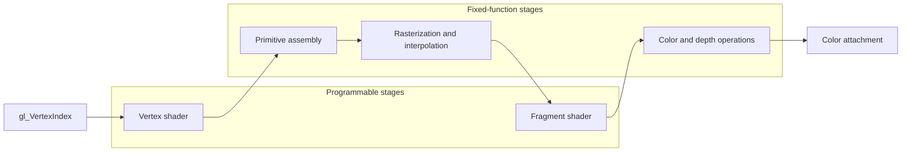

# 4. Your first triangle

*About 267 lines of C; raw Vulkan would need about 1200.*


The frame from chapter 3 finally gets something to draw: a triangle, built from two shaders, one graphics pipeline, and one draw command. A **shader** is a small GPU program that runs at a defined stage of the graphics pipeline. The vertex positions live in the shader for now, so no vertex buffer is needed yet.

Start from your chapter 3 `main.c`. The pulsing clear has done its job, so remove `<math.h>`, the three animation fields in `Renderer`, the `--time` option, and the time calculation in `draw()`. Remove the GPU-name and frame-count prints too; validation errors remain the one diagnostic on every run. Keep `--png`, and use this fixed dark clear color:

```c
    VkClearValue clear = {.color.float32 = {0.04f, 0.05f, 0.08f, 1.0f}};
```

Add the pipeline fields to `Renderer`. From now on, this struct holds every object the draw callback uses. The full listing also trims chapter 3's guide comments.

```c
typedef struct
{
    DvzDevice* device;
    VkFormat color_format;
    DvzCommands* commands;
    DvzRendering* rendering;
    DvzSlots* slots;
    DvzShader* vertex_shader;
    DvzShader* fragment_shader;
    DvzGraphics* pipeline;
} Renderer;
```

Cleanup now releases everything through `renderer`, so declare it zero-initialized with the other handles at the top of `main()`. A failure before the pipeline exists then reaches `cleanup:` with every field `NULL`. Delete the separate `commands` and `rendering` locals and chapter 2's `Renderer renderer = {...}` initializer:

```c
    DvzCanvas* canvas = NULL;
    Renderer renderer = {0};
```

The argument loop now looks only for `--png`:

```c
    for (int argument_index = 1; argument_index + 1 < argc; argument_index++)
        if (strcmp(argv[argument_index], "--png") == 0)
            png_path = argv[argument_index + 1];
```

## Two shader stages

A **shader invocation** is one execution of a shader for one item of work. The vertex shader runs once per requested vertex and writes that vertex's position. `gl_VertexIndex` is 0, 1, then 2, so each invocation picks one position and one color from constant arrays compiled into the shader.

These positions are in clip space: for now, x and y run from −1 to 1, and y points down. Chapter 9 explains why.

```c
static const char* VERTEX_GLSL =
    "#version 450\n"
    "layout(location = 0) out vec3 color;\n"
    "vec2 positions[3] = vec2[](\n"
    "    vec2( 0.0, -0.65), vec2( 0.65, 0.65), vec2(-0.65, 0.65));\n"
    "vec3 colors[3] = vec3[](\n"
    "    vec3(1.0, 0.2, 0.2), vec3(0.2, 1.0, 0.2), vec3(0.2, 0.3, 1.0));\n"
    "void main() {\n"
    "    gl_Position = vec4(positions[gl_VertexIndex], 0.0, 1.0);\n"
    "    color = colors[gl_VertexIndex];\n"
    "}\n";
```

After the vertex stage, primitive assembly groups the three outputs into a triangle, and rasterization finds which framebuffer samples it covers. For each one it produces a **fragment**, a candidate contribution to that sample, with the vertex colors interpolated across the triangle. The fragment shader then runs for each fragment and writes a color to location 0. A fragment is not simply a pixel: later tests can reject it, and multisampling can evaluate several samples per pixel.

```c
static const char* FRAGMENT_GLSL =
    "#version 450\n"
    "layout(location = 0) in vec3 color;\n"
    "layout(location = 0) out vec4 out_color;\n"
    "void main() { out_color = vec4(color, 1.0); }\n";
```

The full path for this draw is:



The programmable stages run code you supply. The fixed-function stages follow state you configure, such as topology, viewport, depth testing, and blending. A **graphics pipeline** packages the shaders and most of that state into one device object. A command later binds it, and the following draws use that whole configuration.

## Resolve the canvas color format

The window system picks the swapchain format; the canvas learns it at the first acquire, and the pipeline must name that exact format. A window may use BGRA where an offscreen canvas uses RGBA, so you cannot guess.

After creating the canvas, set `renderer.device` and run one frame before creating the pipeline. No draw callback is installed yet, so the canvas records its default clear. Then read the resolved format:

```c
    renderer.device = dvz_gpu_ctx_device(gpu);
    // Acquire and submit one default clear before creating a format-dependent pipeline.
    int initial_status = DVZ_CANVAS_FRAME_WAIT_SURFACE;
    while (initial_status == DVZ_CANVAS_FRAME_WAIT_SURFACE)
    {
        dvz_window_host_poll(host);
        if (live && dvz_window_should_close(window))
        {
            exit_code = 0;
            goto cleanup;
        }
        initial_status = dvz_canvas_frame(canvas);
    }
    COURSE_CHECK(initial_status == DVZ_CANVAS_FRAME_READY, "initial frame preparation failed");
    int initial_submit_result = dvz_canvas_submit(canvas);
    COURSE_CHECK(initial_submit_result == 0, "initial frame submission failed");
    renderer.color_format = dvz_canvas_frame_format(canvas);
    COURSE_CHECK(renderer.color_format != VK_FORMAT_UNDEFINED, "canvas color format is unresolved");
```

If the surface is temporarily unavailable, keep polling until a frame is acquired or the window closes. This warm-up frame doesn't count: the loop's first frame draws the triangle, and that is the one `--png` saves.

## Compile and build the pipeline

All the pipeline code lives in one helper that fills the renderer's pipeline fields and returns zero on success:

```c
static int create_pipeline(Renderer* renderer)
{
```

Add `<stdint.h>` and `<datoviz/shader.h>`. GLSL is the shading language of both source strings. `dvz_compile_glsl()` translates each into **SPIR-V**, Vulkan's binary intermediate representation. SPIR-V is not machine code; the driver translates it further for your GPU.

```c
    uint64_t vertex_size = 0;
    uint64_t fragment_size = 0;
    uint32_t* vertex_spirv = dvz_compile_glsl("vertex", VERTEX_GLSL, &vertex_size);
    uint32_t* fragment_spirv = dvz_compile_glsl("fragment", FRAGMENT_GLSL, &fragment_size);
    if (vertex_spirv == NULL || fragment_spirv == NULL)
    {
        dvz_memory_free(vertex_spirv);
        dvz_memory_free(fragment_spirv);
        return -1;
    }
```

Every vklite object you own follows the same lifecycle:

!!! note "vklite object lifecycle"

    | Step | Call | Effect |
    | --- | --- | --- |
    | 1 | `dvz_*_create_wrapper()` | allocate an empty C wrapper; no Vulkan object yet |
    | 2 | `dvz_slots()`, `dvz_graphics()`, ... | attach it to a device, then configure it |
    | 3 | `dvz_*_create()` | create the Vulkan object |
    | 4 | `dvz_*_destroy()` | destroy the Vulkan object |
    | 5 | `dvz_*_free()` | free the wrapper |

    `dvz_shader()` is the one shortcut: it does steps 2 and 3 in a single call.

Allocate the four wrappers:

```c
    renderer->vertex_shader = dvz_shader_create_wrapper();
    renderer->fragment_shader = dvz_shader_create_wrapper();
    renderer->slots = dvz_slots_create_wrapper();
    renderer->pipeline = dvz_graphics_create_wrapper();
    if (renderer->vertex_shader == NULL || renderer->fragment_shader == NULL ||
        renderer->slots == NULL || renderer->pipeline == NULL)
    {
        dvz_memory_free(vertex_spirv);
        dvz_memory_free(fragment_spirv);
        return -1;
    }
```

`dvz_shader()` copies each SPIR-V array into a **shader module**, the Vulkan object that hands one compiled stage to pipeline creation. The CPU arrays can then be freed.

```c
    int vertex_result =
        dvz_shader(renderer->device, vertex_size, vertex_spirv, renderer->vertex_shader);
    int fragment_result =
        dvz_shader(renderer->device, fragment_size, fragment_spirv, renderer->fragment_shader);
    dvz_memory_free(vertex_spirv);
    dvz_memory_free(fragment_spirv);
    if (vertex_result != 0 || fragment_result != 0)
        return -1;
```

`DvzSlots` is Datoviz's wrapper for the **pipeline layout**, the list of resources and small values shaders may access. It is empty here; chapter 8 adds its first entry. The pipeline combines the shader stages with state that says: group vertices in threes, render to the canvas color format, and set the viewport and scissor every frame.

```c
    dvz_slots(renderer->device, renderer->slots);
    if (dvz_slots_create(renderer->slots) != 0)
        return -1;

    dvz_graphics(renderer->device, renderer->pipeline);
    dvz_graphics_shader(
        renderer->pipeline, VK_SHADER_STAGE_VERTEX_BIT,
        dvz_shader_handle(renderer->vertex_shader));
    dvz_graphics_shader(
        renderer->pipeline, VK_SHADER_STAGE_FRAGMENT_BIT,
        dvz_shader_handle(renderer->fragment_shader));
```

```c
    dvz_graphics_primitive(
        renderer->pipeline, VK_PRIMITIVE_TOPOLOGY_TRIANGLE_LIST, DVZ_GRAPHICS_FLAGS_FIXED);
    dvz_graphics_attachment_color(renderer->pipeline, 0, renderer->color_format);
    dvz_graphics_layout(renderer->pipeline, dvz_slots_handle(renderer->slots));
    dvz_graphics_viewport(renderer->pipeline, 0, 0, 0, 0, 0, 1, DVZ_GRAPHICS_FLAGS_DYNAMIC);
    dvz_graphics_scissor(renderer->pipeline, 0, 0, 0, 0, DVZ_GRAPHICS_FLAGS_DYNAMIC);
    return dvz_graphics_create(renderer->pipeline);
```

In `main()`, store the command and rendering wrappers in `renderer`, then build the pipeline before registering the draw callback:

```c
    renderer.commands = dvz_commands_create_wrapper();
    renderer.rendering = dvz_rendering_create_wrapper();
    COURSE_CHECK(
        renderer.commands != NULL && renderer.rendering != NULL, "renderer allocation failed");
    int pipeline_result = create_pipeline(&renderer);
    COURSE_CHECK(pipeline_result == 0, "graphics pipeline creation failed");
```

Submitted frames may still use the pipeline, so cleanup waits for the device first. Then it destroys and frees the pipeline, shader modules, and slots before the other wrappers and the GPU context:

```c
    if (renderer.device != NULL)
        dvz_device_wait(renderer.device);
    if (renderer.pipeline != NULL)
        dvz_graphics_destroy(renderer.pipeline);
    dvz_graphics_free(renderer.pipeline);
    if (renderer.fragment_shader != NULL)
        dvz_shader_destroy(renderer.fragment_shader);
    dvz_shader_free(renderer.fragment_shader);
    if (renderer.vertex_shader != NULL)
        dvz_shader_destroy(renderer.vertex_shader);
    dvz_shader_free(renderer.vertex_shader);
    if (renderer.slots != NULL)
        dvz_slots_destroy(renderer.slots);
    dvz_slots_free(renderer.slots);
    dvz_rendering_free(renderer.rendering);
    dvz_commands_free(renderer.commands);
```

The `NULL` checks skip wrappers that were never allocated, and `free` accepts `NULL`, so this one path works whichever step failed. Vulkan lets you destroy shader modules as soon as the pipeline exists; the course keeps them with the pipeline so one cleanup path covers both.

## Draw three vertices

Bind the pipeline after rendering begins, set the dynamic viewport and scissor, then ask for three vertices. The numbers are first vertex, vertex count, first instance, and instance count; one instance means "draw the shape once".

```c
    dvz_cmd_bind_graphics(renderer->commands, renderer->pipeline);
    dvz_cmd_set_viewport_scissor(renderer->commands, frame->extent);
    dvz_cmd_draw(renderer->commands, 0, 3, 0, 1);
```

## Build and run

Build and run from your `vkcourse` directory, close the window, then capture the same result offscreen:

=== "Linux and macOS"

    ```sh
    cmake --build build
    ./build/vkcourse
    ./build/vkcourse --png chapter04.png
    ```

=== "Windows (Visual Studio)"

    ```powershell
    cmake --build build --config Release
    .\build\Release\vkcourse.exe
    .\build\Release\vkcourse.exe --png chapter04.png
    ```

`chapter04.png` shows the triangle above, and the terminal ends with `validation errors: 0`.

!!! tip "Try it"

    1. Swap the red and blue entries in `colors`. The two corners exchange colors; the geometry stays put.
    2. Change `VK_PRIMITIVE_TOPOLOGY_TRIANGLE_LIST` to `VK_PRIMITIVE_TOPOLOGY_LINE_LIST`. Three vertices make one line and one leftover vertex, so you see a single line, not a triangle.
    3. Exchange the last two positions. The triangle still appears because face culling is off, but its winding is reversed. Chapter 10 makes that visible.

??? info "Under the hood: a Vulkan pipeline"

    Raw Vulkan needs a shader-module create structure per stage, a pipeline layout, about ten fixed-function state structures, the dynamic-rendering attachment formats, and a graphics-pipeline create call. Datoviz fills the routine defaults, but the result is still an ordinary Vulkan pipeline.

!!! warning "When it goes wrong"

    A shader compile error stops startup: the compiler message is followed by `graphics pipeline creation failed`. A blank frame with zero validation errors usually means the triangle is off-screen or the draw call is missing. A draw outside the rendering pass, or a pipeline format that does not match the canvas, produces validation errors; read them first. An upside-down triangle comes from assuming OpenGL's y-up convention.

## Checkpoint

1. What supplies vertex positions when there is no vertex buffer?
2. Which stage interpolates the colors between vertices?
3. Which pipeline state is dynamic in this program?
4. Why can the CPU-side SPIR-V arrays be freed after shader-module creation?

??? example "Your `main.c` after chapter 4"

    ```c
    --8<-- "examples/c/vulkan/step04.c"
    ```

Next: [Shaders in their own files](05-shader-files.md).
