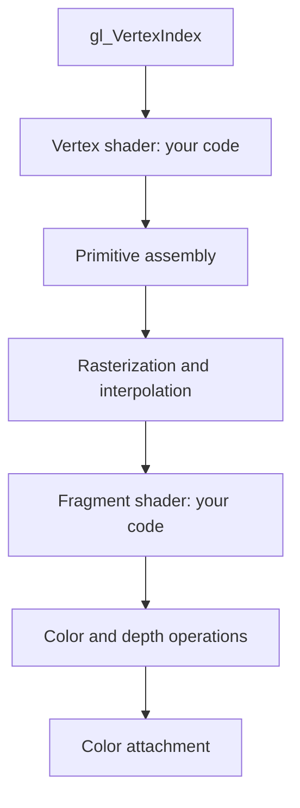

# 4. Your first triangle

*About 330 lines of C; raw Vulkan would need about 1200.*


Chapter 3 gave every frame its shape: a rendering pass that clears the image, with a gap between `dvz_cmd_rendering_begin()` and `dvz_cmd_rendering_end()` where drawing goes. So far that gap is empty. Now we fill it with a triangle.

The triangle is the GPU's basic shape: every surface in this course, up to the final mesh, is made of triangles. Drawing one takes three new things: **shaders**, small programs that run on the GPU; a **graphics pipeline**, which combines the shaders with the settings for how to draw; and a draw command, recorded in the callback. To keep the chapter to those three, the vertex positions are written inside the shader itself. Chapter 6 moves them into a buffer.

We first follow one triangle through the GPU and read the two shaders that draw it. Then we edit `main.c`. At the end, the window shows the triangle above, with a red, a green and a blue corner and the colors mixing smoothly across its surface.

In this chapter you will:

1. follow one triangle through the graphics pipeline;
2. read a vertex shader and a fragment shader written in GLSL;
3. see how GLSL becomes the SPIR-V that Vulkan receives, and store the shaders in C strings;
4. prepare `main.c`: new `Renderer` fields and the canvas color format;
5. build the graphics pipeline, then bind it and draw three vertices.

## How the GPU draws a triangle

On the CPU, you might draw a triangle with a loop over pixels: for each pixel, check whether it is inside the triangle, then set its color. The GPU splits this work into stages. You give it the triangle's three corners and two small programs, and it passes the triangle through the stages in Figure 1.

<figure class="dvz-course-figure" id="fig-graphics-pipeline" markdown="1">



<figcaption>Figure 1. One draw flows through two programmable stages, your shaders, and fixed-function stages configured by the pipeline.</figcaption>

</figure>

Here is what each stage receives and produces for our triangle:

1. **Vertex shader.** It receives a vertex index, 0, 1 or 2, and produces that corner's position and color.
2. **Primitive assembly.** It receives the three positions and groups them into one triangle, because the pipeline says that every three vertices form a separate triangle.
3. **Rasterization and interpolation.** It receives the triangle and finds the pixels it covers. For each one, it makes a **fragment**: a candidate for that pixel, carrying a mix of the three corner colors.
4. **Fragment shader.** It receives one fragment with its interpolated color and produces the color to write.
5. **Color and depth operations.** They receive that color and decide whether and how it is written to the image. Chapter 10 adds a depth test here; this chapter has none.
6. **Color attachment.** This is the image the draw writes into: the frame image the canvas lends to the draw callback (chapter 3).

This mixing in stage 3 is called **interpolation**. Each fragment gets a mix of the three corner colors: the closer it is to a corner, the more of that corner's color it gets. A fragment next to the red corner comes out almost red. At the center of the triangle, the three corners weigh the same, so the fragment gets one third of each. That is how three corner colors become the smooth gradient in the picture.

Figure 1 has two kinds of stage:

- The **programmable** stages, the vertex and fragment shaders, run code you write.
- The **fixed-function** stages run logic built into the GPU and driver. You do not program them; you configure them with pipeline settings such as the topology, the viewport, depth testing and blending.

The GPU runs each shader many times, in parallel: the vertex shader for each vertex, and the fragment shader for each fragment that rasterization produces.

## GLSL in brief

In this course, we write our shaders in **GLSL**, a C-like language for GPU programs. It is one shader language among several: WebGPU uses WGSL, for example, and HLSL is commonly used with Direct3D. We chose GLSL because its syntax is close to C and because Datoviz can compile it while your program runs. Vulkan does not receive the GLSL text itself; [Why shaders are compiled](#why-shaders-are-compiled) explains what it receives instead.

GLSL is separate from C: your C compiler does not compile it, and the shaders run on the GPU, not inside your C program. This chapter needs only a little GLSL, and each piece is explained where it first appears.

A **shader invocation** is one execution of a shader's `main()` function, for one vertex or one fragment. We do not write a C loop that calls the shader's `main()` for each vertex or fragment. The C code records a draw command, and when the GPU executes that command, it schedules the shader invocations itself.

### The vertex shader

The vertex shader runs for each of the three vertices. GLSL provides a built-in input, `gl_VertexIndex`, that holds the index of the current vertex: 0, 1 or 2 in this draw. The shader uses it to pick one position and one color from two arrays. In this example, the arrays hold fixed data written in the shader source, so their values are compiled into the shader. Chapter 6 moves the positions into a buffer that the C program fills.

<!-- embedded-shader: VERTEX_GLSL -->
```glsl
#version 450

// Output to the next stage: this vertex's color, at location 0.
layout(location = 0) out vec3 color;

// Corner positions (x, y), compiled into the shader.
vec2 positions[3] = vec2[](
    // Vertex 0: top
    vec2( 0.0, -0.65),
    // Vertex 1: bottom right
    vec2( 0.65, 0.65),
    // Vertex 2: bottom left
    vec2(-0.65, 0.65));

// Corner colors (red, green, blue), in the same order.
vec3 colors[3] = vec3[](
    // Red
    vec3(1.0, 0.2, 0.2),
    // Green
    vec3(0.2, 1.0, 0.2),
    // Blue
    vec3(0.2, 0.3, 1.0));

// Runs once for each vertex.
void main() {
    // Place the vertex: x and y from the array, then z = 0 and w = 1.
    gl_Position = vec4(positions[gl_VertexIndex], 0.0, 1.0);
    // Pass this corner's color to the next stage.
    color = colors[gl_VertexIndex];
}
```

Reading it from the top:

- `#version 450` says which version of GLSL the shader uses. It comes before any code.
- `vec2`, `vec3` and `vec4` are vectors of 2, 3 and 4 floats. Their components are named `x`, `y`, `z` and `w`. `vec2(0.65, 0.65)` builds a vector from its components, and `vec2[](...)` builds an array of vectors.
- `out` marks a value the shader passes to the next stage. `layout(location = 0)` gives that value a number, which the fragment shader uses to find it.
- Names that start with `gl_` are built-in. The GPU fills in the input `gl_VertexIndex`, and the shader must write the output `gl_Position`.
- `vec4(positions[gl_VertexIndex], 0.0, 1.0)` builds a 4-component vector from a 2-component one and two more numbers: x and y from the array, then z = 0 and w = 1.

`gl_Position` is a position in **clip space**, the coordinates the GPU uses before it maps vertices onto the viewport. The GPU divides x, y and z by w, so w = 1 leaves them unchanged. In this example, with w = 1, x and y from −1 to 1 span chapter 3's viewport from edge to edge, and y points down. That is why vertex 0, at y = −0.65, is the top corner. Here z = 0 is the depth, which matters from chapter 10 on. Chapter 9 explains clip space in full, including the role of w.

### Between the shaders

The vertex shader's `color` output exists only at the three corners. Rasterization fills in the rest: as described after Figure 1, each fragment receives a `color` interpolated from the three corner values. The fragment shader reads that interpolated value as its input.

### The fragment shader

The fragment shader runs for each fragment. It reads the interpolated color and writes one color with four components: red, green, blue and alpha.

<!-- embedded-shader: FRAGMENT_GLSL -->
```glsl
#version 450

// Input from the vertex shader's location 0, interpolated for this fragment.
layout(location = 0) in vec3 color;

// Output to color attachment 0.
layout(location = 0) out vec4 out_color;

// Runs once for each fragment.
void main() {
    // Add alpha 1.0 (fully opaque) to the RGB color.
    out_color = vec4(color, 1.0);
}
```

`in` marks a value received from the previous stage. `vec4(color, 1.0)` appends a fourth component, alpha, to the 3-component color; an alpha of 1.0 means fully opaque.

The shader has two interfaces. Both use location 0, but they connect different things:

- Its input at location 0 receives the vertex shader's output at location 0. The location numbers and the types (`vec3`) must match; the names do not need to.
- Its output at location 0 goes to the pipeline's color attachment 0, which you set up below.

A fragment is not yet a pixel. Later operations, such as chapter 10's depth test, can reject it, and where triangles overlap, several fragments compete for the same pixel.

## Why shaders are compiled

When this program gives a shader to Vulkan, it does not pass GLSL text. The Vulkan call it uses takes **SPIR-V**, the standard binary shader format for Vulkan. A compiler that targets Vulkan can produce SPIR-V from GLSL or from another language, such as HLSL; the Vulkan guide has a [shader language comparison](https://docs.vulkan.org/guide/latest/high_level_shader_language_comparison.html). The language you write in is therefore a separate choice from the format Vulkan receives.

SPIR-V is a kind of **bytecode**: compiled instructions and their associated data, encoded in a binary program format rather than as source text. It is an intermediate form, not machine code for a particular GPU. The same SPIR-V can be used on different GPUs, as long as each one supports the Vulkan version and features the shader was compiled for. SPIR-V is stored as a sequence of 32-bit words, which is why the program holds it in `uint32_t` arrays.

In this program, each shader reaches the GPU in two compile steps:

1. A shader compiler translates GLSL into SPIR-V.
2. The driver turns SPIR-V into instructions for your GPU. It usually does this work, or reuses a cached result, when the graphics pipeline is created, because the pipeline gives it all the stages and the settings around them.

Your C compiler takes no part in either step: to it, a shader is just a string. Vulkan receives each stage's SPIR-V in a **shader module**, an object that holds one stage's SPIR-V for pipeline creation.

Because the driver compiles the shaders together with the pipeline settings, Vulkan wants everything that shapes a draw, such as the shaders, the kind of primitive and the output format, known up front in one object. The program creates that object once at startup, and binding the pipeline in each frame reuses the result. The price is that a pipeline cannot change after creation. Only the settings you mark *dynamic*, such as chapter 3's viewport, are left to the command buffer. Chapter 5 meets this limit when it reloads shaders.

### The compiler Datoviz uses

Datoviz uses [Shaderc](https://github.com/google/shaderc), an existing open-source compiler library, to compile GLSL. `dvz_compile_glsl()` calls Shaderc's library functions inside your program; it does not start a command-line tool. The official v0.4 packages are configured to bundle this runtime library, but not Shaderc's command-line tools or the Vulkan SDK. A source build uses the Shaderc library from the system or SDK environment you set up in chapter 1, and Datoviz can also be built without runtime compilation.

### Two ways to get SPIR-V

You can produce SPIR-V at two different times:

- **At startup, through Datoviz.** This is what the course does. `create_pipeline()` passes the GLSL strings to `dvz_compile_glsl()` and gets SPIR-V back. Compile errors appear as soon as the program starts. Once chapter 5 moves the shaders into their own files, you can edit one and run again without any shader build step, and even reload it while the program runs.
- **Ahead of time, with an external tool.** A command-line compiler, such as `glslc` from the Shaderc project or `glslangValidator`, compiles the GLSL when you build your application. You either save the SPIR-V in `.spv` files and load their words into memory at run time, or embed the words in your C code. Either way, you pass the SPIR-V words and their size in bytes to `dvz_shader()`, the call that creates the shader modules in step 2 below. The application then needs no runtime compiler for those shaders. When the pipeline is created, the driver still produces code for your GPU or reuses a cached result.

## The shaders as C strings

For now, the two shaders are stored as C strings in `main.c`, which keeps the whole program in one file with no shader files to find at run time. Chapter 5 moves them into ordinary `.vert` and `.frag` files, which are easier to edit.

The vertex shader:

```c
static const char* VERTEX_GLSL =
    "#version 450\n"
    "layout(location = 0) out vec3 color;\n"
    "vec2 positions[3] = vec2[](\n"
    "    vec2( 0.0, -0.65), vec2( 0.65, 0.65), vec2(-0.65, 0.65));\n"
    "vec3 colors[3] = vec3[](\n"
    "    vec3(1.0, 0.2, 0.2), vec3(0.2, 1.0, 0.2), vec3(0.2, 0.3, 1.0));\n"
    "void main() {\n"
    "    gl_Position = vec4(positions[gl_VertexIndex], 0.0, 1.0);\n"
    "    color = colors[gl_VertexIndex];\n"
    "}\n";
```

The fragment shader:

```c
static const char* FRAGMENT_GLSL =
    "#version 450\n"
    "layout(location = 0) in vec3 color;\n"
    "layout(location = 0) out vec4 out_color;\n"
    "void main() { out_color = vec4(color, 1.0); }\n";
```

The text inside the quotes is the GLSL you read above, without the comments. Only two pieces of C syntax are added around it:

- Each GLSL line is a C string literal in double quotes. The C compiler joins adjacent literals into one string, so `VERTEX_GLSL` is a single string.
- `\n` ends each line. It keeps `#version 450` on a line of its own, as GLSL requires, and gives shader compiler errors meaningful line numbers.

## Start from chapter 3

Now start editing. Open your chapter 3 `main.c` and add the two shader strings above after the `COURSE_CHECK` macro. The pulsing clear is no longer needed, so remove `<math.h>`, the three animation fields in `Renderer`, the `--time` option, and the time calculation in `draw()`. Remove the GPU-name and frame-count prints too; validation errors remain the one diagnostic on every run. Keep `--png`, and use this fixed dark clear color:

```c
    // A fixed dark background behind the triangle.
    VkClearValue clear = {.color.float32 = {0.04f, 0.05f, 0.08f, 1.0f}};
```

Add the pipeline fields to `Renderer`. From now on, this struct holds every object the draw callback uses, and the pipeline's building blocks, which cleanup must release:

```c
// Renderer state: a borrowed device and the objects our program creates for drawing.
typedef struct
{
    DvzDevice* device;
    VkFormat color_format;
    DvzCommands* commands;
    DvzRendering* rendering;
    DvzSlots* slots;
    DvzShader* vertex_shader;
    DvzShader* fragment_shader;
    DvzGraphics* pipeline;
} Renderer;
```

Cleanup now releases everything through `renderer`, so declare it zero-initialized with the other handles at the top of `main()`. This follows chapter 2's cleanup policy: a failure before the pipeline exists then reaches `cleanup:` with every field `NULL`. Delete the separate `commands` and `rendering` locals and chapter 3's `Renderer renderer = {...}` initializer:

```c
    // Everything the cleanup block releases starts as NULL, meaning "not created yet".
    // Zero-initializing the renderer sets each of its handles to NULL too.
    int exit_code = 1;
    DvzWindowHost* host = NULL;
    DvzGpuCtx* gpu = NULL;
    DvzWindow* window = NULL;
    DvzCanvas* canvas = NULL;
    Renderer renderer = {0};
```

The argument loop now looks only for `--png`:

```c
    for (int argument_index = 1; argument_index + 1 < argc; argument_index++)
        if (strcmp(argv[argument_index], "--png") == 0)
            png_path = argv[argument_index + 1];
```

## Wait for the canvas color format

The pipeline is compiled to write one exact pixel format, so it must know the format of the image it draws into. That image is the canvas's frame target, and it uses the swapchain's format so the canvas can copy it into the swapchain image (chapter 2). The window system chooses that format, and the canvas learns it at the first acquire. A window may use BGRA where an offscreen canvas uses RGBA, so you cannot guess.

After creating the canvas, set `renderer.device` and run one frame before creating the pipeline. No draw callback is installed yet, so this frame records nothing of yours; the new target holds only the canvas's one-time black clear (chapter 2). Then read the resolved format:

```c
    // create_pipeline(), draw(), and the cleanup block reach the device through the renderer.
    renderer.device = dvz_gpu_ctx_device(gpu);

    // Acquire and submit one default clear before creating a format-dependent pipeline.
    // While the surface is unavailable, keep polling unless the user closes the window.
    int initial_status = DVZ_CANVAS_FRAME_WAIT_SURFACE;
    while (initial_status == DVZ_CANVAS_FRAME_WAIT_SURFACE)
    {
        dvz_window_host_poll(host);
        if (live && dvz_window_should_close(window))
        {
            exit_code = 0;
            goto cleanup;
        }
        initial_status = dvz_canvas_frame(canvas);
    }
    COURSE_CHECK(initial_status == DVZ_CANVAS_FRAME_READY, "initial frame preparation failed");
    int initial_submit_result = dvz_canvas_submit(canvas);
    COURSE_CHECK(initial_submit_result == 0, "initial frame submission failed");

    // The pipeline must be built for exactly this color format.
    renderer.color_format = dvz_canvas_frame_format(canvas);
    COURSE_CHECK(
        renderer.color_format != VK_FORMAT_UNDEFINED, "canvas color format is unresolved");
```

If the surface is temporarily unavailable, keep polling until a frame is acquired or the window closes. Closing the window this early is not an error, so that path sets `exit_code = 0` before jumping to `cleanup:`. This warm-up frame doesn't count: the loop's first frame draws the triangle, and that is the one `--png` saves.

## Compile and build the pipeline

Building the pipeline takes four steps:

1. **Compile** the GLSL to SPIR-V.
2. Wrap each result in a **shader module**.
3. Create an empty **pipeline layout**.
4. Set the **graphics state** and create the pipeline from everything above.

All the pipeline code lives in one helper above `draw()`, which fills the renderer's pipeline fields and returns zero on success:

```c
static int create_pipeline(Renderer* renderer)
{
```

A helper cannot use `COURSE_CHECK`, because `goto` cannot leave a function. Instead it returns `-1` at the first failure, and `main()` checks that result. Anything the helper already stored in `renderer` stays there, so `main()`'s cleanup block still releases it.

The shader modules, the pipeline layout, and the pipeline you build here all follow the same lifecycle:

!!! note "vklite object lifecycle"

    | Step | Call | Effect |
    | --- | --- | --- |
    | 1 | `dvz_*_create_wrapper()` | allocate an empty C wrapper; no Vulkan object yet |
    | 2 | `dvz_slots()`, `dvz_graphics()`, ... | attach it to a device, then configure it |
    | 3 | `dvz_*_create()` | create the Vulkan object |
    | 4 | `dvz_*_destroy()` | destroy the Vulkan object |
    | 5 | `dvz_*_free()` | free the wrapper |

    `dvz_shader()` is the one shortcut: it does steps 2 and 3 in a single call.

Not every wrapper fits this table. The command and rendering wrappers from chapter 2 have no create or destroy step in this program: `renderer->commands` only borrows the canvas's command buffer during each callback, and `renderer->rendering` only describes a pass, so neither owns a Vulkan object and both go straight from `create_wrapper` to `free`. Chapter 13 gives a commands wrapper a command buffer of its own, and then it needs `dvz_commands_destroy()` too. Descriptor sets, in chapter 12, are another exception.

### 1. Compile GLSL to SPIR-V

Add `<stdint.h>` for the fixed-size integer types. `dvz_compile_glsl()` comes from `<datoviz/shader.h>`, which `<datoviz/advanced.h>` already includes. It runs the shader compiler on each string and returns SPIR-V: the first of the two compile steps described earlier.

```c
    // Compile both GLSL strings to SPIR-V. We own the returned arrays.
    uint64_t vertex_size = 0;
    uint64_t fragment_size = 0;
    uint32_t* vertex_spirv = dvz_compile_glsl("vertex", VERTEX_GLSL, &vertex_size);
    uint32_t* fragment_spirv = dvz_compile_glsl("fragment", FRAGMENT_GLSL, &fragment_size);
    if (vertex_spirv == NULL || fragment_spirv == NULL)
    {
        dvz_memory_free(vertex_spirv);
        dvz_memory_free(fragment_spirv);
        return -1;
    }
```

The compiler returns arrays that your program owns. If either compilation fails, free whatever was returned and report the failure; the compiler has already printed its message.

### 2. Create the shader modules

First allocate the four wrappers this helper fills, the lifecycle's step 1. The renderer owns them from this point, so a later failure leaves them for `main()`'s cleanup:

```c
    // Allocate four empty wrappers. The renderer owns them, even if a later step fails.
    renderer->vertex_shader = dvz_shader_create_wrapper();
    renderer->fragment_shader = dvz_shader_create_wrapper();
    renderer->slots = dvz_slots_create_wrapper();
    renderer->pipeline = dvz_graphics_create_wrapper();
    if (renderer->vertex_shader == NULL || renderer->fragment_shader == NULL ||
        renderer->slots == NULL || renderer->pipeline == NULL)
    {
        dvz_memory_free(vertex_spirv);
        dvz_memory_free(fragment_spirv);
        return -1;
    }
```

`dvz_shader()` copies each SPIR-V array into its shader module, so the CPU arrays can then be freed.

```c
    // Copy the SPIR-V into two shader modules, then free the CPU arrays.
    int vertex_result =
        dvz_shader(renderer->device, vertex_size, vertex_spirv, renderer->vertex_shader);
    int fragment_result =
        dvz_shader(renderer->device, fragment_size, fragment_spirv, renderer->fragment_shader);
    dvz_memory_free(vertex_spirv);
    dvz_memory_free(fragment_spirv);
    if (vertex_result != 0 || fragment_result != 0)
        return -1;
```

Both arrays are freed before the results are checked, so neither leaks whichever way this step ends.

### 3. Create the pipeline layout

`DvzSlots` is Datoviz's wrapper for the **pipeline layout**, the list of resources and small values shaders may access. It is empty here, because these shaders read nothing but their built-in arrays; chapter 8 adds its first entry.

```c
    // An empty pipeline layout: these shaders read no resources yet.
    dvz_slots(renderer->device, renderer->slots);
    if (dvz_slots_create(renderer->slots) != 0)
        return -1;
```

This is the lifecycle in full: `dvz_slots()` attaches the wrapper to the device, and `dvz_slots_create()` creates the Vulkan object.

### 4. Configure and create the graphics pipeline

The pipeline combines the shader stages with state that says: group vertices in threes, render to the canvas color format, and set the viewport and scissor every frame. Configure it in three groups, then create it.

First, attach the device and the two programmable stages:

```c
    // Attach the two programmable stages to the pipeline.
    dvz_graphics(renderer->device, renderer->pipeline);
    dvz_graphics_shader(
        renderer->pipeline, VK_SHADER_STAGE_VERTEX_BIT,
        dvz_shader_handle(renderer->vertex_shader));
    dvz_graphics_shader(
        renderer->pipeline, VK_SHADER_STAGE_FRAGMENT_BIT,
        dvz_shader_handle(renderer->fragment_shader));
```

Each stage flag says which programmable stage the shader module provides. `dvz_shader_handle()` lends the raw `VkShaderModule` inside each wrapper; the wrapper still owns it.

Pipeline state comes in two kinds:

- **Fixed** state is baked into the pipeline when it is created. Changing it later means building another pipeline.
- **Dynamic** state is left open and recorded in the command buffer each frame.

Next, the fixed state:

```c
    // Fixed state: separate triangles, one color attachment in the canvas format, empty layout.
    dvz_graphics_primitive(
        renderer->pipeline, VK_PRIMITIVE_TOPOLOGY_TRIANGLE_LIST, DVZ_GRAPHICS_FLAGS_FIXED);
    dvz_graphics_attachment_color(renderer->pipeline, 0, renderer->color_format);
    dvz_graphics_layout(renderer->pipeline, dvz_slots_handle(renderer->slots));
```

`DVZ_GRAPHICS_FLAGS_FIXED` bakes the triangle-list topology into the pipeline: every three vertices make one separate triangle. Color attachment 0 is the one `dvz_cmd_rendering_default()` sets up in each frame, and its format is the one you read from the canvas. The layout is the empty one from step 3.

Last, the dynamic state, and the call that creates the pipeline:

```c
    // Dynamic state: the zeros are placeholders; each frame records the real values.
    dvz_graphics_viewport(renderer->pipeline, 0, 0, 0, 0, 0, 1, DVZ_GRAPHICS_FLAGS_DYNAMIC);
    dvz_graphics_scissor(renderer->pipeline, 0, 0, 0, 0, DVZ_GRAPHICS_FLAGS_DYNAMIC);

    // Create the Vulkan pipeline object from everything above.
    return dvz_graphics_create(renderer->pipeline);
}
```

The zeros in the viewport and scissor calls are placeholders: the dynamic flag means the real values come from `dvz_cmd_set_viewport_scissor()`, which you added in chapter 3. `dvz_graphics_create()` is where the driver usually does the second compile step, from SPIR-V to code for your GPU. Its result is the helper's result.

## Call the helper from main

In `main()`, after reading the color format, store the command and rendering wrappers in `renderer`, then build the pipeline before registering the draw callback:

```c
    // Allocate the recording wrappers, then build the pipeline before any frame draws.
    renderer.commands = dvz_commands_create_wrapper();
    renderer.rendering = dvz_rendering_create_wrapper();
    COURSE_CHECK(
        renderer.commands != NULL && renderer.rendering != NULL, "renderer allocation failed");
    int pipeline_result = create_pipeline(&renderer);
    COURSE_CHECK(pipeline_result == 0, "graphics pipeline creation failed");

    // Only now may the canvas call draw(): everything it uses exists.
    dvz_canvas_set_draw_callback(canvas, draw, &renderer);
```

The order matters. The canvas calls `draw()` from `dvz_canvas_frame()` once a callback is registered, and `draw()` binds `renderer->pipeline`. Registering the callback last guarantees that no frame ever records with a missing pipeline. That is also why the warm-up frame above ran without a callback.

## Clean up after the GPU is idle

Submitted frames may still use the pipeline: recording is not execution, as chapter 3 showed, and the GPU may still be drawing the last frame when the loop ends. So cleanup first waits until the device is idle:

```c
cleanup:
    // Submitted frames may still use the pipeline: wait until the GPU is idle.
    if (renderer.device != NULL)
        dvz_device_wait(renderer.device);
```

Only then is it safe to destroy what those frames used. Cleanup destroys and frees the pipeline, shader modules, and slots before the other wrappers and the GPU context:

```c
    // Destroy each Vulkan object, then free its wrapper. A NULL wrapper was never allocated.
    if (renderer.pipeline != NULL)
        dvz_graphics_destroy(renderer.pipeline);
    dvz_graphics_free(renderer.pipeline);
    if (renderer.fragment_shader != NULL)
        dvz_shader_destroy(renderer.fragment_shader);
    dvz_shader_free(renderer.fragment_shader);
    if (renderer.vertex_shader != NULL)
        dvz_shader_destroy(renderer.vertex_shader);
    dvz_shader_free(renderer.vertex_shader);
    if (renderer.slots != NULL)
        dvz_slots_destroy(renderer.slots);
    dvz_slots_free(renderer.slots);

    // These two wrappers own no Vulkan object, so they are only freed.
    dvz_rendering_free(renderer.rendering);
    dvz_commands_free(renderer.commands);
```

The `NULL` checks skip wrappers that were never allocated, and `free` accepts `NULL`, so this one path works whichever step failed. Vulkan lets you destroy shader modules as soon as the pipeline exists; the course keeps them with the pipeline so one cleanup path covers both. The rest of the cleanup block is chapter 2's, unchanged: the canvas, the window, the window host, then the validation count and the GPU context.

## Draw three vertices

Last, the draw itself, inside chapter 3's rendering pass. A draw uses whatever pipeline is bound at that moment. Insert the bind right after `dvz_cmd_rendering_begin()`, so chapter 3's `dvz_cmd_set_viewport_scissor()` call moves below it, and add the draw after that call; do not add a second viewport call. The final order is:

1. begin rendering;
2. bind the pipeline;
3. set the dynamic viewport and scissor;
4. draw three vertices.

```c
    // Use our pipeline for the draw, then record its dynamic viewport and scissor.
    dvz_cmd_bind_graphics(renderer->commands, renderer->pipeline);
    dvz_cmd_set_viewport_scissor(renderer->commands, frame->extent);

    // First vertex 0, 3 vertices, first instance 0, 1 instance.
    dvz_cmd_draw(renderer->commands, 0, 3, 0, 1);
```

The numbers are first vertex, vertex count, first instance, and instance count; one instance means "draw the shape once".

No vertex buffer is bound, and none is needed: the GPU numbers the vertices 0, 1, 2 and runs the vertex shader for each, which looks up its position from `gl_VertexIndex`.

## Build and run

From this chapter on, the program also uses the runtime shader compiler when it starts. Run it from the same environment you built and configured with in chapter 1.

Build and run from your `vkcourse` directory, close the window, then capture the same result offscreen:

=== "Linux"

    ```sh
    cmake --build build
    ./build/vkcourse
    ./build/vkcourse --png chapter04.png
    ```

=== "macOS"

    ```sh
    cmake --build build
    ./build/vkcourse
    ./build/vkcourse --png chapter04.png
    ```

=== "Windows"

    In a Developer PowerShell for Visual Studio, with the `PATH` setup from chapter 1:

    ```powershell
    cmake --build build --config Release
    .\build\Release\vkcourse.exe
    .\build\Release\vkcourse.exe --png chapter04.png
    ```

`chapter04.png` shows the triangle above, and the terminal ends with `validation errors: 0`.

??? tip "Try it"

    1. Swap the red and blue entries in `colors`. The two corners exchange colors; the geometry stays put.
    2. Change `VK_PRIMITIVE_TOPOLOGY_TRIANGLE_LIST` to `VK_PRIMITIVE_TOPOLOGY_LINE_LIST`. Three vertices make one line and one leftover vertex, so you see a single line, not a triangle.
    3. Exchange the last two positions. The triangle still appears because face culling is off, but its winding is reversed. Chapter 10 makes that visible.

??? info "Under the hood: a Vulkan pipeline"

    Raw Vulkan needs a shader-module create structure per stage, a pipeline layout, about ten fixed-function state structures, the dynamic-rendering attachment formats, and a graphics-pipeline create call. Datoviz fills the routine defaults, but the result is still an ordinary Vulkan pipeline.

??? warning "When it goes wrong"

    `provider-missing` before `graphics pipeline creation failed` means Datoviz could not load the runtime shader compiler. With a source install, keep the system or SDK environment you built Datoviz in active when running the program (chapter 1).

    A shader compile error stops startup: the compiler message is followed by `graphics pipeline creation failed`. A blank frame with zero validation errors usually means the triangle is off-screen or the draw call is missing. A draw outside the rendering pass, or a pipeline format that does not match the canvas, produces validation errors; read them first. An upside-down triangle comes from assuming OpenGL's y-up convention.

## What carries over

- Every modern API draws through a pipeline object that fixes shaders and most drawing state ahead of time: render pipelines in WebGPU, pipeline states in Metal and Direct3D 12. Changing a fixed setting means another pipeline.
- A draw runs one program per vertex and one per fragment, in parallel, with fixed hardware between them. Stages pass data by location number, not by name.
- In Vulkan and Direct3D 12, shader source is compiled twice: once to a portable form (SPIR-V, DXIL), then by the driver into code for your GPU.

## Checkpoint

1. What supplies vertex positions when there is no vertex buffer?
2. Which stage interpolates the colors between vertices?
3. Which pipeline state is dynamic in this program?
4. Why can the CPU-side SPIR-V arrays be freed after shader-module creation?

??? example "Your `main.c` after chapter 4"

    ```c
    --8<-- "examples/c/vulkan/step04.c"
    ```

Next: [Shaders in their own files](05-shader-files.md).
