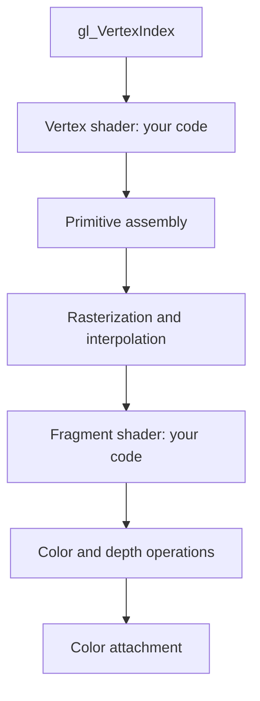

# 4. Your first triangle

*About 330 lines of C; raw Vulkan would need about 1200.*


Chapter 3 gave every frame its shape: a rendering pass that clears the image, with a gap between `dvz_cmd_rendering_begin()` and `dvz_cmd_rendering_end()` where drawing goes. So far that gap is empty. Now we fill it with a triangle.

The triangle is the GPU's basic shape: every surface in this course, up to the final mesh, is made of triangles. Drawing one takes three new things: **shaders**, small programs that run on the GPU; a **graphics pipeline**, which combines the shaders with the settings for how to draw; and a draw command, recorded in the callback. To keep the chapter to those three, the vertex positions are written inside the shader itself. Chapter 6 moves them into a buffer.

In this chapter you will:

1. remove chapter 3's animation and give `Renderer` fields for the pipeline;
2. write a vertex shader and a fragment shader in GLSL;
3. wait until the canvas knows its color format;
4. compile the shaders and build the graphics pipeline;
5. bind the pipeline and draw three vertices.

## What a draw needs

On the CPU, you would draw a triangle with a loop over pixels. The GPU works the other way around. You supply two small programs, and the GPU runs them many times in parallel: the **vertex shader** once per vertex, to say where it goes, and the **fragment shader** about once for each pixel a triangle covers, to say what color it gets. Between the two, fixed hardware does the part that never changes: it assembles vertices into triangles and finds which pixels each one covers.

The pipeline ties these together. Vulkan wants everything that shapes a draw, such as the shaders, the kind of primitive, and the output format, known up front in one object. The driver can then compile it all into GPU code once, when the pipeline is created, rather than at each draw. Creating a pipeline is slow; binding one is cheap. The price is that a pipeline cannot change afterwards. Only the few settings you mark *dynamic*, such as chapter 3's viewport, are left to the command buffer. Chapter 5 meets this limit when it reloads shaders.

## Start from chapter 3

Start from your chapter 3 `main.c`. The pulsing clear has done its job, so remove `<math.h>`, the three animation fields in `Renderer`, the `--time` option, and the time calculation in `draw()`. Remove the GPU-name and frame-count prints too; validation errors remain the one diagnostic on every run. Keep `--png`, and use this fixed dark clear color:

```c
    // A fixed dark background behind the triangle.
    VkClearValue clear = {.color.float32 = {0.04f, 0.05f, 0.08f, 1.0f}};
```

Add the pipeline fields to `Renderer`. From now on, this struct holds every object the draw callback uses, and the pipeline's building blocks, which cleanup must release:

```c
// Renderer state: a borrowed device and the objects our program creates for drawing.
typedef struct
{
    DvzDevice* device;
    VkFormat color_format;
    DvzCommands* commands;
    DvzRendering* rendering;
    DvzSlots* slots;
    DvzShader* vertex_shader;
    DvzShader* fragment_shader;
    DvzGraphics* pipeline;
} Renderer;
```

Cleanup now releases everything through `renderer`, so declare it zero-initialized with the other handles at the top of `main()`. This follows chapter 2's cleanup policy: a failure before the pipeline exists then reaches `cleanup:` with every field `NULL`. Delete the separate `commands` and `rendering` locals and chapter 3's `Renderer renderer = {...}` initializer:

```c
    // Everything the cleanup block releases starts as NULL, meaning "not created yet".
    // Zero-initializing the renderer sets each of its handles to NULL too.
    int exit_code = 1;
    DvzWindowHost* host = NULL;
    DvzGpuCtx* gpu = NULL;
    DvzWindow* window = NULL;
    DvzCanvas* canvas = NULL;
    Renderer renderer = {0};
```

The argument loop now looks only for `--png`:

```c
    for (int argument_index = 1; argument_index + 1 < argc; argument_index++)
        if (strcmp(argv[argument_index], "--png") == 0)
            png_path = argv[argument_index + 1];
```

## Write the two shaders

Shaders are written in **GLSL**, a C-like language for GPU programs. For now they live in C strings near the top of `main.c`; chapter 5 moves them into files. A **shader invocation** is one execution of a shader for one item of work. This draw has two shaders, one for each programmable stage.

### The vertex shader

The vertex shader runs once per vertex. `gl_VertexIndex` is 0, 1, then 2, so each invocation picks one position and one color from constant arrays compiled into the shader.

These positions are in clip space, the −1 to 1 space of chapter 3's viewport: x and y run from −1 to 1, and y points down. Chapter 9 explains why.

```c
// Vertex shader: runs once per vertex and picks a built-in position and color by index.
static const char* VERTEX_GLSL =
    "#version 450\n"
    "layout(location = 0) out vec3 color;\n"
    "vec2 positions[3] = vec2[](\n"
    "    vec2( 0.0, -0.65), vec2( 0.65, 0.65), vec2(-0.65, 0.65));\n"
    "vec3 colors[3] = vec3[](\n"
    "    vec3(1.0, 0.2, 0.2), vec3(0.2, 1.0, 0.2), vec3(0.2, 0.3, 1.0));\n"
    "void main() {\n"
    "    gl_Position = vec4(positions[gl_VertexIndex], 0.0, 1.0);\n"
    "    color = colors[gl_VertexIndex];\n"
    "}\n";
```

Each invocation writes two outputs: `gl_Position`, the built-in output that places the vertex, and `color`, which it passes on to the next stage.

### The fragment shader

After the vertex stage, the GPU groups the three outputs into a triangle (**primitive assembly**) and finds which pixels it covers (**rasterization**). For each covered pixel it makes a **fragment**, a candidate color for that pixel that carries the vertex colors, interpolated across the triangle. The fragment shader runs once per fragment and writes a color to location 0. A fragment is not yet a pixel: later tests, such as chapter 10's depth test, can discard it, and where triangles overlap, several fragments compete for the same pixel.

```c
// Fragment shader: runs once per fragment and writes the interpolated color.
static const char* FRAGMENT_GLSL =
    "#version 450\n"
    "layout(location = 0) in vec3 color;\n"
    "layout(location = 0) out vec4 out_color;\n"
    "void main() { out_color = vec4(color, 1.0); }\n";
```

The two shaders connect through numbered locations:

- The vertex shader's `out vec3 color` at location 0 becomes the fragment shader's `in vec3 color` at location 0. The numbers, not the names, link them.
- The fragment shader's own output at location 0 goes to the pipeline's color attachment 0, which you set up below.

### From vertices to pixels

The full path for this draw is:

<figure class="dvz-course-figure" id="fig-graphics-pipeline" markdown="1">



<figcaption>Figure 1. One draw flows through two programmable stages, your shaders, and fixed-function stages configured by the pipeline.</figcaption>

</figure>

The stages fall into two kinds:

- The **programmable** stages, the vertex and fragment shaders, run code you supply.
- The **fixed-function** stages follow state you configure, such as topology, viewport, depth testing, and blending.

## Wait for the canvas color format

The pipeline is compiled to write one exact pixel format, so it must know the format of the image it draws into. That image is the canvas's frame target, and it uses the swapchain's format so the canvas can copy it into the swapchain image (chapter 2). The window system chooses that format, and the canvas learns it at the first acquire. A window may use BGRA where an offscreen canvas uses RGBA, so you cannot guess.

After creating the canvas, set `renderer.device` and run one frame before creating the pipeline. No draw callback is installed yet, so this frame records nothing of yours; the new target holds only the canvas's one-time black clear (chapter 2). Then read the resolved format:

```c
    // create_pipeline(), draw(), and the cleanup block reach the device through the renderer.
    renderer.device = dvz_gpu_ctx_device(gpu);

    // Acquire and submit one default clear before creating a format-dependent pipeline.
    // While the surface is unavailable, keep polling unless the user closes the window.
    int initial_status = DVZ_CANVAS_FRAME_WAIT_SURFACE;
    while (initial_status == DVZ_CANVAS_FRAME_WAIT_SURFACE)
    {
        dvz_window_host_poll(host);
        if (live && dvz_window_should_close(window))
        {
            exit_code = 0;
            goto cleanup;
        }
        initial_status = dvz_canvas_frame(canvas);
    }
    COURSE_CHECK(initial_status == DVZ_CANVAS_FRAME_READY, "initial frame preparation failed");
    int initial_submit_result = dvz_canvas_submit(canvas);
    COURSE_CHECK(initial_submit_result == 0, "initial frame submission failed");

    // The pipeline must be built for exactly this color format.
    renderer.color_format = dvz_canvas_frame_format(canvas);
    COURSE_CHECK(
        renderer.color_format != VK_FORMAT_UNDEFINED, "canvas color format is unresolved");
```

If the surface is temporarily unavailable, keep polling until a frame is acquired or the window closes. Closing the window this early is not an error, so that path sets `exit_code = 0` before jumping to `cleanup:`. This warm-up frame doesn't count: the loop's first frame draws the triangle, and that is the one `--png` saves.

## Compile and build the pipeline

Now the pipeline itself. Building it takes four steps:

1. **Compile** the GLSL to SPIR-V.
2. Wrap each result in a **shader module**.
3. Create an empty **pipeline layout**.
4. Set the **graphics state** and create the pipeline from everything above.

All the pipeline code lives in one helper above `draw()`, which fills the renderer's pipeline fields and returns zero on success:

```c
static int create_pipeline(Renderer* renderer)
{
```

A helper cannot use `COURSE_CHECK`, because `goto` cannot leave a function. Instead it returns `-1` at the first failure, and `main()` checks that result. Anything the helper already stored in `renderer` stays there, so `main()`'s cleanup block still releases it.

The shader modules, the pipeline layout, and the pipeline you build here all follow the same lifecycle:

!!! note "vklite object lifecycle"

    | Step | Call | Effect |
    | --- | --- | --- |
    | 1 | `dvz_*_create_wrapper()` | allocate an empty C wrapper; no Vulkan object yet |
    | 2 | `dvz_slots()`, `dvz_graphics()`, ... | attach it to a device, then configure it |
    | 3 | `dvz_*_create()` | create the Vulkan object |
    | 4 | `dvz_*_destroy()` | destroy the Vulkan object |
    | 5 | `dvz_*_free()` | free the wrapper |

    `dvz_shader()` is the one shortcut: it does steps 2 and 3 in a single call.

Not every wrapper fits this table. The command and rendering wrappers from chapter 2 have no create or destroy step in this program: `renderer->commands` only borrows the canvas's command buffer during each callback, and `renderer->rendering` only describes a pass, so neither owns a Vulkan object and both go straight from `create_wrapper` to `free`. Chapter 13 gives a commands wrapper a command buffer of its own, and then it needs `dvz_commands_destroy()` too. Descriptor sets, in chapter 12, are another exception.

### 1. Compile GLSL to SPIR-V

Add `<stdint.h>` for the fixed-size integer types. `dvz_compile_glsl()` comes from `<datoviz/shader.h>`, which `<datoviz/advanced.h>` already includes. It translates each shader string into **SPIR-V**, Vulkan's binary intermediate representation. SPIR-V is not machine code; the driver translates it further for your GPU.

```c
    // Compile both GLSL strings to SPIR-V. We own the returned arrays.
    uint64_t vertex_size = 0;
    uint64_t fragment_size = 0;
    uint32_t* vertex_spirv = dvz_compile_glsl("vertex", VERTEX_GLSL, &vertex_size);
    uint32_t* fragment_spirv = dvz_compile_glsl("fragment", FRAGMENT_GLSL, &fragment_size);
    if (vertex_spirv == NULL || fragment_spirv == NULL)
    {
        dvz_memory_free(vertex_spirv);
        dvz_memory_free(fragment_spirv);
        return -1;
    }
```

The compiler returns arrays that your program owns. If either compilation fails, free whatever was returned and report the failure; the compiler has already printed its message.

### 2. Create the shader modules

First allocate the four wrappers this helper fills, the lifecycle's step 1. The renderer owns them from this point, so a later failure leaves them for `main()`'s cleanup:

```c
    // Allocate four empty wrappers. The renderer owns them, even if a later step fails.
    renderer->vertex_shader = dvz_shader_create_wrapper();
    renderer->fragment_shader = dvz_shader_create_wrapper();
    renderer->slots = dvz_slots_create_wrapper();
    renderer->pipeline = dvz_graphics_create_wrapper();
    if (renderer->vertex_shader == NULL || renderer->fragment_shader == NULL ||
        renderer->slots == NULL || renderer->pipeline == NULL)
    {
        dvz_memory_free(vertex_spirv);
        dvz_memory_free(fragment_spirv);
        return -1;
    }
```

`dvz_shader()` copies each SPIR-V array into a **shader module**, the Vulkan object that hands one compiled stage to pipeline creation. The CPU arrays can then be freed.

```c
    // Copy the SPIR-V into two shader modules, then free the CPU arrays.
    int vertex_result =
        dvz_shader(renderer->device, vertex_size, vertex_spirv, renderer->vertex_shader);
    int fragment_result =
        dvz_shader(renderer->device, fragment_size, fragment_spirv, renderer->fragment_shader);
    dvz_memory_free(vertex_spirv);
    dvz_memory_free(fragment_spirv);
    if (vertex_result != 0 || fragment_result != 0)
        return -1;
```

Both arrays are freed before the results are checked, so neither leaks whichever way this step ends.

### 3. Create the pipeline layout

`DvzSlots` is Datoviz's wrapper for the **pipeline layout**, the list of resources and small values shaders may access. It is empty here, because these shaders read nothing but their built-in arrays; chapter 8 adds its first entry.

```c
    // An empty pipeline layout: these shaders read no resources yet.
    dvz_slots(renderer->device, renderer->slots);
    if (dvz_slots_create(renderer->slots) != 0)
        return -1;
```

This is the lifecycle in full: `dvz_slots()` attaches the wrapper to the device, and `dvz_slots_create()` creates the Vulkan object.

### 4. Configure and create the graphics pipeline

The pipeline combines the shader stages with state that says: group vertices in threes, render to the canvas color format, and set the viewport and scissor every frame. Configure it in three groups, then create it.

First, attach the device and the two programmable stages:

```c
    // Attach the two programmable stages to the pipeline.
    dvz_graphics(renderer->device, renderer->pipeline);
    dvz_graphics_shader(
        renderer->pipeline, VK_SHADER_STAGE_VERTEX_BIT,
        dvz_shader_handle(renderer->vertex_shader));
    dvz_graphics_shader(
        renderer->pipeline, VK_SHADER_STAGE_FRAGMENT_BIT,
        dvz_shader_handle(renderer->fragment_shader));
```

Each stage flag says which programmable stage the shader module provides. `dvz_shader_handle()` lends the raw `VkShaderModule` inside each wrapper; the wrapper still owns it.

Pipeline state comes in two kinds:

- **Fixed** state is baked into the pipeline when it is created. Changing it later means building another pipeline.
- **Dynamic** state is left open and recorded in the command buffer each frame.

Next, the fixed state:

```c
    // Fixed state: separate triangles, one color attachment in the canvas format, empty layout.
    dvz_graphics_primitive(
        renderer->pipeline, VK_PRIMITIVE_TOPOLOGY_TRIANGLE_LIST, DVZ_GRAPHICS_FLAGS_FIXED);
    dvz_graphics_attachment_color(renderer->pipeline, 0, renderer->color_format);
    dvz_graphics_layout(renderer->pipeline, dvz_slots_handle(renderer->slots));
```

`DVZ_GRAPHICS_FLAGS_FIXED` bakes the triangle-list topology into the pipeline: every three vertices make one separate triangle. Color attachment 0 is the one `dvz_cmd_rendering_default()` sets up in each frame, and its format is the one you read from the canvas. The layout is the empty one from step 3.

Last, the dynamic state, and the call that creates the pipeline:

```c
    // Dynamic state: the zeros are placeholders; each frame records the real values.
    dvz_graphics_viewport(renderer->pipeline, 0, 0, 0, 0, 0, 1, DVZ_GRAPHICS_FLAGS_DYNAMIC);
    dvz_graphics_scissor(renderer->pipeline, 0, 0, 0, 0, DVZ_GRAPHICS_FLAGS_DYNAMIC);

    // Create the Vulkan pipeline object from everything above.
    return dvz_graphics_create(renderer->pipeline);
}
```

The zeros in the viewport and scissor calls are placeholders: the dynamic flag means the real values come from `dvz_cmd_set_viewport_scissor()`, which you added in chapter 3. `dvz_graphics_create()` is the slow step, where the driver compiles everything into GPU code, and its result is the helper's result.

## Call the helper from main

In `main()`, after reading the color format, store the command and rendering wrappers in `renderer`, then build the pipeline before registering the draw callback:

```c
    // Allocate the recording wrappers, then build the pipeline before any frame draws.
    renderer.commands = dvz_commands_create_wrapper();
    renderer.rendering = dvz_rendering_create_wrapper();
    COURSE_CHECK(
        renderer.commands != NULL && renderer.rendering != NULL, "renderer allocation failed");
    int pipeline_result = create_pipeline(&renderer);
    COURSE_CHECK(pipeline_result == 0, "graphics pipeline creation failed");

    // Only now may the canvas call draw(): everything it uses exists.
    dvz_canvas_set_draw_callback(canvas, draw, &renderer);
```

The order matters. The canvas calls `draw()` from `dvz_canvas_frame()` once a callback is registered, and `draw()` binds `renderer->pipeline`. Registering the callback last guarantees that no frame ever records with a missing pipeline. That is also why the warm-up frame above ran without a callback.

## Clean up after the GPU is idle

Submitted frames may still use the pipeline: recording is not execution, as chapter 3 showed, and the GPU may still be drawing the last frame when the loop ends. So cleanup first waits until the device is idle:

```c
cleanup:
    // Submitted frames may still use the pipeline: wait until the GPU is idle.
    if (renderer.device != NULL)
        dvz_device_wait(renderer.device);
```

Only then is it safe to destroy what those frames used. Cleanup destroys and frees the pipeline, shader modules, and slots before the other wrappers and the GPU context:

```c
    // Destroy each Vulkan object, then free its wrapper. A NULL wrapper was never allocated.
    if (renderer.pipeline != NULL)
        dvz_graphics_destroy(renderer.pipeline);
    dvz_graphics_free(renderer.pipeline);
    if (renderer.fragment_shader != NULL)
        dvz_shader_destroy(renderer.fragment_shader);
    dvz_shader_free(renderer.fragment_shader);
    if (renderer.vertex_shader != NULL)
        dvz_shader_destroy(renderer.vertex_shader);
    dvz_shader_free(renderer.vertex_shader);
    if (renderer.slots != NULL)
        dvz_slots_destroy(renderer.slots);
    dvz_slots_free(renderer.slots);

    // These two wrappers own no Vulkan object, so they are only freed.
    dvz_rendering_free(renderer.rendering);
    dvz_commands_free(renderer.commands);
```

The `NULL` checks skip wrappers that were never allocated, and `free` accepts `NULL`, so this one path works whichever step failed. Vulkan lets you destroy shader modules as soon as the pipeline exists; the course keeps them with the pipeline so one cleanup path covers both. The rest of the cleanup block is chapter 2's, unchanged: the canvas, the window, the window host, then the validation count and the GPU context.

## Draw three vertices

Last, the draw itself, inside chapter 3's rendering pass. A draw uses whatever pipeline is bound at that moment. Insert the bind right after `dvz_cmd_rendering_begin()`, so chapter 3's `dvz_cmd_set_viewport_scissor()` call moves below it, and add the draw after that call; do not add a second viewport call. The final order is:

1. begin rendering;
2. bind the pipeline;
3. set the dynamic viewport and scissor;
4. draw three vertices.

```c
    // Use our pipeline for the draw, then record its dynamic viewport and scissor.
    dvz_cmd_bind_graphics(renderer->commands, renderer->pipeline);
    dvz_cmd_set_viewport_scissor(renderer->commands, frame->extent);

    // First vertex 0, 3 vertices, first instance 0, 1 instance.
    dvz_cmd_draw(renderer->commands, 0, 3, 0, 1);
```

The numbers are first vertex, vertex count, first instance, and instance count; one instance means "draw the shape once".

No vertex buffer is bound, and none is needed: the GPU numbers the vertices 0, 1, 2 and runs the vertex shader for each, which looks up its position from `gl_VertexIndex`.

## Build and run

From this chapter on, the program also loads the runtime shader compiler when it starts. Run it from the same environment you built and configured with in chapter 1.

Build and run from your `vkcourse` directory, close the window, then capture the same result offscreen:

=== "Linux"

    ```sh
    cmake --build build
    ./build/vkcourse
    ./build/vkcourse --png chapter04.png
    ```

=== "macOS"

    ```sh
    cmake --build build
    ./build/vkcourse
    ./build/vkcourse --png chapter04.png
    ```

=== "Windows"

    In a Developer PowerShell for Visual Studio, with the `PATH` setup from chapter 1:

    ```powershell
    cmake --build build --config Release
    .\build\Release\vkcourse.exe
    .\build\Release\vkcourse.exe --png chapter04.png
    ```

`chapter04.png` shows the triangle above, and the terminal ends with `validation errors: 0`.

??? tip "Try it"

    1. Swap the red and blue entries in `colors`. The two corners exchange colors; the geometry stays put.
    2. Change `VK_PRIMITIVE_TOPOLOGY_TRIANGLE_LIST` to `VK_PRIMITIVE_TOPOLOGY_LINE_LIST`. Three vertices make one line and one leftover vertex, so you see a single line, not a triangle.
    3. Exchange the last two positions. The triangle still appears because face culling is off, but its winding is reversed. Chapter 10 makes that visible.

??? info "Under the hood: a Vulkan pipeline"

    Raw Vulkan needs a shader-module create structure per stage, a pipeline layout, about ten fixed-function state structures, the dynamic-rendering attachment formats, and a graphics-pipeline create call. Datoviz fills the routine defaults, but the result is still an ordinary Vulkan pipeline.

??? warning "When it goes wrong"

    `provider-missing` before `graphics pipeline creation failed` means Datoviz could not load the runtime shader compiler. With a source install, keep the system or SDK environment you built Datoviz in active when running the program (chapter 1).

    A shader compile error stops startup: the compiler message is followed by `graphics pipeline creation failed`. A blank frame with zero validation errors usually means the triangle is off-screen or the draw call is missing. A draw outside the rendering pass, or a pipeline format that does not match the canvas, produces validation errors; read them first. An upside-down triangle comes from assuming OpenGL's y-up convention.

## What carries over

- Every modern API draws through a pipeline object that fixes shaders and most drawing state ahead of time: render pipelines in WebGPU, pipeline states in Metal and Direct3D 12. Changing a fixed setting means another pipeline.
- A draw runs one program per vertex and one per fragment, in parallel, with fixed hardware between them. Stages pass data by location number, not by name.
- In Vulkan and Direct3D 12, shader source is compiled twice: once to a portable form (SPIR-V, DXIL), then by the driver into code for your GPU.

## Checkpoint

1. What supplies vertex positions when there is no vertex buffer?
2. Which stage interpolates the colors between vertices?
3. Which pipeline state is dynamic in this program?
4. Why can the CPU-side SPIR-V arrays be freed after shader-module creation?

??? example "Your `main.c` after chapter 4"

    ```c
    --8<-- "examples/c/vulkan/step04.c"
    ```

Next: [Shaders in their own files](05-shader-files.md).
