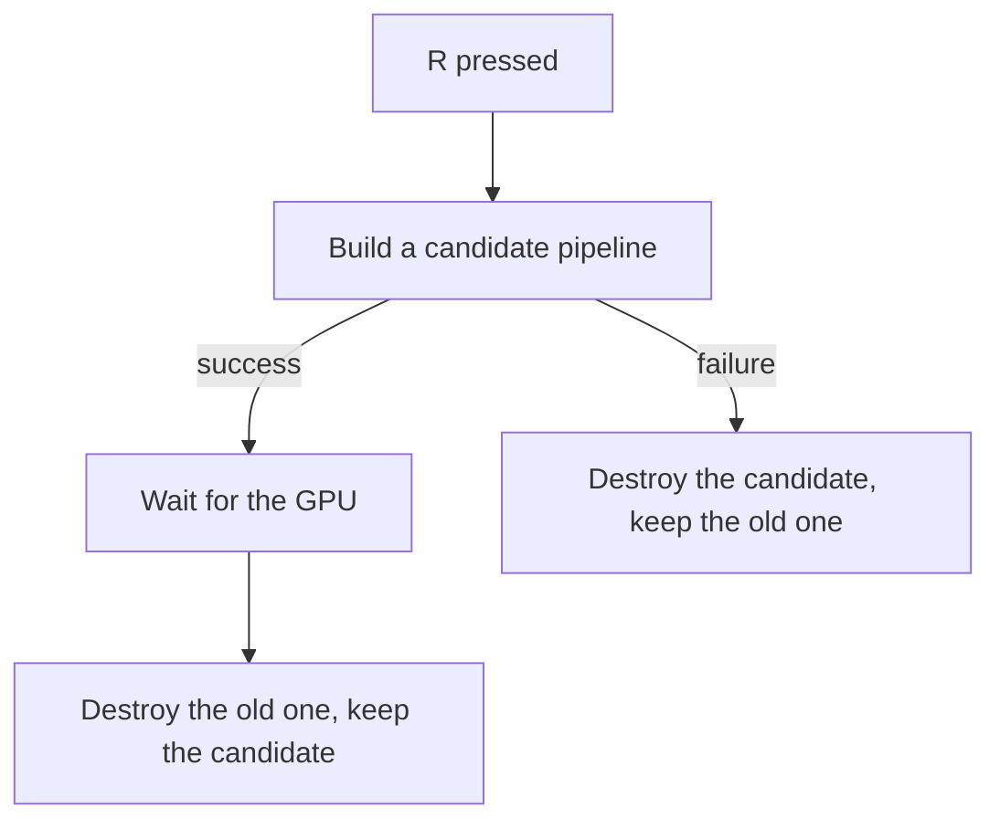

# 5. Shaders in their own files

*About 430 lines of C; raw Vulkan would need about 1250.*


Chapter 4 drew a triangle with two shaders written as C strings. That works, but it is awkward: every shader edit means editing quoted lines, rebuilding the C program, and restarting it, and a GLSL error points into a string rather than a file. The shaders grow in almost every chapter from here on, so it is worth fixing how you work with them now.

This chapter moves the shaders into ordinary `.vert` and `.frag` files, reports compiler errors with file names and line numbers, and rebuilds the pipeline when you press **R**, without restarting the program. The image is identical to chapter 4; what changes is how fast you can experiment.

In this chapter you will:

1. move the two shaders into their own files;
2. read, compile and diagnose one shader file in a helper;
3. build the shader modules from the compiler's results;
4. gather the pipeline teardown into one helper;
5. rebuild the pipeline when you press **R**, and keep the old one if the new one fails.

## Why reloading means a new pipeline

Reloading a shader sounds like replacing one file. Vulkan does not allow that: shader modules and pipelines cannot change once created, because the driver has already compiled them into GPU code (chapter 4). A shader edit therefore means building a whole new pipeline and throwing the old one away.

Building a pipeline is startup work, not per-frame work. Compiling GLSL and creating a pipeline can take from a few milliseconds to much longer, depending on the shaders, the driver and its caches. Even a few milliseconds is a large share of the roughly 16.7 ms frame budget at 60 frames per second (chapter 3). Binding a finished pipeline in each frame is cheap by comparison. That is why the program builds its pipeline once before the loop, and why a reload is an occasional event you trigger with a key, not something to do every frame.

Two rules make the swap safe:

- Build the new pipeline completely before touching the old one. If your edit does not compile, you keep drawing with the pipeline you have.
- Do not destroy the old pipeline while the GPU may still use it. Chapter 3 showed that submitted frames run later, so a frame recorded with the old pipeline may still be executing. Wait for the GPU to finish, then swap.

<figure class="dvz-course-figure" id="fig-pipeline-reload" markdown="1">



<figcaption>Figure 1. A reload builds a complete candidate first; only a successful candidate replaces the working pipeline.</figcaption>

</figure>

Figure 1 shows the two outcomes. In both, exactly one complete pipeline is left for `draw()` to bind, and nothing the GPU may still be using is destroyed early. The rest of the chapter builds the pieces this needs: a compile step that can fail cleanly, a teardown helper that works on a full or partial pipeline, and a loop that performs the swap.

## Move the shaders into files

Delete the `VERTEX_GLSL` and `FRAGMENT_GLSL` strings from `main.c`, and create `shader.vert` and `shader.frag` beside it. The include block does not change: the file-reading function used below, `dvz_read_text()`, is declared in `<datoviz/fileio.h>`, which `<datoviz/advanced.h>` already includes, like chapter 4's shader compiler.

Name the two files below the `COURSE_CHECK` macro. The paths are relative to the directory where you launch `vkcourse`, not to the executable:

```c
// Shader files, relative to the directory where you launch the program.
#define VERTEX_PATH   "shader.vert"
#define FRAGMENT_PATH "shader.frag"
```

The two files hold the chapter 4 shader bodies, now as ordinary GLSL with real line breaks:

```glsl
--8<-- "examples/c/vulkan/step05/shader.vert"
```

```glsl
--8<-- "examples/c/vulkan/step05/shader.frag"
```

## Compile one shader file

Chapter 4's `dvz_compile_glsl()` took a C string and reported errors only through the log. The new helper, `compile_file()`, starts from a file and uses `dvz_shader_compile()`, which returns a typed status and diagnostics that name the file and line. It works in four phases:

1. **Read** the file into memory.
2. **Describe** what to compile in a request.
3. **Compile**, then free the source text.
4. **Diagnose** a failure, by file and line.

Place the helper above `create_pipeline()`, which calls it. It returns `true` on success. On any failure it prints a message and returns `false`; like chapter 4's `create_pipeline()`, it is a helper, so it reports failure by returning rather than with `COURSE_CHECK`.

```c
static bool compile_file(
    const char* path, DvzShaderStage stage, DvzShaderCompileResult* result)
{
```

`path` names the file and `stage` says which shader it holds. `result` belongs to the caller: the helper fills it, and the caller destroys it.

### 1. Read the file

```c
    // Read: we own the returned null-terminated copy of the file.
    DvzSize source_size = 0;
    char* source = dvz_read_text(path, &source_size);
    if (source == NULL)
    {
        fprintf(stderr, "could not read %s\n", path);
        return false;
    }
```

`dvz_read_text()` returns an owned, null-terminated copy of the whole file and stores its size in `source_size`. It returns `NULL` when the file cannot be read, most often because the program was started from another directory. That failure is reported as `could not read shader.vert`: the compiler never ran, and `result` is left as the caller initialized it.

### 2. Describe the request

```c
    // Request: one graphics-stage shader, named after its file, starting at main().
    DvzShaderCompileRequest request = {
        .stage = stage,
        .profile = DVZ_SHADER_PROFILE_GRAPHICS,
        .source = source,
        .source_size = source_size,
        .source_name = path,
        .entry_point = "main",
    };
```

Read the request as: compile this source as a graphics-stage shader, report errors under the file's name, and start at `main`. The graphics profile targets Vulkan 1.0 and SPIR-V 1.0, enough for every shader in the course. `source_name` is used only in diagnostics, so it should name the real file; that is what turns a compiler message into a location you can open in your editor. The request only points at `source` and `path`; it copies neither.

### 3. Compile, then free the source

```c
    // Compile: the result owns its SPIR-V or diagnostics; our source copy is no longer needed.
    DvzShaderCompileStatus status = dvz_shader_compile(&request, result);
    dvz_memory_free(source);
```

`dvz_shader_compile()` always fills `result`. On success it owns the SPIR-V words; on failure it normally owns the compiler's diagnostic text. Either way, the compiler is done with the source text, so the helper frees it right away, before looking at the status. As in chapter 4, freeing first means no path through the helper can leak it.

Compiling at startup is convenient for learning and live editing. Production applications often compile shaders at build time, so startup is faster and deployment does not need a compiler.

### 4. Report a failure by file and line

```c
    // Diagnose: print the status name and the compiler's message, which names file and line.
    if (status != DVZ_SHADER_COMPILE_SUCCESS)
    {
        fprintf(
            stderr, "%s: %s\n", dvz_shader_compile_status_name(status),
            result->diagnostics != NULL ? result->diagnostics : "shader compilation failed");
        return false;
    }
    return true;
}
```

On failure, the helper prints the status name and the compiler's message, then returns `false`. The status name says what kind of failure it was, such as `provider-missing` when the runtime compiler could not be loaded (chapter 4); the diagnostics say where a GLSL error is. If the compiler produced no text, a generic message takes its place. A failed `result` may still own its diagnostics, which is why the caller destroys it on every path.

## Build the shader modules from the results

In `create_pipeline()`, `compile_file()` replaces chapter 4's two `dvz_compile_glsl()` calls. Only the owner of the SPIR-V changes: a `DvzShaderCompileResult` instead of a raw array. Each place where chapter 4 freed the arrays now destroys the two results instead, so the helper keeps its shape and still releases them on every path.

First, compile both files:

```c
    // Compile both files. We own both results and destroy them on every path.
    DvzShaderCompileResult vertex = {0};
    DvzShaderCompileResult fragment = {0};
    if (!compile_file(VERTEX_PATH, DVZ_SHADER_STAGE_VERTEX, &vertex) ||
        !compile_file(FRAGMENT_PATH, DVZ_SHADER_STAGE_FRAGMENT, &fragment))
    {
        dvz_shader_compile_result_destroy(&vertex);
        dvz_shader_compile_result_destroy(&fragment);
        return -1;
    }
```

If the vertex file fails, `||` skips the fragment file, so `fragment` is still all zeros. Destroying a zero-initialized result does nothing, so the failure branch can destroy both without tracking which one ran.

The wrapper allocation that follows is chapter 4's, except that its failure branch destroys the two results instead of freeing raw SPIR-V:

```c
    // Allocate four empty wrappers. The renderer owns them, even if a later step fails.
    renderer->vertex_shader = dvz_shader_create_wrapper();
    renderer->fragment_shader = dvz_shader_create_wrapper();
    renderer->slots = dvz_slots_create_wrapper();
    renderer->pipeline = dvz_graphics_create_wrapper();
    if (renderer->vertex_shader == NULL || renderer->fragment_shader == NULL ||
        renderer->slots == NULL || renderer->pipeline == NULL)
    {
        dvz_shader_compile_result_destroy(&vertex);
        dvz_shader_compile_result_destroy(&fragment);
        return -1;
    }
```

Then the shader modules read `spirv` and `spirv_size` from each result:

```c
    // Copy the SPIR-V into two shader modules, then destroy both compile results.
    int vertex_result =
        dvz_shader(renderer->device, vertex.spirv_size, vertex.spirv, renderer->vertex_shader);
    int fragment_result = dvz_shader(
        renderer->device, fragment.spirv_size, fragment.spirv, renderer->fragment_shader);
    dvz_shader_compile_result_destroy(&vertex);
    dvz_shader_compile_result_destroy(&fragment);
    if (vertex_result != 0 || fragment_result != 0)
        return -1;
```

`dvz_shader()` copies the words into each shader module, so the results can be destroyed before the check, exactly as chapter 4 freed its arrays. From the empty pipeline layout onward, `create_pipeline()` is chapter 4's code, unchanged.

## Gather the teardown in one helper

Reload needs to tear down a pipeline from two places: the loop, for the old pipeline or a failed candidate, and `cleanup:` at the end of `main()`. So move the pipeline, shader-module, and slots teardown from `main()` into a helper. Place it right after the `Renderer` struct:

```c
static void destroy_pipeline(Renderer* renderer)
{
    // Destroy each Vulkan object, free its wrapper, then clear the pointer. NULL means "none".
    if (renderer->pipeline != NULL)
        dvz_graphics_destroy(renderer->pipeline);
    dvz_graphics_free(renderer->pipeline);
    renderer->pipeline = NULL;
    if (renderer->fragment_shader != NULL)
        dvz_shader_destroy(renderer->fragment_shader);
    dvz_shader_free(renderer->fragment_shader);
    renderer->fragment_shader = NULL;
    if (renderer->vertex_shader != NULL)
        dvz_shader_destroy(renderer->vertex_shader);
    dvz_shader_free(renderer->vertex_shader);
    renderer->vertex_shader = NULL;
    if (renderer->slots != NULL)
        dvz_slots_destroy(renderer->slots);
    dvz_slots_free(renderer->slots);
    renderer->slots = NULL;
}
```

The order and `NULL` checks are chapter 4's cleanup code. Clearing each pointer lets the helper clean either a complete pipeline or a candidate that failed halfway, and makes a second call on the same renderer harmless. The helper does not wait for the GPU; every caller must first make sure no submitted frame still uses these objects.

In `cleanup:`, chapter 4's block of destroy and free calls becomes one call, right after the device wait:

```c
    // Destroy the pipeline, shader modules, and layout through the shared helper.
    destroy_pipeline(&renderer);
```

## Request a reload from the keyboard

Add `bool reload_requested;` to `Renderer`. The keyboard callback only sets that flag; destroying GPU resources in the middle of event dispatch would be unsafe.

```c
static void keyboard(DvzInputRouter* router, const DvzKeyboardEvent* event, void* user_data)
{
    (void)router;
    Renderer* renderer = (Renderer*)user_data;

    // Only record the request; the render loop rebuilds the pipeline between frames.
    if (event->type == DVZ_KEYBOARD_EVENT_PRESS && event->key == DVZ_KEY_R)
        renderer->reload_requested = true;
}
```

The window delivers input through a `DvzInputRouter`, its event dispatcher: you subscribe callbacks to it, and it calls them as events arrive. `dvz_window_router()` returns the window's router, borrowed and valid until the window is destroyed. Subscribe after installing the draw callback:

```c
    // Only now may the canvas call draw(): everything it uses exists.
    dvz_canvas_set_draw_callback(canvas, draw, &renderer);

    // On each key event, the window's router calls keyboard() with &renderer.
    DvzCallbackId keyboard_id =
        dvz_input_subscribe_keyboard(dvz_window_router(window), keyboard, &renderer);
    COURSE_CHECK(keyboard_id != DVZ_CALLBACK_ID_NONE, "keyboard subscription failed");
```

The router keeps the `&renderer` pointer, so `renderer` must outlive the subscription. It does: `renderer` lives until `main()` returns, and the window and its router are destroyed earlier, in `cleanup:`.

## Swap pipelines in the loop

The loop applies the two rules from the start of the chapter, at a point where your program controls the GPU's work: after polling events, before recording the next frame. Ownership moves in a clear progression:

1. **Candidate.** A second `Renderer`, zero-initialized except for the device and the resolved `color_format` from chapter 4, which keeps the candidate compatible with the canvas. `create_pipeline()` fills its four pipeline fields. Until the swap, the candidate owns them, and the working pipeline in `renderer` keeps drawing.
2. **Failure.** `destroy_pipeline(&candidate)` releases whatever the candidate got as far as creating, under chapter 4's partial-failure rule. No frame ever used the candidate, so no wait is needed, and the old pipeline stays.
3. **Success.** `dvz_device_wait()` blocks until the GPU has finished every submitted frame, because the latest of them may still use the old pipeline. Then `destroy_pipeline(&renderer)` releases the old objects, and four assignments move the candidate's pointers into `renderer`.
4. **After the move.** `candidate` still holds copies of the same four pointers, but no longer owns them. It goes out of scope at the end of the block without being destroyed; destroying it would release the pipeline `renderer` now draws with.

```c
        // Act on a reload request here, between frames, never inside a callback.
        if (renderer.reload_requested)
        {
            // Build a complete candidate. The current pipeline stays untouched meanwhile.
            Renderer candidate = {
                .device = renderer.device,
                .color_format = renderer.color_format,
            };
            pipeline_result = create_pipeline(&candidate);
            if (pipeline_result == 0)
            {
                // Success: wait until no submitted frame uses the old pipeline, then swap.
                dvz_device_wait(renderer.device);
                destroy_pipeline(&renderer);
                renderer.slots = candidate.slots;
                renderer.vertex_shader = candidate.vertex_shader;
                renderer.fragment_shader = candidate.fragment_shader;
                renderer.pipeline = candidate.pipeline;
                printf("reloaded %s and %s\n", VERTEX_PATH, FRAGMENT_PATH);
            }
            else
            {
                // Failure: release the partial candidate and keep drawing with the old pipeline.
                destroy_pipeline(&candidate);
                fprintf(stderr, "reload failed; keeping the current pipeline\n");
            }
            renderer.reload_requested = false;
        }
```

Put this block in the render loop right after `dvz_window_host_poll(host);`. It reuses the `pipeline_result` variable from chapter 4. Either way the flag is cleared, so one key press makes one attempt.

The device wait is the price of this simple swap. It stops the CPU until all submitted frames have finished, on top of the compile time, so the live window may pause briefly when you press **R**. That is fine for a tool you trigger by hand. A program that replaced pipelines often would instead keep the old one until the fence of the last frame that used it signals (chapter 3), without stopping the loop.

## Build and run

From now on, run the executable from your `vkcourse` directory, where `shader.vert` and `shader.frag` live. Running it from `build` would break the relative shader paths.

=== "Linux"

    ```sh
    cmake --build build
    ./build/vkcourse
    ./build/vkcourse --png chapter05.png
    ```

=== "macOS"

    ```sh
    cmake --build build
    ./build/vkcourse
    ./build/vkcourse --png chapter05.png
    ```

=== "Windows"

    In a Developer PowerShell for Visual Studio, with the `PATH` setup from chapter 1:

    ```powershell
    cmake --build build --config Release
    .\build\Release\vkcourse.exe
    .\build\Release\vkcourse.exe --png chapter05.png
    ```

Edit either shader, save, and press **R** in the live window. The terminal prints `reloaded shader.vert and shader.frag`. `chapter05.png` matches chapter 4 exactly, and the terminal ends with `validation errors: 0`.

??? tip "Try it"

    1. In `shader.frag`, change the output to `vec4(color.r, 0.0, color.b, 1.0)`, save, and press **R**. The green drains out of the triangle without recompiling C.
    2. Remove a semicolon and press **R**. The terminal names the file and line, prints `reload failed; keeping the current pipeline`, and the triangle keeps drawing. Fix it and press **R** again.
    3. Scale the three positions in `shader.vert` by 0.5 and press **R**. The triangle shrinks: the positions are constants inside the shader module, so they change only with a new pipeline.

??? info "Under the hood: immutable shader modules"

    Raw Vulkan reads the file, calls a compiler library such as shaderc, and passes the SPIR-V to `vkCreateShaderModule`. Shader modules and pipelines are immutable: no Vulkan call patches one stage in place. Live reload is therefore destroy-and-create work around the same pipeline description, guarded by `vkDeviceWaitIdle` or fences.

??? warning "When it goes wrong"

    `could not read shader.vert` means the program cannot find the shader files; start it from the directory that contains them. A compiler error is different: the file was found, and the message names the GLSL rule that failed.

## What carries over

- Treat shaders as source files of their own, with real names, so compiler errors point at a file and line as in any other language.
- To replace a GPU object safely, build the replacement first, wait until no submitted work uses the old one, then swap and destroy.
- Input callbacks should record what the user asked for, and the main loop should act on it at a point where the program controls what the GPU is doing.

## Checkpoint

1. Why does the compiler request include `source_name`?
2. Why must a shader edit rebuild the graphics pipeline?
3. Why does reload wait for the device before destroying the old pipeline?
4. After a successful swap, why must the program not call `destroy_pipeline(&candidate)`?

??? example "Your `main.c` after chapter 5"

    ```c
    --8<-- "examples/c/vulkan/step05.c"
    ```

Next: [Vertex buffers](06-vertex-buffers.md).
