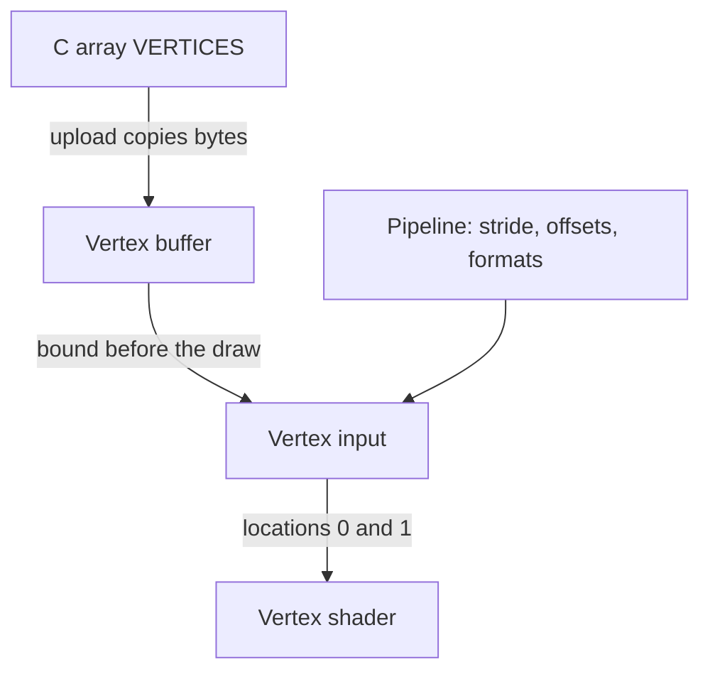

# 6. Vertex buffers

*About 390 lines of C; raw Vulkan would need about 1300.*


Since chapter 4, the program draws a triangle, and since chapter 5 its shaders live in their own files and reload with **R**. But the triangle's three positions and colors are constants inside the vertex shader, which picks one with `gl_VertexIndex`. To change the shape, you have to change the shader.

Real applications don't work that way. A plot, a mesh or a map is data: the program generates, loads or updates it on the CPU. So the geometry must travel from a C array into GPU memory, and the shader must receive it as ordinary inputs. That route, the **vertex buffer**, is how every later chapter feeds geometry to the GPU.

This chapter moves the geometry out of the shader and draws a square as two triangles: six vertices read from a buffer.

In this chapter you will:

1. define a vertex record in C and matching inputs in GLSL;
2. describe the record's byte layout to the pipeline;
3. create a GPU buffer and copy the vertices into it;
4. bind the buffer and draw six vertices.

## From a C array to shader inputs

Three pieces work together:

- The **data**: an array of vertex records, copied into a GPU buffer.
- The **description**, part of the pipeline: how many bytes separate one vertex from the next, and where each value sits inside a vertex. The GPU cannot see your C struct, so you spell this out.
- The **bind command**, recorded before the draw: which buffer the following draws read.

When the draw runs, a fixed-function stage called **vertex input** uses the description to fetch each vertex's bytes from the bound buffer and hands the values to the vertex shader's `in` variables. The vertex shader still runs once per vertex, as in chapter 4, but its inputs now come from your data instead of constant arrays.



## Describe one vertex

Start with the data. A **vertex record** collects every attribute of one vertex. This one has a two-component position and a three-component color. The field names help you, but the GPU sees only bytes; the pipeline description below tells it how to decode them.

```c
typedef struct
{
    float position[2];
    float color[3];
} Vertex;
```

A square has four corners, but the pipeline still groups vertices in threes, as set up in chapter 4. So the square is two triangles, and the two corners on the diagonal appear in both. Add `<stddef.h>` for `offsetof`, which the pipeline description will use, and place these six records below `Vertex`:

```c
static const Vertex VERTICES[6] = {
    {{-0.65f, -0.65f}, {1.0f, 0.2f, 0.2f}},
    {{ 0.65f, -0.65f}, {0.2f, 1.0f, 0.2f}},
    {{ 0.65f,  0.65f}, {0.2f, 0.3f, 1.0f}},
    {{-0.65f, -0.65f}, {1.0f, 0.2f, 0.2f}},
    {{ 0.65f,  0.65f}, {0.2f, 0.3f, 1.0f}},
    {{-0.65f,  0.65f}, {1.0f, 0.8f, 0.2f}},
};
```

On the shader side, the constant arrays and `gl_VertexIndex` give way to two inputs. Each `in` variable has a **location**, a number the pipeline description will refer to. Replace `shader.vert` with this version; `shader.frag` is unchanged:

```glsl
#version 450

layout(location = 0) in vec2 in_position;
layout(location = 1) in vec3 in_color;
layout(location = 0) out vec3 color;

void main()
{
    gl_Position = vec4(in_position, 0.0, 1.0);
    color = in_color;
}
```

## Describe the layout to the pipeline

The pipeline connects the `Vertex` records to the shader inputs with two kinds of entries:

- A **vertex binding** is one byte stream with a **stride**, the distance in bytes from one record to the next.
- A vertex **attribute** is one value inside each record: which vertex binding supplies it, which shader location receives it, its format, and its byte offset within the record.

A binding number picks a byte stream; a location names a shader input. Here there is one stream and two attributes. In `create_pipeline()`, add the description after the two `dvz_graphics_shader()` calls. `offsetof` asks C for the real field offsets instead of assuming the struct has no padding:

```c
    dvz_graphics_vertex_binding(
        renderer->pipeline, 0, sizeof(Vertex), VK_VERTEX_INPUT_RATE_VERTEX);
    dvz_graphics_vertex_attr(
        renderer->pipeline, 0, 0, VK_FORMAT_R32G32_SFLOAT, offsetof(Vertex, position));
    dvz_graphics_vertex_attr(
        renderer->pipeline, 0, 1, VK_FORMAT_R32G32B32_SFLOAT, offsetof(Vertex, color));
```

Read the first call as: binding 0 advances by `sizeof(Vertex)`, 20 bytes, once per vertex. The attribute calls read: from binding 0, location 0 receives two floats at the offset of `position`, and location 1 receives three floats at the offset of `color`.

Locations 0 and 1 must match `in_position` and `in_color`. `VK_FORMAT_R32G32_SFLOAT` reads two 32-bit floats, `VK_FORMAT_R32G32B32_SFLOAT` three; Vulkan reuses its image-format names, so R, G and B just count components. Get the format wrong and the GPU reads the same bytes as something else.

The description is part of the pipeline, so it is fixed when the pipeline is created. The buffer it reads is chosen later, at draw time. That split lets one pipeline draw many meshes that share a layout.

## Allocate and upload

Now the bytes. A **buffer** is a block of GPU-accessible memory with no type of its own; its usage flags say what it may be used for. Add `DvzBuffer* vertex_buffer;` to `Renderer`. In `main()`, after creating the pipeline, allocate the wrapper, configure the buffer, create it, and upload the records. The steps follow chapter 4's object lifecycle:

```c
    renderer.vertex_buffer = dvz_buffer_create_wrapper();
    COURSE_CHECK(renderer.vertex_buffer != NULL, "vertex buffer allocation failed");
    dvz_buffer(renderer.device, dvz_gpu_ctx_alloc(gpu), renderer.vertex_buffer);
    dvz_buffer_size(renderer.vertex_buffer, sizeof(VERTICES));
    dvz_buffer_usage(renderer.vertex_buffer, VK_BUFFER_USAGE_VERTEX_BUFFER_BIT);
    dvz_buffer_flags(
        renderer.vertex_buffer, DVZ_ALLOC_MAPPED | DVZ_ALLOC_HOST_ACCESS_SEQUENTIAL_WRITE);
    int buffer_result = dvz_buffer_create(renderer.vertex_buffer);
    COURSE_CHECK(buffer_result == 0, "vertex buffer creation failed");
    dvz_buffer_upload(renderer.vertex_buffer, 0, sizeof(VERTICES), VERTICES);
```

The buffer is `sizeof(VERTICES)` bytes, 120, and `VK_BUFFER_USAGE_VERTEX_BUFFER_BIT` declares that draws will read it as vertex data.

The allocation flags choose *where* the memory lives. GPUs have two broad kinds of memory. Device-local memory is fast GPU memory the CPU usually cannot write; host-visible memory is CPU-mappable. `DVZ_ALLOC_MAPPED` keeps the memory mapped to a CPU pointer, and `DVZ_ALLOC_HOST_ACCESS_SEQUENTIAL_WRITE` says the CPU will only write it, in order. Together they make this buffer host-visible, so `dvz_buffer_upload()` can copy directly. Chapter 13 uses a staging copy to fill a device-local image.

`dvz_buffer_upload()` copies `VERTICES` before it returns, so the CPU array need not stay alive. The `DvzBuffer` is different: recorded commands only refer to it, so by chapter 3's rule it must stay alive until every submitted draw that reads it has finished.

## Bind, then draw

In `draw()`, after setting the viewport and scissor, bind the buffer to vertex binding 0 and ask for six vertices instead of three:

```c
    DvzSize vertex_offset = 0;
    dvz_cmd_bind_vertex_buffers(
        renderer->commands, 0, 1, renderer->vertex_buffer, &vertex_offset);
    dvz_cmd_draw(renderer->commands, 0, 6, 0, 1);
```

Read the bind call as: starting at binding 0, bind 1 buffer, read from byte offset 0. The draw arguments are chapter 4's: first vertex 0, 6 vertices, first instance 0, 1 instance.

The triangle-list topology reads six vertices as two independent triples. The duplicated corners are simple but wasteful; chapter 7 removes them.

A submitted frame may still read the buffer, so in cleanup destroy it after the device wait and before `destroy_pipeline(&renderer)`:

```c
    if (renderer.vertex_buffer != NULL)
        dvz_buffer_destroy(renderer.vertex_buffer);
    dvz_buffer_free(renderer.vertex_buffer);
```

## Build and run

Build and run as before; the capture goes to `chapter06.png`. Press **R** in the live window to reload the shaders.

=== "Linux and macOS"

    ```sh
    cmake --build build
    ./build/vkcourse
    ./build/vkcourse --png chapter06.png
    ```

=== "Windows (Visual Studio)"

    ```powershell
    cmake --build build --config Release
    .\build\Release\vkcourse.exe
    .\build\Release\vkcourse.exe --png chapter06.png
    ```

You see the square above, and the terminal ends with `validation errors: 0`.

!!! tip "Try it"

    1. Change the color of vertex 3 (a copy of vertex 0) without changing vertex 0. A hard color edge appears along the diagonal, because the two triangles no longer agree at that corner.
    2. Draw only the first three vertices. Half the square remains.
    3. Swap the `position` and `color` fields in `Vertex`, and the two brace groups in every `VERTICES` entry. The image stays correct: `offsetof` and `sizeof` follow the new layout. Then replace `offsetof(Vertex, position)` with `0`. The square scrambles, because the GPU now reads color bytes as positions.

??? info "Under the hood: a buffer and its memory"

    Raw Vulkan creates a buffer object, queries its memory requirements, picks a suitable memory type, allocates and binds memory, then maps it or records a transfer. It also fills a `VkPipelineVertexInputStateCreateInfo` with the binding and attribute descriptions. Datoviz's allocator handles the memory; you still choose the usage and allocation flags.

!!! warning "When it goes wrong"

    Wild geometry or flat colors usually mean a wrong stride, format, or offset. A validation error at draw time often means the buffer lacks `VK_BUFFER_USAGE_VERTEX_BUFFER_BIT`, or was destroyed while a submitted frame still used it. Red `has not been destroyed` messages after `validation errors: 0`, or a VMA `Some allocations were not freed` assertion, mean a buffer is missing from cleanup: those checks run when the device is destroyed, after the count is printed.

## What carries over

- Every GPU API splits vertex data into the bytes, in a buffer, and a description of how to read them: stride, offsets and formats. WebGPU calls the description a vertex buffer layout; OpenGL sets it with vertex attribute pointers.
- The GPU never sees your C types. Matching the two sides is your job, and `sizeof` and `offsetof` keep the description correct when the struct changes.
- Where memory lives is a trade-off: CPU-writable memory is simplest to fill, while the fastest GPU memory usually needs an extra copy.

## Checkpoint

1. What is the difference between a binding stride and an attribute offset?
2. Why use `offsetof` instead of writing `8` by hand?
3. Which must outlive the submitted draw: `VERTICES`, the GPU buffer, or both?
4. What does host-visible memory make easy, and what does chapter 13 do instead for an image?

??? example "Your `main.c` after chapter 6"

    ```c
    --8<-- "examples/c/vulkan/step06.c"
    ```

??? example "Your `shader.vert` after chapter 6"

    ```glsl
    --8<-- "examples/c/vulkan/step06/shader.vert"
    ```

??? example "Your `shader.frag` after chapter 6"

    ```glsl
    --8<-- "examples/c/vulkan/step06/shader.frag"
    ```

Next: [Index buffers](07-index-buffers.md).
