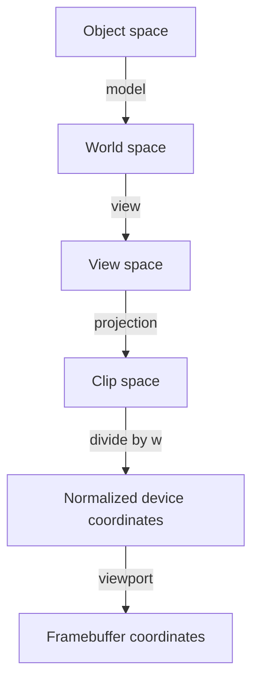

# 9. Matrices and perspective

*About 526 lines of C; raw Vulkan would need about 1550.*


So far everything has been flat. Chapters 6 and 7 drew a square from vertex and index buffers, and chapter 8 made it rotate and pulse with two floats pushed every frame. The shader still writes positions directly in the screen's −1 to 1 range, so the square shears as it turns: in a 4:3 window, one unit is wider than it is tall.

A 3D object needs more: a place in a scene, a camera looking at it, and perspective, so that distant parts look smaller. Renderers express each as a 4 × 4 matrix and multiply them into one.

This chapter turns the square into a cube, builds those matrices on the CPU, and pushes the result as in chapter 8. The cube spins in perspective, but looks wrong on purpose: faces drawn later cover earlier ones, even when they are behind. Chapter 10 fixes that.

In this chapter you will:

1. describe a cube with eight corners and twelve triangles;
2. follow one position through the coordinate spaces between the cube and the screen;
3. build the model, view, and projection matrices and combine them on the CPU;
4. push the combined matrix and apply it in the vertex shader.

## From the cube to the screen

Think of taking a photo: the object has a shape, it stands somewhere in a room, you stand somewhere with a camera, and the lens frames the picture. A renderer keeps these decisions separate, each with its own **coordinate space** and matrix:

- **Object space**: the cube's stored coordinates, centered on its own origin. The vertex buffer holds these, and they never change.
- **World space**: where the object stands, how it is turned, and how big it is. The **model matrix** takes object space to world space. Rotating the cube means changing this matrix, not the vertex buffer.
- **View space**: the same scene seen from the camera, which sits at the origin and looks down negative z. The **view matrix** takes world space to view space. Moving the camera means changing this matrix.
- **Clip space**: the output of the **projection matrix**, which plays the lens: field of view, aspect ratio, and the nearest and farthest distances drawn. This is the space `gl_Position` is written in, and Vulkan clips triangles against its bounds.
- **Normalized device coordinates** (NDC): clip coordinates divided by their fourth component, `w`, which the GPU does itself. x and y run from −1 to 1 across the viewport, z from 0 at the near plane to 1 at the far plane. Chapters 4 to 8 wrote `w = 1`, so their clip coordinates were already NDC.
- **Framebuffer coordinates**: pixels. The viewport, set since chapter 4, maps NDC to them.

Vulkan only knows clip space and what follows. The earlier spaces and their matrices are this program's conventions, which is why the matrix code lives in C.



## Why four components

A 3 × 3 matrix can rotate and scale a point but not move it: multiplication always leaves the origin in place. With a fourth component, a position `(x, y, z, 1)` picks up the fourth column of a 4 × 4 matrix as a translation, while a direction, written with `w = 0`, ignores it. These are **homogeneous coordinates**.

The fourth component also gives perspective. An object twice as far away looks half as big: its size on screen is divided by its distance. A matrix cannot divide, so the projection copies the distance in front of the camera into `w`, and the GPU's **perspective divide** by `w` does the rest: distant points shrink toward the center.

## One matrix per draw

The three matrices combine into one **model-view-projection (MVP) matrix**, `projection * view * model`. Read it from right to left: the matrix nearest the vector applies first, so the vertex is placed in the world, then seen from the camera, then projected. The order matters: turning then moving is not the same as moving then turning.

We multiply them on the CPU once per frame, not in the shader once per vertex, since the product is the same for every vertex. Its 64 bytes fit within chapter 8's 128-byte push-constant guarantee. The rotation and pulse leave the shader, which now applies whatever matrix it receives.

## Describe the cube

Include `<datoviz/math/types.h>` for `mat4`, a 4 × 4 float matrix. Positions need a third float, and the two-float `Push` becomes one matrix:

```c
typedef struct
{
    float position[3];
    float color[3];
} Vertex;

typedef struct
{
    mat4 mvp;
} Push;
```

A cube has eight corners, each shared by three faces: a job for chapter 7's index buffer. Replace both geometry arrays. Each face is two triangles, 36 indices in all, and each triangle lists its corners counter-clockwise when seen from outside; chapter 10 relies on that order:

```c
static const Vertex VERTICES[8] = {
    {{-0.65f, -0.65f, -0.65f}, {1.0f, 0.2f, 0.2f}},
    {{ 0.65f, -0.65f, -0.65f}, {1.0f, 0.7f, 0.2f}},
    {{ 0.65f,  0.65f, -0.65f}, {0.2f, 0.9f, 0.3f}},
    {{-0.65f,  0.65f, -0.65f}, {0.2f, 0.5f, 1.0f}},
    {{-0.65f, -0.65f,  0.65f}, {0.5f, 0.2f, 1.0f}},
    {{ 0.65f, -0.65f,  0.65f}, {1.0f, 0.3f, 0.7f}},
    {{ 0.65f,  0.65f,  0.65f}, {0.3f, 1.0f, 0.9f}},
    {{-0.65f,  0.65f,  0.65f}, {0.9f, 0.9f, 0.2f}},
};

// Each face winds counter-clockwise when seen from outside the cube.
static const uint16_t INDICES[36] = {
    0, 2, 1, 0, 3, 2,
    4, 5, 6, 4, 6, 7,
    0, 1, 5, 0, 5, 4,
    3, 7, 6, 3, 6, 2,
    1, 2, 6, 1, 6, 5,
    0, 4, 7, 0, 7, 3,
};
```

The buffer sizes use `sizeof(VERTICES)` and `sizeof(INDICES)`, so they follow. The pipeline must now read three floats per position instead of two. Change the position attribute:

```c
    dvz_graphics_vertex_attr(
        renderer->pipeline, 0, 0, VK_FORMAT_R32G32B32_SFLOAT, offsetof(Vertex, position));
```

Read it as: from vertex binding 0, shader location 0 is three 32-bit floats at the offset of `position`. The draw must also cover all 36 indices instead of 6:

```c
    dvz_cmd_draw_indexed(renderer->commands, 0, 0, 36, 0, 1);
```

## Multiply two matrices

The C side needs one piece of matrix math: a product. Add these two helpers before `create_pipeline()`, starting with the multiplication. `mat4` stores columns, as GLSL does, so an element is `[column][row]`:

```c
static void multiply_mat4(mat4 left, mat4 right, mat4 out)
{
    mat4 product = {{0}};
    for (uint32_t column = 0; column < 4; column++)
        for (uint32_t row = 0; row < 4; row++)
            for (uint32_t inner = 0; inner < 4; inner++)
                product[column][row] += left[inner][row] * right[column][inner];
    for (uint32_t column = 0; column < 4; column++)
        for (uint32_t row = 0; row < 4; row++)
            out[column][row] = product[column][row];
}
```

Each output element is a row of `left` times a column of `right`. The result goes to a temporary first, so the same matrix can be passed as an input and as the output, which the next helper does.

## Build the model, view, and projection

The second helper builds the three matrices for a given time and aspect ratio, then multiplies them:

- The **model** matrix turns the cube about the vertical y axis and scales it by chapter 8's pulse. A fixed tilt about x then shows three faces instead of one; multiplying `tilt_matrix` on the left applies it after the spin.
- The **view** matrix places the camera three units along positive z, looking at the origin. Moving the camera back is the same as moving the whole world forward, so the view is a plain translation by −3 along z.
- The **projection** uses a 60-degree vertical field of view (`1.0471976` radians), the framebuffer aspect ratio, and near and far distances of 0.1 and 100. At distance 1, the visible region reaches `tan(fov_y / 2)` above the center; scaling by `focal_length`, its inverse, puts that edge at y = 1. Dividing x by the aspect ratio keeps units square.

In the initializers below, each inner brace of a `mat4` is one column, so the matrices read transposed on the page; the view's translation, for example, is its last brace:

```c
static void make_mvp(float aspect, float time, mat4 out)
{
    float angle = time * 0.7f;
    float cosine = cosf(angle);
    float sine = sinf(angle);
    float pulse = 1.0f + 0.08f * sinf(time * 3.0f);
    mat4 model = {
        {pulse * cosine, 0, -pulse * sine, 0},
        {0, pulse, 0, 0},
        {pulse * sine, 0, pulse * cosine, 0},
        {0, 0, 0, 1},
    };
    // Tilt the cube so that three faces can be seen.
    float tilt = -0.35f;
    mat4 tilt_matrix = {
        {1, 0, 0, 0},
        {0, cosf(tilt), sinf(tilt), 0},
        {0, -sinf(tilt), cosf(tilt), 0},
        {0, 0, 0, 1},
    };
    multiply_mat4(tilt_matrix, model, model);
    mat4 view = {{1, 0, 0, 0}, {0, 1, 0, 0}, {0, 0, 1, 0}, {0, 0, -3, 1}};
    float near_clip = 0.1f;
    float far_clip = 100.0f;
    float fov_y = 1.0471976f;
    float focal_length = 1.0f / tanf(0.5f * fov_y);
    mat4 projection = {
        {focal_length / aspect, 0, 0, 0},
        {0, -focal_length, 0, 0},
        {0, 0, far_clip / (near_clip - far_clip), -1},
        {0, 0, near_clip * far_clip / (near_clip - far_clip), 0},
    };
    mat4 view_model = {{0}};
    multiply_mat4(view, model, view_model);
    multiply_mat4(projection, view_model, out);
}
```

The last two calls compute `view * model`, then `projection * (view * model)`. The projection holds three Vulkan-specific details:

- Points in front of this camera have negative view-space z. The `-1` in `projection[2][3]` sets clip `w` to minus that z, a positive distance, which the perspective divide then uses.
- The two depth terms map the near plane to NDC z = 0 and the far plane to z = 1, the range Vulkan requires.
- Vulkan's NDC y points down, which is why chapter 4's triangle needed a negative y for its top vertex. The negative y scale flips it, so world-space up appears up.

## Send the matrix

The matrix depends on the window's shape, so compute it each frame from the current framebuffer size. In `draw()`, keep the elapsed-time calculation but replace the old `Push` initializer:

```c
    Push push = {0};
    float aspect = (float)frame->extent.width / (float)frame->extent.height;
    make_mvp(aspect, time, push.mvp);
```

Dividing by the current aspect ratio fixes chapter 8's shear and keeps the cube square after a resize. The push-constant code itself is unchanged: `sizeof(Push)` now declares and pushes 64 bytes. On the GPU side, replace `shader.vert`; `shader.frag` is unchanged:

```glsl
#version 450

layout(push_constant) uniform Push { mat4 mvp; } push_data;
layout(location = 0) in vec3 in_position;
layout(location = 1) in vec3 in_color;
layout(location = 0) out vec3 color;

void main()
{
    gl_Position = push_data.mvp * vec4(in_position, 1.0);
    color = in_color;
}
```

The shader appends `w = 1` to make each stored position a homogeneous point, and one multiplication takes it all the way from object space to clip space.

## Why it looks wrong

The GPU draws the twelve triangles in index order, and each overwrites the pixels it covers. Nothing records how far each pixel's surface is, so a back face drawn after a front face covers it. Sorting triangles by distance fails in general, for example when they intersect; chapter 10 adds a per-pixel depth test instead.

## Build and run

Build and run as before; the capture goes to `chapter09.png`.

=== "Linux and macOS"

    ```sh
    cmake --build build
    ./build/vkcourse
    ./build/vkcourse --png chapter09.png
    ```

=== "Windows (Visual Studio)"

    ```powershell
    cmake --build build --config Release
    .\build\Release\vkcourse.exe
    .\build\Release\vkcourse.exe --png chapter09.png
    ```

The cube spins with some back faces drawn over front ones. The terminal ends with `validation errors: 0`.

!!! tip "Try it"

    1. Change `fov_y` from `1.0471976f` to `0.5235988f` (60 to 30 degrees). The cube looks bigger, as through a narrower lens.
    2. Move `near_clip` to `3.0f`. The near plane slices off the front of the cube, and you see into it.
    3. Set `angle` to zero and keep the tilt. The cube stops rotating, and you can study which faces wrongly cover others.
    4. Swap the arguments in the last `multiply_mat4()` call. The cube vanishes: matrix multiplication does not commute.

??? info "Under the hood: matrix math belongs to the application"

    Vulkan copies 64 bytes through `vkCmdPushConstants` and runs the vertex shader. It has no model or camera matrix. The coordinate conventions and multiplication order are this program's choices.

!!! warning "When it goes wrong"

    An invisible cube often means clip `w` has the wrong sign or the multiplication order is reversed. Wrong face overlap is expected here. If the cube stretches on resize, check the aspect ratio.

## What carries over

- Model, view, and projection matrices, then the divide by `w`, are how every real-time 3D API gets from stored vertices to the screen. Only conventions differ: Vulkan's NDC has y down and depth from 0 to 1, OpenGL's has y up and depth from −1 to 1.
- Work that is the same for every vertex, such as combining matrices, belongs on the CPU once per draw, not in the shader once per vertex.
- C and the shader must agree on how a matrix is laid out in memory. GLSL stores columns; C code that writes rows sends the transposed matrix.

## Checkpoint

1. What does the perspective divide do?
2. Starting from one stored cube position, name each coordinate space it passes through before reaching a framebuffer pixel.
3. Why is the order `projection * view * model`?
4. Which depth values do the near and far planes produce?

??? example "Your `main.c` after chapter 9"

    ```c
    --8<-- "examples/c/vulkan/step09.c"
    ```

??? example "Your `shader.vert` after chapter 9"

    ```glsl
    --8<-- "examples/c/vulkan/step09/shader.vert"
    ```

??? example "Your `shader.frag` after chapter 9"

    ```glsl
    --8<-- "examples/c/vulkan/step09/shader.frag"
    ```

Next: [Depth and culling](10-depth-culling.md).
