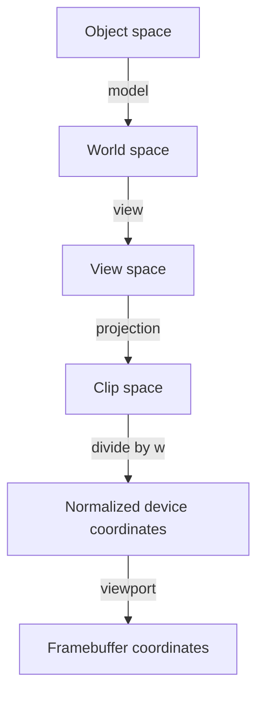

# 9. Matrices and perspective

*About 630 lines of C; raw Vulkan would need about 1550.*


So far everything has been flat. Chapters 6 and 7 drew a square from vertex and index buffers, and chapter 8 made it rotate and pulse with two floats pushed every frame. The shader still writes positions directly in the −1 to 1 range that spans the window, so the square looks stretched as it turns: in a 4:3 window, one unit is wider than it is tall.

A 3D object needs more than that: a place in a scene, a camera looking at it, and perspective, so that distant parts look smaller. Renderers express each of these as a 4 × 4 matrix and multiply them into one.

This chapter turns the square into a cube, builds those matrices on the CPU, and pushes the result as in chapter 8. The cube spins in perspective but looks wrong on purpose: faces drawn later cover earlier ones, even when they are behind. Chapter 10 fixes that.

In this chapter you will:

1. follow one position through the coordinate spaces between the cube and the screen;
2. apply one combined matrix in the vertex shader;
3. describe a cube with eight corners and twelve triangles;
4. build the model, view and projection matrices and combine them on the CPU;
5. push the matrix each frame.

## From the cube to the screen

Think of taking a photo: the object has a shape, it stands somewhere in a room, you stand somewhere with a camera, and the lens frames the picture. A renderer keeps these decisions separate. Each one has its own **coordinate space**, and a matrix or a fixed GPU step takes a position from one space to the next. In order:

1. **Object space**: the cube's stored coordinates, centered on its own origin. The vertex buffer holds these, and they never change.
2. **World space**: where the object stands, how it is turned and how big it is. The **model matrix** takes object space to world space. To rotate the cube, we change this matrix and leave the vertex buffer alone.
3. **View space**: the same scene seen from the camera. In this program, the camera sits at the origin and looks down negative z. The **view matrix** takes world space to view space. To move the camera, we change this matrix.
4. **Clip space**: the output of the **projection matrix**, which plays the role of the lens: field of view, aspect ratio, and the nearest and farthest distances drawn. The vertex shader writes `gl_Position` in this space, and Vulkan clips triangles against its bounds.
5. **Normalized device coordinates** (NDC): clip coordinates divided by their fourth component, `w`. The GPU does this division itself. x and y run from −1 to 1 across the viewport, and z from 0 to 1. Our projection puts the near plane at z = 0 and the far plane at z = 1. Chapters 4 to 8 wrote `w = 1`, so their clip coordinates were already NDC.
6. **Framebuffer coordinates**: pixels. The viewport, set since chapter 3, maps NDC to them.

Figure 1 shows the same chain. Our program builds the first three arrows as matrices; the last two are fixed steps the GPU performs after the vertex shader.

<figure class="dvz-course-figure" id="fig-coordinate-spaces" markdown="1">



<figcaption>Figure 1. A vertex position passes through three matrices, then the GPU's divide by w and the viewport.</figcaption>

</figure>

Vulkan only knows clip space and what follows. The earlier spaces and their matrices are this program's conventions, which is why the matrix code lives in C.

## Why four components

A 3 × 3 matrix can rotate and scale a point but cannot move it: multiplication always leaves the origin in place. With a fourth component, a position `(x, y, z, 1)` picks up the fourth column of a 4 × 4 matrix as a translation, while a direction, written with `w = 0`, ignores it. These are **homogeneous coordinates**.

The fourth component also gives perspective. An object twice as far away looks half as big: its size on screen is divided by its distance. A matrix cannot divide, so the projection copies the distance in front of the camera into `w`, and the GPU's **perspective divide** by `w` does the rest. Distant points shrink toward the center.

## One matrix per draw

The three matrices combine into one **model-view-projection (MVP) matrix**, `projection * view * model`. Read it from right to left: the matrix nearest the vector applies first, so the vertex is placed in the world, then seen from the camera, then projected. The order matters. Rotating the cube and then moving it 3 units turns it in place; moving it first and then rotating swings it around the origin.

The product is the same for every vertex, so we compute it once per frame on the CPU instead of once per vertex in the shader. Its 64 bytes fit within chapter 8's 128-byte push-constant guarantee. The rotation and pulse move out of the shader, which now applies whatever matrix it receives.

<p class="dvz-course-equation" role="math" aria-label="Clip position equals projection times view times model times object position."><i>p</i><sub>clip</sub> = <i>P V M p</i><sub>object</sub></p>

Figure 2 separates the model and view transformations at time zero. The orange dot tracks one corner through the model; the side view then shows how subtracting 3 from world z puts the camera at the view origin. These are spatial schematics, not screenshots of the rendered cube.

<figure class="dvz-course-figure" id="fig-model-view-transform" markdown="1">

<div class="dvz-figure-panels" markdown="0">

--8<-- "docs/images/gpu-graphics/cube-object.svg"

--8<-- "docs/images/gpu-graphics/cube-world.svg"

--8<-- "docs/images/gpu-graphics/camera-view.svg"

</div>

<figcaption>Figure 2. The model changes the cube’s pose. The view expresses that same scene relative to the camera.</figcaption>

</figure>

## Apply the matrix in the vertex shader

Start with where the matrix ends up. Replace `shader.vert` with this version and save it; `shader.frag` is unchanged. Don't run the program or press **R** in chapter 8's program yet: this shader expects a matrix and three-float positions, which the C side only provides after the edits below.

```glsl
#version 450

layout(push_constant) uniform Push { mat4 mvp; } push_data;
layout(location = 0) in vec3 in_position;
layout(location = 1) in vec3 in_color;
layout(location = 0) out vec3 color;

void main()
{
    gl_Position = push_data.mvp * vec4(in_position, 1.0);
    color = in_color;
}
```

The push-constant block now holds one `mat4` named `mvp`, and the position input is a `vec3`. The shader appends `w = 1` to make each stored position a homogeneous point, and one multiplication takes it all the way from object space to clip space.

To see what that multiplication does, follow the cube corner `(0.65, 0.65, 0.65)` from the vertex array below:

1. The shader turns it into `(0.65, 0.65, 0.65, 1)`.
2. The model part spins, scales and tilts it about the cube's center. It stays near the origin, now in world space.
3. The view part moves it 3 units along −z, so it sits in front of the camera, at negative view-space z.
4. The projection part scales x and y for the field of view and the aspect ratio, computes depth, and copies the corner's distance in front of the camera into `w`. The result is `gl_Position`.
5. After the shader, the GPU divides by `w`, so x and y shrink with distance, and the viewport turns them into pixels.

The shader only ever sees the combined matrix. The rest of the chapter changes the C side to match: three-float positions, a 64-byte `Push`, and a function that builds the three parts and combines them each frame. Run the program once all of them are done.

## Describe the cube

Positions need a third float to match the shader's `vec3` input, and the two-float `Push` becomes the shader's single matrix. `mat4`, a 4 × 4 float matrix type, already comes from `<datoviz.h>`:

```c
// One vertex record: an object-space position and a color.
typedef struct
{
    float position[3];
    float color[3];
} Vertex;

// The push-constant block: one combined model-view-projection matrix, 64 bytes.
typedef struct
{
    mat4 mvp;
} Push;
```

A cube has eight corners, each shared by three faces, which suits chapter 7's index buffer. Replace both geometry arrays. Each face is two triangles, 36 indices in all, and each triangle lists its corners counter-clockwise when seen from outside; chapter 10 relies on that order:

```c
// The eight corners of the cube, centered on its own origin.
static const Vertex VERTICES[8] = {
    {{-0.65f, -0.65f, -0.65f}, {1.0f, 0.2f, 0.2f}},
    {{ 0.65f, -0.65f, -0.65f}, {1.0f, 0.7f, 0.2f}},
    {{ 0.65f,  0.65f, -0.65f}, {0.2f, 0.9f, 0.3f}},
    {{-0.65f,  0.65f, -0.65f}, {0.2f, 0.5f, 1.0f}},
    {{-0.65f, -0.65f,  0.65f}, {0.5f, 0.2f, 1.0f}},
    {{ 0.65f, -0.65f,  0.65f}, {1.0f, 0.3f, 0.7f}},
    {{ 0.65f,  0.65f,  0.65f}, {0.3f, 1.0f, 0.9f}},
    {{-0.65f,  0.65f,  0.65f}, {0.9f, 0.9f, 0.2f}},
};

// Each face winds counter-clockwise when seen from outside the cube.
static const uint16_t INDICES[36] = {
    0, 2, 1, 0, 3, 2,
    4, 5, 6, 4, 6, 7,
    0, 1, 5, 0, 5, 4,
    3, 7, 6, 3, 6, 2,
    1, 2, 6, 1, 6, 5,
    0, 4, 7, 0, 7, 3,
};
```

The buffer sizes use `sizeof(VERTICES)` and `sizeof(INDICES)`, so they adjust on their own. The pipeline must now read three floats per position instead of two. Change the position attribute:

```c
    dvz_graphics_vertex_attr(
        renderer->pipeline, 0, 0, VK_FORMAT_R32G32B32_SFLOAT, offsetof(Vertex, position));
```

Read it as: from vertex binding 0, shader location 0 is three 32-bit floats at the offset of `position`. The draw must also cover all 36 indices instead of 6:

```c
    // First index 0, vertex offset 0, 36 indices, first instance 0, 1 instance.
    dvz_cmd_draw_indexed(renderer->commands, 0, 0, 36, 0, 1);
```

## Multiply two matrices

The C side needs one piece of matrix math: a product. Add this helper before `create_pipeline()`. `mat4` stores columns, as GLSL does, so an element is `[column][row]`:

```c
static void multiply_mat4(mat4 left, mat4 right, mat4 out)
{
    // Accumulate into a temporary, so out may be the same matrix as left or right.
    mat4 product = {{0}};
    for (uint32_t column = 0; column < 4; column++)
        for (uint32_t row = 0; row < 4; row++)
            for (uint32_t inner = 0; inner < 4; inner++)
                product[column][row] += left[inner][row] * right[column][inner];

    // Copy the finished product out.
    for (uint32_t column = 0; column < 4; column++)
        for (uint32_t row = 0; row < 4; row++)
            out[column][row] = product[column][row];
}
```

Each output element is a row of `left` times a column of `right`. The result goes to a temporary first, so you can pass the same matrix as an input and as the output. The next helper does that.

## Build the model, view and projection

A second helper, `make_mvp()`, builds the three matrices for a given time and aspect ratio and multiplies them. Add it after `multiply_mat4()`. It works in four steps, which the next subsections follow in source order:

1. build the model matrix, which spins, scales and tilts the cube;
2. build the view matrix, which places the camera;
3. build the projection matrix, which acts as the lens;
4. multiply the three into one.

In the initializers, each inner brace of a `mat4` is one column, so the matrices read transposed on the page. The view's translation, for example, is its last brace.

### Place the cube in the world

The function starts with the model matrix:

```c
static void make_mvp(float aspect, float time, mat4 out)
{
    // Model: spin about the vertical y axis and pulse in size. Each inner brace is a column.
    float angle = time * 0.7f;
    float cosine = cosf(angle);
    float sine = sinf(angle);
    float pulse = 1.0f + 0.08f * sinf(time * 3.0f);
    mat4 model = {
        {pulse * cosine, 0, -pulse * sine, 0},
        {0, pulse, 0, 0},
        {pulse * sine, 0, pulse * cosine, 0},
        {0, 0, 0, 1},
    };

    // Tilt the cube so that three faces can be seen.
    float tilt = -0.35f;
    mat4 tilt_matrix = {
        {1, 0, 0, 0},
        {0, cosf(tilt), sinf(tilt), 0},
        {0, -sinf(tilt), cosf(tilt), 0},
        {0, 0, 0, 1},
    };
    multiply_mat4(tilt_matrix, model, model);
```

The **model** matrix turns the cube about the vertical y axis by 0.7 radians per second and scales it by chapter 8's pulse. Seen straight from the side, a cube turning about y shows at most two faces, so a fixed tilt of −0.35 radians (about 20 degrees) about x brings a third face into view. Multiplying `tilt_matrix` on the left applies it after the spin. The call passes `model` as both input and output, which `multiply_mat4()` allows.

### Place the camera

Next comes the view matrix:

```c
    // View: the camera stands 3 units along +z, so the world moves 3 units along -z.
    mat4 view = {{1, 0, 0, 0}, {0, 1, 0, 0}, {0, 0, 1, 0}, {0, 0, -3, 1}};
```

The **view** matrix places the camera three units along positive z, looking at the origin. Moving the camera back is the same as moving the whole world forward, so the view is a plain translation by −3 along z. That translation is the last brace, `{0, 0, -3, 1}`.

### Project onto the screen

Then the projection matrix:

```c
    // Projection: a 60-degree vertical field of view, Vulkan's y-down NDC, depth 0 to 1.
    float near_clip = 0.1f;
    float far_clip = 100.0f;
    float fov_y = 1.0471976f;
    float focal_length = 1.0f / tanf(0.5f * fov_y);
    mat4 projection = {
        {focal_length / aspect, 0, 0, 0},
        {0, -focal_length, 0, 0},
        {0, 0, far_clip / (near_clip - far_clip), -1},
        {0, 0, near_clip * far_clip / (near_clip - far_clip), 0},
    };
```

The **projection** uses a 60-degree vertical field of view (`1.0471976` radians), the framebuffer aspect ratio, and near and far distances of 0.1 and 100. At distance 1, the visible region reaches `tan(fov_y / 2)` above the center; scaling by `focal_length`, its inverse, puts that edge at y = 1. Dividing x by the aspect ratio keeps units square.

The projection also holds three Vulkan-specific details:

- Points in front of this camera have negative view-space z. The `-1` in `projection[2][3]` sets clip `w` to minus that z, a positive distance, which the perspective divide then uses.
- The two depth terms map the near plane to NDC z = 0 and the far plane to z = 1. Vulkan clips depth outside 0 to 1, and this projection uses that whole range.
- Vulkan's NDC y points down, which is why chapter 4's triangle needed a negative y for its top vertex. The negative y scale flips it, so world-space up appears up.

Figure 3 connects this projection to the camera rays. The virtual plane in the sketch helps compare apparent sizes; it is not a clipping plane. The numerical example uses aspect ratio 1 and two illustrative points at distances 2 and 4.

<p class="dvz-course-equation" role="math" aria-label="NDC x equals clip x divided by clip w. Clip w equals minus view z."><i>x</i><sub>NDC</sub> = <i>x</i><sub>clip</sub> / <i>w</i><sub>clip</sub><br/><i>w</i><sub>clip</sub> = −<i>z</i><sub>view</sub></p>

<figure class="dvz-course-figure" id="fig-perspective-divide" markdown="1">

<div class="dvz-figure-panels" markdown="0">

--8<-- "docs/images/gpu-graphics/perspective-rays.svg"

--8<-- "docs/images/gpu-graphics/perspective-divide.svg"

</div>

<figcaption>Figure 3. Equal sizes appear different at different distances: doubling the distance doubles w and halves the size after division.</figcaption>

</figure>

### Combine the three

Finally, the function multiplies the matrices and ends:

```c
    // Combine right to left: projection * (view * model).
    mat4 view_model = {{0}};
    multiply_mat4(view, model, view_model);
    multiply_mat4(projection, view_model, out);
}
```

The first call computes `view * model`, and the second multiplies the projection on the left. The order matches the right-to-left reading from the previous section.

## Send the matrix

The matrix depends on the window's shape, so compute it each frame from the current framebuffer size. In `draw()`, keep the elapsed-time calculation but replace the old `Push` initializer:

```c
    // Build this frame's matrix from the current framebuffer aspect ratio.
    Push push = {0};
    float aspect = (float)frame->extent.width / (float)frame->extent.height;
    make_mvp(aspect, time, push.mvp);
```

Dividing by the current aspect ratio removes chapter 8's stretch and keeps the cube's proportions after a resize. The push-constant code itself is unchanged: `sizeof(Push)` now declares and pushes 64 bytes, which the shader you installed earlier reads as `mvp`.

## Why it looks wrong

The GPU draws the twelve triangles in index order, and each overwrites the pixels it covers. Nothing records how far away each pixel's surface is, so a back face drawn after a front face covers it. Sorting triangles by distance does not work in general, for example when triangles intersect. Chapter 10 adds a per-pixel depth test instead.

## Build and run

Build and run as before; the capture goes to `chapter09.png`.

=== "Linux"

    ```sh
    cmake --build build
    ./build/vkcourse
    ./build/vkcourse --png chapter09.png
    ```

=== "macOS"

    ```sh
    cmake --build build
    ./build/vkcourse
    ./build/vkcourse --png chapter09.png
    ```

=== "Windows"

    In a Developer PowerShell for Visual Studio, with the `PATH` setup from chapter 1:

    ```powershell
    cmake --build build --config Release
    .\build\Release\vkcourse.exe
    .\build\Release\vkcourse.exe --png chapter09.png
    ```

The cube spins with some back faces drawn over front ones. The terminal ends with `validation errors: 0`.

??? tip "Try it"

    1. Change `fov_y` from `1.0471976f` to `0.5235988f` (60 to 30 degrees). The cube looks bigger, as through a narrower lens.
    2. Move `near_clip` to `3.0f`. The near plane slices off the front of the cube, and you see into it.
    3. Set `angle` to zero and keep the tilt. The cube stops rotating, and you can study which faces wrongly cover others.
    4. Swap the arguments in the last `multiply_mat4()` call. The cube vanishes: matrix multiplication does not commute.

??? info "Under the hood: matrix math belongs to the application"

    Vulkan copies 64 bytes through `vkCmdPushConstants` and runs the vertex shader. It has no model or camera matrix. The coordinate conventions and multiplication order are this program's choices.

??? warning "When it goes wrong"

    An invisible cube often means clip `w` has the wrong sign or the multiplication order is reversed. Wrong face overlap is expected in this chapter. If the cube stretches on resize, check the aspect ratio.

## What carries over

- Model, view and projection matrices, then the divide by `w`, are how real-time 3D renderers get from stored vertices to the screen. The conventions differ between APIs: Vulkan's NDC has y down and depth from 0 to 1, while OpenGL's has y up and depth from −1 to 1.
- Work that gives the same result for every vertex, such as combining matrices, can be done once per draw on the CPU instead of once per vertex in the shader.
- C and the shader must agree on how a matrix is laid out in memory. GLSL stores columns; C code that writes rows sends the transposed matrix.

## Checkpoint

1. What does the perspective divide do?
2. Starting from one stored cube position, name each coordinate space it passes through before reaching a framebuffer pixel.
3. Why is the order `projection * view * model`?
4. Which depth values do the near and far planes produce?

??? example "Your `main.c` after chapter 9"

    ```c
    --8<-- "examples/c/vulkan/step09.c"
    ```

??? example "Your `shader.vert` after chapter 9"

    ```glsl
    --8<-- "examples/c/vulkan/step09/shader.vert"
    ```

??? example "Your `shader.frag` after chapter 9"

    ```glsl
    --8<-- "examples/c/vulkan/step09/shader.frag"
    ```

Next: [Depth and culling](10-depth-culling.md).
