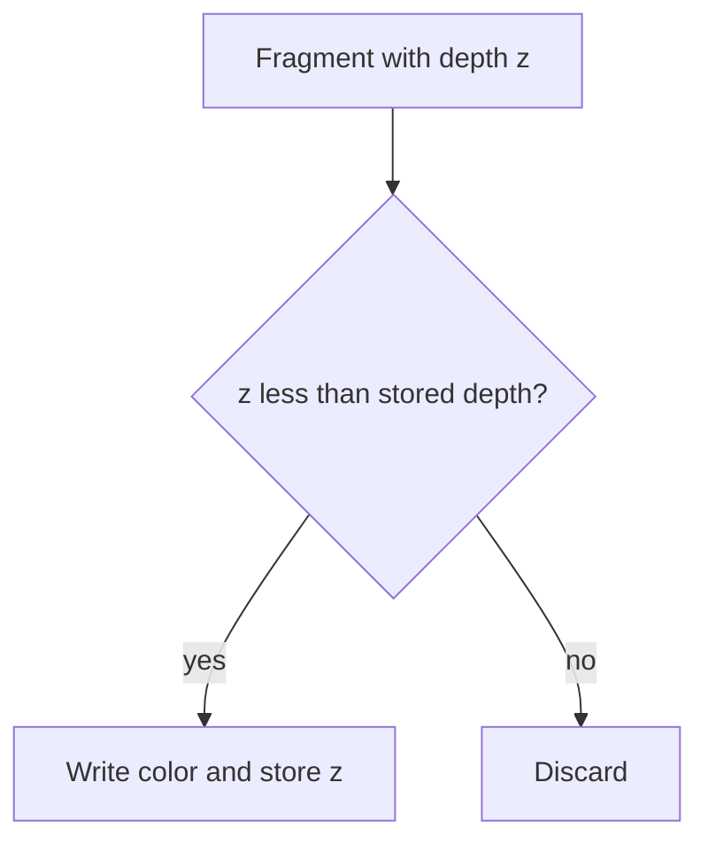

# 10. Depth and culling

*About 538 lines of C; raw Vulkan would need about 1650.*


Chapter 9 gave us a cube in perspective, but it does not look solid. The GPU draws its twelve triangles in index order, each overwriting the pixels it covers, so a back face drawn after a front face shows through it. As the cube turns, faces pop in front of each other.

The GPU needs to remember, for every pixel, how far the surface already drawn there is, and keep only the nearest one: the depth test. A second, cheaper idea helps too: on a closed object, faces turned away from the camera are always hidden, so the GPU can skip them: **back-face culling**. By the end, the cube is solid from every angle.

In this chapter you will:

1. ask the canvas for a depth image and attach it to each frame's rendering, cleared to "far";
2. turn on the depth test and depth writes in the pipeline;
3. turn on back-face culling, using the winding order chapter 9 gave the cube.

## Keep the nearest surface

Chapter 9's projection already gives each vertex a depth: NDC z, from 0 at the near plane to 1 at the far plane. The rasterizer interpolates it across each triangle, so every fragment knows its own depth. What is missing is a place to remember the nearest depth drawn so far at each pixel.

That place is a **depth attachment**: an image the size of the framebuffer, holding one depth value per sample. It sits beside the color attachment: one records what you see, the other how far it is.

Each frame starts by clearing every depth value to 1.0, the far plane, so the first surface drawn anywhere is nearer than "nothing". Then, for each fragment:

- The **depth test** compares the fragment's depth with the stored value. With `VK_COMPARE_OP_LESS`, the fragment passes only if it is strictly closer; otherwise it is discarded and changes nothing.
- A **depth write** stores a passing fragment's depth, so later fragments compare against it. Testing and writing are separate settings: you can test without writing, as transparent objects often do.



The nearest surface now wins at every pixel, whatever order the triangles arrive in.

## Skip faces that point away

In chapter 9, every triangle of the cube lists its corners counter-clockwise when seen from outside. Seen from inside, or from behind, the same corners appear clockwise. So after projection, the on-screen order of a triangle's corners, its **winding**, tells the GPU whether we see its front or its back.

Back-face culling drops triangles that show their back, before any fragment is produced. On a closed solid, those faces are always behind front faces, so dropping them leaves the image unchanged and saves rasterizing about half the triangles.

Culling never looks at distance, so you still need depth whenever front-facing triangles overlap.

## Request and attach depth

Since chapter 2, the canvas owns the image each frame draws into. It can also own a depth image for each frame slot (chapter 3). In `main()`, before creating the canvas, request a 32-bit float depth format:

```c
    canvas_config.depth_format = VK_FORMAT_D32_SFLOAT;
```

Vulkan guarantees depth-attachment support for `D16_UNORM` and for at least one of `X8_D24_UNORM_PACK32` and `D32_SFLOAT`. The canvas allocates exactly the format you request and does not substitute another, so on a device without `D32_SFLOAT` depth images, pick one of the others. The canvas also recreates the image on resize, since it must match the color image's size.

Having a depth image is not enough: each frame's rendering must use it. In `draw()`, right after `dvz_cmd_rendering_default()` and before beginning rendering, attach this frame's borrowed depth view and clear it. The order matters: `dvz_cmd_rendering_default()` resets the whole rendering description every frame, so the depth attachment must be set after it:

```c
    DvzAttachment* depth = dvz_rendering_depth(renderer->rendering);
    dvz_attachment_image(depth, frame->depth_view, frame->depth_layout);
    dvz_attachment_ops(depth, VK_ATTACHMENT_LOAD_OP_CLEAR, VK_ATTACHMENT_STORE_OP_STORE);
    dvz_attachment_clear(depth, (VkClearValue){.depthStencil = {1.0f, 0}});
```

Read it as: the depth attachment is this frame's depth view, in the layout the canvas reports; clear it when rendering begins and keep the result when it ends; clear it to depth 1.0 and stencil 0, unused by this format. The canvas owns the image; `draw()` only borrows its view. The canvas also keeps it in the right image layout and reports it in `frame->depth_layout`; chapter 13 explains layouts.

## Turn on testing and writes

The attachment gives the GPU somewhere to store depth, but the pipeline decides whether to use it. Depth state is fixed-function pipeline state, like chapter 4's topology. In `create_pipeline()`, after the color attachment format and before the pipeline layout, add:

```c
    dvz_graphics_attachment_depth(renderer->pipeline, VK_FORMAT_D32_SFLOAT);
    dvz_graphics_depth(
        renderer->pipeline, false, true, VK_COMPARE_OP_LESS, DVZ_GRAPHICS_FLAGS_FIXED);
```

The first call declares the depth format, which must match the canvas. Read the second as: no depth clamping, depth writes on, keep fragments whose depth is less than the stored one. There is no separate switch for the depth test: passing `DVZ_GRAPHICS_FLAGS_FIXED`, a nonzero flag, both enables it and bakes these settings into the pipeline. Depth clamping, off here, would pin out-of-range depths to the near and far planes instead of clipping them.

## Cull back faces

Add these calls right after the depth state:

```c
    dvz_graphics_cull_mode(
        renderer->pipeline, VK_CULL_MODE_BACK_BIT, DVZ_GRAPHICS_FLAGS_FIXED);
    dvz_graphics_front_face(
        renderer->pipeline, VK_FRONT_FACE_COUNTER_CLOCKWISE, DVZ_GRAPHICS_FLAGS_FIXED);
```

Read them as: drop back faces, and count counter-clockwise on screen as front. The cube's indices wind counter-clockwise from outside, and chapter 9's y flip keeps that winding counter-clockwise on screen. Culling never looks at normals, only at the order of the projected corners.

## Build and run

Build and run as before; the capture goes to `chapter10.png`.

=== "Linux and macOS"

    ```sh
    cmake --build build
    ./build/vkcourse
    ./build/vkcourse --png chapter10.png
    ```

=== "Windows (Visual Studio)"

    ```powershell
    cmake --build build --config Release
    .\build\Release\vkcourse.exe
    .\build\Release\vkcourse.exe --png chapter10.png
    ```

The cube is solid from every angle. The terminal ends with `validation errors: 0`.

!!! tip "Try it"

    1. Set the depth-write Boolean to `false` and use `VK_CULL_MODE_NONE`. With no writes, the stored depth stays at 1.0, every fragment passes, and the chapter 9 overlap returns.
    2. Restore both, then flip the front face to `VK_FRONT_FACE_CLOCKWISE`. You see the cube's inner faces.
    3. Restore counter-clockwise fronts and switch between `VK_CULL_MODE_NONE` and `VK_CULL_MODE_BACK_BIT`. The image does not change: depth alone already hides the back faces.
    4. See the triangles. Wireframe drawing is an optional device feature, so request it before creating the GPU context:

        ```c
        VkPhysicalDeviceFeatures features = {.fillModeNonSolid = VK_TRUE};
        dvz_gpu_ctx_config_features10(&gpu_config, &features);
        ```

        Then, in `create_pipeline()`, draw polygons as lines:

        ```c
        dvz_graphics_polygon_mode(renderer->pipeline, VK_POLYGON_MODE_LINE, DVZ_GRAPHICS_FLAGS_FIXED);
        ```

        Each face splits into its two triangles, and with back-face culling you see only the three faces turned toward you. Switch to `VK_CULL_MODE_NONE` to see all twelve triangles.

??? info "Under the hood: another image and two pipeline states"

    Raw Vulkan needs a depth image, its memory, a view, a layout transition, and recreation on resize. The pipeline also carries depth-stencil and rasterization state structures. The canvas manages the image; you choose the comparison, the clear, the winding, and the culling.

!!! warning "When it goes wrong"

    An attachment-format validation error means the pipeline and canvas disagree. An inside-out cube points to the winding or front-face setting. Flickering where two surfaces meet means they are nearly at the same depth: depth has finite precision, so keep a sensible near/far range.

## What carries over

- The depth buffer, cleared to "far" and updated with a less-than test, is how every rasterizing GPU API hides surfaces, from OpenGL to WebGPU. Draw order then matters only for transparency.
- Back-face culling depends on consistent winding. Any closed mesh you build or load must wind its triangles the same way as seen from outside.
- Depth testing and writing are independent switches; renderers combine them differently for opaque objects, transparent objects, and overlays.

## Checkpoint

1. Why is depth cleared to 1.0?
2. What distinguishes a depth test from a depth write?
3. What does back-face culling use to classify a triangle?

??? example "Your `main.c` after chapter 10"

    ```c
    --8<-- "examples/c/vulkan/step10.c"
    ```

??? example "Your `shader.vert` after chapter 10"

    ```glsl
    --8<-- "examples/c/vulkan/step10/shader.vert"
    ```

??? example "Your `shader.frag` after chapter 10"

    ```glsl
    --8<-- "examples/c/vulkan/step10/shader.frag"
    ```

Next: [Mouse control](11-mouse-control.md).
