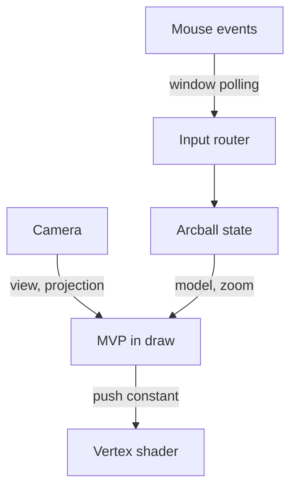

# 11. Mouse control

*About 640 lines of C; raw Vulkan would need about 1750.*


The cube is now solid. Chapter 9 built its model, view and projection matrices on the CPU and pushed their product each frame, and chapter 10 made the nearest surface win at every pixel. But the cube spins on a timer. To inspect a 3D object, you want to turn it yourself, look at it from any side, and move closer or farther.

Vulkan has no notion of a mouse or a camera; it only receives the matrix we push. So interaction is CPU work: we turn mouse events into new matrices and keep pushing one 64-byte MVP as before. Instead of writing that math ourselves, we use two Datoviz controllers. By the end, you drag to rotate the cube and scroll to zoom.

This chapter completes the cube's geometry and camera. From chapter 12 on, the course turns to what the shaders read: materials, textures and light.

In this chapter you will:

1. create a **camera**, which produces the view and projection matrices;
2. create an **arcball**, which turns pointer drags into a rotation and scrolls into a zoom;
3. connect the arcball to the window's input events;
4. combine their matrices each frame, converting them to Vulkan's clip conventions;
5. disconnect and destroy the controllers at cleanup.

## Input stays on the CPU

Events and drawing happen at different moments. While the main loop polls the window, mouse events update the arcball's state: its rotation and zoom. Later, `draw()` asks the camera and the arcball for matrices, multiplies them, and pushes the result. The shaders do not change.

Figure 1 shows both paths. Events flow from the window into the arcball during polling; matrices flow from the controllers into the push constant during `draw()`.

<figure class="dvz-course-figure" id="fig-input-to-mvp" markdown="1">



<figcaption>Figure 1. Mouse events update the arcball on the CPU; each frame, draw() combines the controllers' matrices and pushes one MVP.</figcaption>

</figure>

The two controllers split chapter 9's three matrices between them:

- A **camera** describes where you look from and through what lens: an eye, a target, an up direction, a field of view, and near and far planes. It produces the view and projection matrices that chapter 9's `make_mvp()` built by hand.
- An **arcball** produces the model matrix. Picture the cube inside a glass ball: dragging the pointer rolls the ball under it, so the cube turns in the direction you drag. Scrolling moves the camera closer or farther, which the arcball applies to the view matrix.

## Two clip conventions

The camera produces OpenGL-style clip coordinates, a convention many libraries share: y up, depth from −1 to 1. Chapter 9 built Vulkan's convention into its projection: y down, depth from 0 to 1. We keep the camera as it is and convert its output with one more matrix, multiplied last:

- it negates y, so world-space up appears up on a Vulkan viewport;
- it replaces z with `0.5 * z + 0.5 * w`, so after the divide by `w`, depth −1 becomes 0 and depth 1 stays 1.

## Create a camera and arcball

The controller API comes with `<datoviz/advanced.h>`, which you already include. The controllers replace chapter 8's timer, so in `Renderer`, replace `start_ns`, `capture_time` and `animate` with two owned objects:

```c
    // The reload flag, the two owned controllers, and the draw error flag.
    bool reload_requested;
    DvzArcball* arcball;
    DvzCamera* camera;
    bool draw_failed;
```

Remove `make_mvp()`; keep `multiply_mat4()`, which still combines the matrices.

Without a timer, `--time` has nothing to set. Remove `capture_time`, the `--time` branch and the `isfinite()` check from the argument parsing:

```c
    // With --png PATH, render offscreen and save an image instead of opening a window.
    const char* png_path = NULL;
    for (int argument_index = 1; argument_index + 1 < argc; argument_index++)
    {
        if (strcmp(argv[argument_index], "--png") == 0)
            png_path = argv[++argument_index];
    }
    bool live = png_path == NULL;
```

Offscreen mode draws one frame at the arcball's initial pose, so captures stay the same from run to run without simulated input.

In `main()`, replace the clock initialization before `dvz_canvas_set_draw_callback()` with three steps. First, create the two controllers:

```c
    // The camera makes view and projection; the arcball makes the model and applies zoom.
    DvzCameraDesc camera_desc = dvz_camera_desc();
    camera_desc.projection.fov_y = 1.0471976f;
    renderer.camera = dvz_camera_create(&camera_desc);
    renderer.arcball = dvz_arcball_create(NULL);
    COURSE_CHECK(
        renderer.camera != NULL && renderer.arcball != NULL, "controller creation failed");
```

The camera starts from Datoviz's defaults, an eye at `(0, 0, 3)` looking at the origin, and takes chapter 9's 60-degree field of view, so the starting picture matches. `NULL` gives the arcball its default settings. The renderer owns both objects and destroys them at cleanup. They are plain CPU objects, with no Vulkan resources.

Second, give the arcball a starting pose:

```c
    // Start tilted so three faces show: angles in radians about x, y, and z.
    DvzResult initial_result = dvz_arcball_initial(renderer.arcball, (vec3){-0.35f, 0.65f, 0.0f});
    COURSE_CHECK(initial_result == DVZ_OK, "initial rotation failed");
```

`(vec3){-0.35f, 0.65f, 0.0f}` are the initial rotation angles in radians about x, y and z, so the cube starts tilted with three faces showing.

Third, connect the arcball to input:

```c
    // Subscribe the arcball to the window's pointer events; polling delivers them.
    DvzResult connect_result = dvz_arcball_connect(renderer.arcball, dvz_canvas_input(canvas));
    COURSE_CHECK(connect_result == DVZ_OK, "arcball connection failed");
```

`dvz_canvas_input(canvas)` returns the window's input router, the same one `dvz_window_router(window)` gives the keyboard callback. The program borrows the router; the window owns it. Connecting subscribes the arcball to its pointer events, and the existing `dvz_window_host_poll()` delivers them. Nothing else in the loop changes, so the arcball's state updates during polling, between frames.

## Compose the matrices each frame

Each frame, `draw()` turns the controllers' current state into one pushed matrix. Replace the elapsed-time and `make_mvp()` code at the beginning of `draw()`. The new code has four phases:

1. tell each controller the current size, in the units it needs;
2. collect the controllers' matrices;
3. build the clip correction from the previous section;
4. multiply everything into the pushed MVP.

`draw()` now uses `canvas`, so delete its `(void)canvas;` line. Start with the two structures the phases fill:

```c
    // This frame's pushed matrix, and the model, view, and projection the controllers fill.
    Push push = {0};
    DvzMVP mvp = {0};
```

### Tell the controllers the current size

The camera and the arcball both need the window's size, but in different units:

```c
    // The camera's aspect ratio comes from framebuffer pixels.
    DvzResult camera_resize = dvz_camera_resize(
        renderer->camera, (float)frame->extent.width, (float)frame->extent.height);

    // Pointer positions use window coordinates, which may differ from framebuffer pixels.
    DvzInputResizeEvent input_size = {0};
    float pointer_width = (float)frame->extent.width;
    float pointer_height = (float)frame->extent.height;
    if (dvz_input_router_last_resize(dvz_canvas_input(canvas), &input_size) &&
        input_size.window_width > 0 && input_size.window_height > 0)
    {
        pointer_width = (float)input_size.window_width;
        pointer_height = (float)input_size.window_height;
    }
    DvzResult arcball_resize =
        dvz_arcball_resize(renderer->arcball, pointer_width, pointer_height);
    if (camera_resize != DVZ_OK || arcball_resize != DVZ_OK)
        renderer->draw_failed = true;
```

The camera needs framebuffer pixels for the aspect ratio. The arcball needs window coordinates, because pointer positions are measured in them. The two differ on high-density displays, where one window unit covers several pixels. The input router remembers the last resize event, which carries both; until one arrives, the framebuffer extent is a usable fallback. Refreshing both sizes every frame keeps them right after a resize.

A failed resize sets `draw_failed`, the flag chapter 8 introduced for a failed push. `draw()` still cannot return a status, so the render loop checks the flag as before.

### Collect the controller matrices

`DvzMVP` holds a model, a view and a projection matrix. Each controller fills its part:

```c
    // The camera fills view and proj; the arcball then fills model and adjusts view for zoom.
    dvz_camera_mvp(renderer->camera, &mvp);
    dvz_arcball_mvp(renderer->arcball, &mvp);
```

The camera fills `view` and `proj`. The arcball then fills `model` and adjusts `view` for zoom, so the calls must run in this order.

### Build the clip correction

The correction matrix from the previous section is a constant:

```c
    // Camera matrices use OpenGL clip coordinates; convert y and z for this Vulkan viewport.
    mat4 clip_correction = {{1, 0, 0, 0}, {0, -1, 0, 0}, {0, 0, 0.5f, 0}, {0, 0, 0.5f, 1}};
```

As in chapter 9, each inner brace is a column. The second column, `{0, -1, 0, 0}`, negates y. The third and fourth columns together give a new z of `0.5 * z + 0.5 * w` and leave `w` unchanged.

### Multiply into the pushed matrix

Finally, combine the four matrices:

```c
    // Multiply right to left: clip_correction * proj * view * model.
    mat4 view_model = {{0}};
    mat4 projection_view_model = {{0}};
    multiply_mat4(mvp.view, mvp.model, view_model);
    multiply_mat4(mvp.proj, view_model, projection_view_model);
    multiply_mat4(clip_correction, projection_view_model, push.mvp);
```

The three `multiply_mat4()` calls build `clip_correction * proj * view * model`: chapter 9's order, with the correction applied last. The result goes straight into `push.mvp`. The rest of `draw()` is unchanged.

Since the flag now also covers the resize calls, update the message of the check in the render loop:

```c
        // draw() cannot return a status, so check the flag it sets before submitting.
        COURSE_CHECK(!renderer.draw_failed, "matrix or push-constant update failed");
```

## Disconnect before cleanup

The arcball's subscription lives in the window's input router, so release it while the canvas and window still exist. In cleanup, after the device wait and the buffer cleanup, and before `destroy_pipeline()`:

```c
    // Unsubscribe the arcball while its router still exists, then destroy both controllers.
    if (renderer.arcball != NULL && canvas != NULL)
        dvz_arcball_disconnect(renderer.arcball, dvz_canvas_input(canvas));
    if (renderer.arcball != NULL)
        dvz_arcball_destroy(renderer.arcball);
    dvz_camera_destroy(renderer.camera);
```

The `NULL` tests let cleanup run safely after a failure at any earlier step. The canvas, window and window host are destroyed later, in chapter 2's order.

## Build and run

Build and run as before; the capture goes to `chapter11.png`.

=== "Linux"

    ```sh
    cmake --build build
    ./build/vkcourse
    ./build/vkcourse --png chapter11.png
    ```

=== "macOS"

    ```sh
    cmake --build build
    ./build/vkcourse
    ./build/vkcourse --png chapter11.png
    ```

=== "Windows"

    In a Developer PowerShell for Visual Studio, with the `PATH` setup from chapter 1:

    ```powershell
    cmake --build build --config Release
    .\build\Release\vkcourse.exe
    .\build\Release\vkcourse.exe --png chapter11.png
    ```

Drag with the left button to rotate the cube; scroll to zoom. The terminal ends with `validation errors: 0`.

??? tip "Try it"

    1. Replace `clip_correction` with the identity matrix. The cube turns upside down, and you see its inside: flipping y also reverses the winding, so culling now drops the front faces.
    2. Change the initial angles to `(vec3){0.0f, 0.0f, 0.0f}`. The capture shows one face straight on, as a plain square.
    3. Swap the `dvz_camera_mvp()` and `dvz_arcball_mvp()` calls. Scrolling stops working, because the camera now overwrites the arcball's zoom.

??? info "Under the hood: input is CPU work"

    Vulkan has no input API and no camera. A window toolkit such as GLFW delivers events, a controller tracks pointer state, and matrix math turns it into model and view transforms. The GPU still receives one matrix and an indexed draw.

??? warning "When it goes wrong"

    If the cube never responds, the arcball is connected to the wrong router, or the loop stopped polling events. If scrolling has no effect, check that `dvz_camera_mvp()` runs before `dvz_arcball_mvp()`. A crash at exit can mean the arcball was disconnected after its router was destroyed. If the program stops with `matrix or push-constant update failed`, a controller resize or the push was rejected in `draw()`.

## What carries over

- Input events never reach the GPU. Each frame, the CPU turns input state into data the shader already reads.
- Camera and controller libraries often follow OpenGL's clip conventions. One correction matrix, applied last, adapts them to Vulkan, so you can reuse such code instead of rewriting it.
- Pointer positions and framebuffer pixels are different units on high-density displays. Use window coordinates for input and pixels for rendering.

## Checkpoint

1. Which part of the program handles mouse events, and which part never sees them?
2. Why does the callback refresh the camera and arcball sizes every frame?
3. What does the clip correction change, and why did chapter 9 not need it?

??? example "Your `main.c` after chapter 11"

    ```c
    --8<-- "examples/c/vulkan/step11.c"
    ```

??? example "Your `shader.vert` after chapter 11"

    ```glsl
    --8<-- "examples/c/vulkan/step11/shader.vert"
    ```

??? example "Your `shader.frag` after chapter 11"

    ```glsl
    --8<-- "examples/c/vulkan/step11/shader.frag"
    ```

Next: [Uniform buffers and descriptors](12-uniform-buffers.md).
