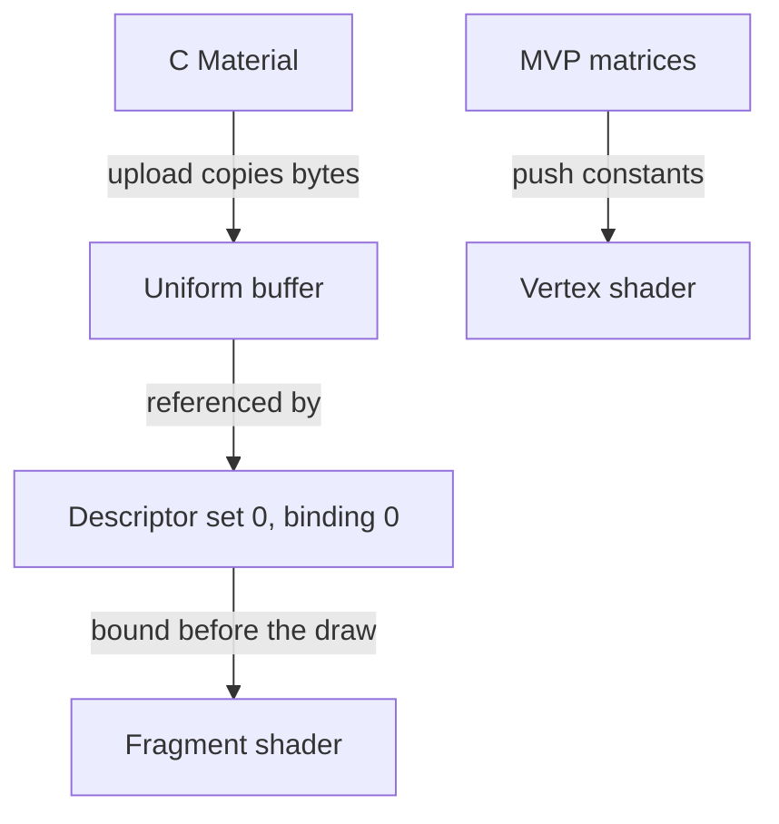

# 12. Uniform buffers and descriptors

*About 576 lines of C; raw Vulkan would need about 1850.*


The cube now turns under the mouse, and its shaders get data in two ways. Vertex attributes give one value per vertex (chapter 6). Push constants give a few bytes per draw, copied into the command buffer (chapter 8).

Real renderers need a third way. A texture can be megabytes, and a material or light is shared by many draws, so copying them into every command buffer is not an option. The shader must instead *read them from GPU memory*. In Vulkan, a shader finds such a resource through a **descriptor**.

This chapter takes the smallest possible example: one color, the material's tint, which the fragment shader multiplies with the vertex colors. A tint would fit in a push constant; the point is to learn the route, because textures (chapter 14) and lighting (chapter 15) take exactly the same one. By the end, the cube turns orange.

In this chapter you will:

1. put the tint in a **uniform buffer**, a GPU buffer that shaders read;
2. declare, in the pipeline layout, that the fragment shader reads one uniform buffer;
3. create a **descriptor set** that points that declaration at your buffer;
4. bind the descriptor set before the draw, and read the tint in GLSL.

## Copied or referenced

Push constants are *copied*: the bytes travel inside the command buffer, so you can change them for the next draw at no risk. A uniform buffer is *referenced*: the command buffer only says where the bytes are, and the GPU reads them when the draw executes. That makes it cheap for large or shared data, with one consequence: the buffer must stay alive and unchanged until every draw that reads it has finished.

## How a shader finds a buffer

A shader cannot hold a pointer to your buffer. It declares a numbered slot instead, such as `layout(set = 0, binding = 0) uniform Material`, and Vulkan connects that slot to a resource. Three pieces make this work:

- A **descriptor set layout** describes the slots: binding 0 is one uniform buffer, read by the fragment stage. It becomes part of the pipeline layout, so it is fixed when the pipeline is created.
- A **descriptor set** fills those slots with real resources: binding 0 is this buffer, from this offset, for this many bytes.
- Binding the set in the command buffer selects which filled-in set the following draws use.

A function call is a good analogy: the layout is the function signature, the descriptor set holds the arguments, and binding it before the draw is the call. You can create many sets from one layout, for example one per material, and switch between them with one command.

The numbers are a contract between C and GLSL: both must agree on the set, the binding, and the descriptor type, and the C side must make the slot visible to the stage that reads it. This **descriptor binding** is unrelated to chapter 6's vertex binding; Vulkan reuses the word.



## Define the material

Start on the C side with a structure that matches what the shader will read. Add it after `Push`:

```c
typedef struct
{
    float tint[4];
} Material;

_Static_assert(sizeof(Material) == 16, "the material block must match four shader floats");
```

The GPU reads the buffer's bytes with GLSL's layout rules, not C's. Uniform blocks follow the `std140` rules, which can place members further apart than a C compiler would. A `vec4` is the easy case: 16 bytes, exactly four C floats. Avoid a lone `vec3` in a uniform block: `std140` aligns it like a `vec4`, and C does not. The assertion stops the build if the structure ever stops matching.

The renderer needs three new fields. Creating a buffer takes the GPU memory allocator, which the GPU context owns and you only borrow. Add it beside `device`:

```c
    DvzVma* allocator;
```

Then add the material buffer and its descriptors beside the existing buffers in `Renderer`:

```c
    DvzBuffer* material_buffer;
    DvzDescriptors* descriptors;
```

Save the allocator after assigning `renderer.device`:

```c
    renderer.allocator = dvz_gpu_ctx_alloc(gpu);
```

## Create and upload the buffer

This helper creates a 16-byte buffer, marks it as a uniform buffer, and copies the tint into it. Add it before `keyboard()`:

```c
static int create_material(Renderer* renderer)
{
    Material material = {.tint = {1.0f, 0.55f, 0.25f, 1.0f}};
    renderer->material_buffer = dvz_buffer_create_wrapper();
    if (renderer->material_buffer == NULL)
        return -1;
    dvz_buffer(renderer->device, renderer->allocator, renderer->material_buffer);
    dvz_buffer_size(renderer->material_buffer, sizeof(Material));
    dvz_buffer_usage(renderer->material_buffer, VK_BUFFER_USAGE_UNIFORM_BUFFER_BIT);
    dvz_buffer_flags(
        renderer->material_buffer, DVZ_ALLOC_MAPPED | DVZ_ALLOC_HOST_ACCESS_SEQUENTIAL_WRITE);
    if (dvz_buffer_create(renderer->material_buffer) != 0)
        return -1;
    dvz_buffer_upload(renderer->material_buffer, 0, sizeof(material), &material);
    return 0;
}
```

The pattern is chapter 6's vertex buffer with a different usage flag. The same flags ask for memory the CPU can write directly, which suits small data.

Once `dvz_buffer_upload()` returns, the bytes are in the buffer and the local `material` can go. The upload happens once, before any draw, so one buffer is safe for every frame. Rewriting it every frame would not be: the CPU could change bytes that an earlier frame, still in flight, is reading. Renderers handle that with one buffer region per frame slot, or by waiting. Writing through a mapped pointer gives access, not synchronization.

The descriptor will point at this buffer, so the buffer must exist before the pipeline. Call the helper just before pipeline creation:

```c
    int material_result = create_material(&renderer);
    COURSE_CHECK(material_result == 0, "material buffer creation failed");
    int pipeline_result = create_pipeline(&renderer);
    COURSE_CHECK(pipeline_result == 0, "graphics pipeline creation failed");
```

## Declare the slot in the pipeline layout

Now the signature. Since chapter 8, the pipeline layout, `DvzSlots`, has held one entry: the push-constant range. Add the uniform buffer slot beside it in `create_pipeline()`:

```c
    dvz_slots_binding(
        renderer->slots, 0, 0, 1, VK_SHADER_STAGE_FRAGMENT_BIT,
        VK_DESCRIPTOR_TYPE_UNIFORM_BUFFER);
    dvz_slots_push(renderer->slots, VK_SHADER_STAGE_VERTEX_BIT, 0, sizeof(Push));
```

Read the first call as: in set 0, binding 0, there is 1 descriptor, visible to the fragment shader, and it is a uniform buffer. The shader will declare the same numbers.

## Fill the descriptor set

Now the arguments. A descriptor set is created from the layout, so this code goes at the end of `create_pipeline()`, once the pipeline exists:

```c
    if (dvz_graphics_create(renderer->pipeline) != 0)
        return -1;
    renderer->descriptors = dvz_descriptors_create_wrapper();
    if (renderer->descriptors == NULL)
        return -1;
    dvz_descriptors(renderer->slots, renderer->descriptors);
    dvz_descriptors_buffer(
        renderer->descriptors, 0, 0, 0, dvz_buffer_handle(renderer->material_buffer), 0,
        sizeof(Material));
    return dvz_descriptors_handle(renderer->descriptors, 0) != VK_NULL_HANDLE ? 0 : -1;
```

`dvz_descriptors()` allocates descriptor sets that match the slots. `dvz_descriptors_buffer()` fills one entry: set 0, binding 0, array element 0 is this buffer, from offset 0, for `sizeof(Material)` bytes. Nothing is copied: the descriptor records where the bytes are, not the bytes.

## Bind it and read it

A filled descriptor set is not used until a command binds it. In `draw()`, after the viewport and before the push, add:

```c
    dvz_cmd_bind_descriptors(
        renderer->commands, VK_PIPELINE_BIND_POINT_GRAPHICS, renderer->descriptors, 0, 1, 0, NULL);
```

This binds 1 set, starting at set 0, for graphics draws. The last two arguments are dynamic offsets, which this course does not use.

Last, the shader side of the contract. Replace `shader.frag` with:

```glsl
#version 450

layout(set = 0, binding = 0) uniform Material { vec4 tint; } material;
layout(location = 0) in vec3 color;
layout(location = 0) out vec4 out_color;

void main()
{
    out_color = vec4(color, 1.0) * material.tint;
}
```

The `uniform` block names set 0, binding 0, with the same 16-byte layout as the C structure. Every fragment reads the same tint. Multiplying keeps the red and cuts green and blue, so the cube turns orange while its vertex colors still show. `shader.vert` is unchanged.

## Keep ownership clear during reload

Since chapter 5, pressing **R** rebuilds the pipeline from the shader files. The descriptor set is built from the pipeline's layout, so it belongs to the pipeline and is rebuilt with it. The material buffer is not: it lives for the whole program.

| Object | Owner | Lives until |
| --- | --- | --- |
| local `material` | `create_material()` | `dvz_buffer_upload()` returns |
| `material_buffer` | `Renderer` | teardown, after the device wait |
| `descriptors` | the current pipeline group | that pipeline is destroyed or replaced |
| pipeline, slots, shaders | the current pipeline group | reload or teardown |

So `destroy_pipeline()` releases the descriptor set too. Add at its beginning:

```c
    dvz_descriptors_free(renderer->descriptors);
    renderer->descriptors = NULL;
```

A reload candidate borrows the existing material buffer and builds its own descriptor set from its new layout:

```c
            Renderer candidate = {
                .device = renderer.device,
                .color_format = renderer.color_format,
                .material_buffer = renderer.material_buffer,
            };
```

On success, after the device wait and `destroy_pipeline(&renderer)`, take the candidate's descriptor set along with its other pipeline objects:

```c
                renderer.descriptors = candidate.descriptors;
```

At shutdown, order matters: a descriptor must not outlive the buffer it refers to. At `cleanup:`, move `destroy_pipeline(&renderer);` up to right after the device wait, then destroy the material buffer before the geometry buffers:

```c
    destroy_pipeline(&renderer);
    if (renderer.material_buffer != NULL)
        dvz_buffer_destroy(renderer.material_buffer);
    dvz_buffer_free(renderer.material_buffer);
```

## Build and run

Build and run as before; the capture goes to `chapter12.png`.

=== "Linux and macOS"

    ```sh
    cmake --build build
    ./build/vkcourse
    ./build/vkcourse --png chapter12.png
    ```

=== "Windows (Visual Studio)"

    ```powershell
    cmake --build build --config Release
    .\build\Release\vkcourse.exe
    .\build\Release\vkcourse.exe --png chapter12.png
    ```

The cube keeps its shape and controls, now tinted orange. The terminal ends with `validation errors: 0`.

!!! tip "Try it"

    1. Change the tint to `{1.0f, 1.0f, 1.0f, 1.0f}` and rebuild. The cube shows chapter 11's colors again: multiplying by white changes nothing.
    2. In `shader.frag`, change `binding = 0` to `binding = 1` and press **R**. Validation reports that the shader uses set 0 binding 1, which the layout does not declare, at pipeline creation and again at the draw. The pipeline is still created, and drawing with it is undefined behavior: some drivers crash. Restore the line, and restart the program if it exited.
    3. Comment out `dvz_cmd_bind_descriptors()` and rebuild. Validation reports at the draw that the pipeline uses descriptor set 0 but none was bound.

??? info "Under the hood: what the descriptor names"

    Raw Vulkan creates a descriptor set layout, includes it in the pipeline layout, allocates a descriptor set from a descriptor pool, and writes a `VkDescriptorBufferInfo` into it with `vkUpdateDescriptorSets`. The descriptor holds a buffer handle, an offset, and a range, never the material bytes.

!!! warning "When it goes wrong"

    A validation error about set 0 binding 0 means C and GLSL disagree on its number, type, or stage. An unchanged color means the fragment shader still ignores the tint. Garbled values after adding members point to a C/GLSL layout mismatch; keep members `vec4`-sized and check sizes with `_Static_assert`.

## What carries over

- Every modern GPU API separates *declaring* the resources a shader uses from *supplying* them. Vulkan has descriptor set layouts and sets; WebGPU has bind group layouts and bind groups.
- Copied data, like push constants, is easy to change between draws. Referenced data, like buffers and images, is cheap to share but must stay valid while the GPU may read it.
- Bytes cross from C to GLSL under the shader's layout rules, so match them explicitly and assert the sizes.

## Checkpoint

1. Which operation copies the local `Material` bytes, and which stores only a reference?
2. What is the difference between a descriptor set layout, a descriptor set, and descriptor binding 0?
3. Why can the local `material` variable disappear after upload while `material_buffer` must outlive submitted draws?
4. Why is one upload at startup safe, while rewriting one shared uniform buffer every frame may not be?

??? example "Your `main.c` after chapter 12"

    ```c
    --8<-- "examples/c/vulkan/step12.c"
    ```

??? example "Your `shader.vert` after chapter 12"

    ```glsl
    --8<-- "examples/c/vulkan/step12/shader.vert"
    ```

??? example "Your `shader.frag` after chapter 12"

    ```glsl
    --8<-- "examples/c/vulkan/step12/shader.frag"
    ```

Next: [Uploading a texture](13-texture-upload.md).
