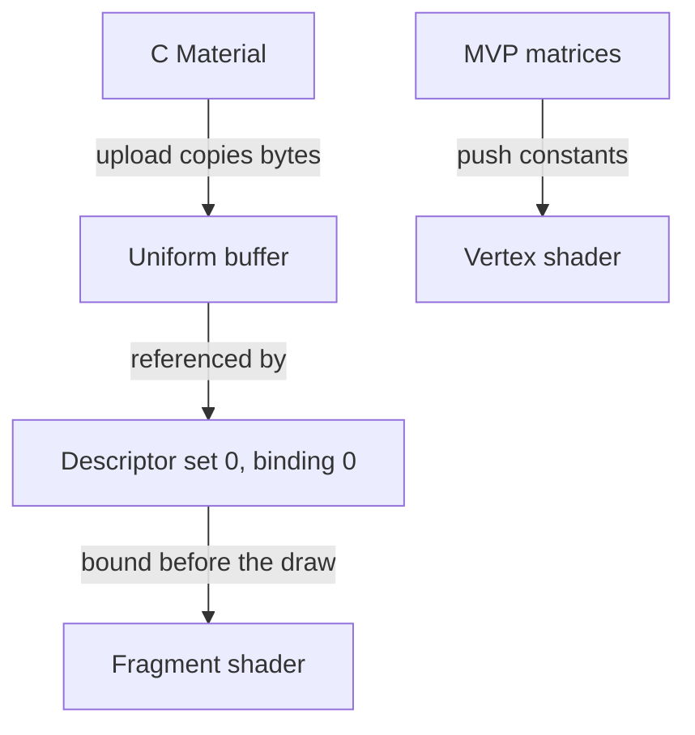

# 12. Uniform buffers and descriptors

*About 576 lines of C; raw Vulkan would need about 1850.*


Push constants have limits. Only 128 bytes are guaranteed, they are copied into every command buffer that uses them, and they can never carry an image. Real renderers also need one copy of data that many draws share without re-recording it, and textures that shaders sample. Both go through **descriptors**. This chapter's material tint would fit in a push constant; the point is to learn the route that textures (chapter 14) and lighting (chapter 15) need. The result: the cube turns clearly warm.

## From a C value to a shader input

A **uniform buffer** is a buffer whose bytes a shader reads as a block of read-only parameters. A push constant copies its value into the commands; a uniform buffer is referenced instead. The buffer must therefore stay alive until every submitted draw that reads it has finished.

A descriptor is a typed reference from a shader declaration to a resource, here a buffer range. Three ideas organize descriptors:

- A **descriptor set layout** declares the type and visible shader stages of each entry.
- A **descriptor set** is one filled-in instance of that layout.
- Each entry has a number, its **descriptor binding**. It is not chapter 6's vertex binding.

Think of the layout as a function signature, the set as the bound arguments, and binding the set in a command buffer as the call.

C and GLSL must agree on the set number, the binding number, and the descriptor type, and the C stage flags must include the stage that reads it. `DvzSlots`, the pipeline-layout wrapper from chapter 4, holds both the descriptor set layout and the push-constant range.



## Define an aligned material

Add this structure after `Push`:

```c
typedef struct
{
    float tint[4];
} Material;

_Static_assert(sizeof(Material) == 16, "the material block must match four shader floats");
```

GLSL uniform blocks use the `std140` layout rules, which can demand more alignment than C. A `vec4` takes one 16-byte unit, the same as four C floats, and the assertion catches accidental changes. Starting with a `vec4` also avoids the padding surprise of a lone `vec3`, which `std140` aligns like a `vec4`.

Add the allocator beside `device`, then the buffer and descriptor fields beside the existing buffers in `Renderer`:

```c
    DvzVma* allocator;
```

```c
    DvzBuffer* material_buffer;
    DvzDescriptors* descriptors;
```

Save the borrowed allocator after assigning `renderer.device`:

```c
    renderer.allocator = dvz_gpu_ctx_alloc(gpu);
```

## Create and upload the buffer

Add this helper before `keyboard()`:

```c
static int create_material(Renderer* renderer)
{
    Material material = {.tint = {1.0f, 0.55f, 0.25f, 1.0f}};
    renderer->material_buffer = dvz_buffer_create_wrapper();
    if (renderer->material_buffer == NULL)
        return -1;
    dvz_buffer(renderer->device, renderer->allocator, renderer->material_buffer);
    dvz_buffer_size(renderer->material_buffer, sizeof(Material));
    dvz_buffer_usage(renderer->material_buffer, VK_BUFFER_USAGE_UNIFORM_BUFFER_BIT);
    dvz_buffer_flags(
        renderer->material_buffer, DVZ_ALLOC_MAPPED | DVZ_ALLOC_HOST_ACCESS_SEQUENTIAL_WRITE);
    if (dvz_buffer_create(renderer->material_buffer) != 0)
        return -1;
    dvz_buffer_upload(renderer->material_buffer, 0, sizeof(material), &material);
    return 0;
}
```

The material is uploaded once, before any draw, so one buffer is safe for every frame. Rewriting it every frame would be different: the CPU could change bytes an earlier frame is still reading. That needs one buffer region per frame slot, dynamic offsets, or a wait. A mapped pointer gives access, not synchronization.

`create_pipeline()` will point the descriptor at `renderer.material_buffer`, so the buffer must exist first. Call the helper just before pipeline creation:

```c
    int material_result = create_material(&renderer);
    COURSE_CHECK(material_result == 0, "material buffer creation failed");
    int pipeline_result = create_pipeline(&renderer);
    COURSE_CHECK(pipeline_result == 0, "graphics pipeline creation failed");
```

## Declare and populate the descriptor

In `create_pipeline()`, declare set 0, descriptor binding 0, as one uniform buffer visible to the fragment stage. Keep the vertex-stage push range beside it:

```c
    dvz_slots_binding(
        renderer->slots, 0, 0, 1, VK_SHADER_STAGE_FRAGMENT_BIT,
        VK_DESCRIPTOR_TYPE_UNIFORM_BUFFER);
    dvz_slots_push(renderer->slots, VK_SHADER_STAGE_VERTEX_BIT, 0, sizeof(Push));
```

A descriptor set is allocated from a layout, so it comes after pipeline creation. Allocate one and point descriptor binding 0 at the whole material buffer:

```c
    if (dvz_graphics_create(renderer->pipeline) != 0)
        return -1;
    renderer->descriptors = dvz_descriptors_create_wrapper();
    if (renderer->descriptors == NULL)
        return -1;
    dvz_descriptors(renderer->slots, renderer->descriptors);
    dvz_descriptors_buffer(
        renderer->descriptors, 0, 0, 0, dvz_buffer_handle(renderer->material_buffer), 0,
        sizeof(Material));
    return dvz_descriptors_handle(renderer->descriptors, 0) != VK_NULL_HANDLE ? 0 : -1;
```

The descriptor stores a reference to the buffer range; it does not copy `Material`. The draw needs the set bound before it, so in `draw()` bind it after the viewport and before the push:

```c
    dvz_cmd_bind_descriptors(
        renderer->commands, VK_PIPELINE_BIND_POINT_GRAPHICS, renderer->descriptors, 0, 1, 0, NULL);
```

Replace `shader.frag` with:

```glsl
#version 450

layout(set = 0, binding = 0) uniform Material { vec4 tint; } material;
layout(location = 0) in vec3 color;
layout(location = 0) out vec4 out_color;

void main()
{
    out_color = vec4(color, 1.0) * material.tint;
}
```

Every fragment reads the same tint. Multiplying keeps red and cuts green and blue, so the cube turns orange while its vertex colors still show. `shader.vert` is unchanged.

## Preserve ownership during reload

Who owns what now:

| Object | Owner | Lives until |
| --- | --- | --- |
| local `material` | `create_material()` | `dvz_buffer_upload()` returns |
| `material_buffer` | `Renderer` | teardown, after the device wait |
| `descriptors` | the current pipeline group | that pipeline is destroyed or replaced |
| pipeline, slots, shaders | the current pipeline group | reload or teardown |

The descriptor set belongs with its layout, so `destroy_pipeline()` must release it first. Add at its beginning:

```c
    dvz_descriptors_free(renderer->descriptors);
    renderer->descriptors = NULL;
```

A reload candidate borrows the material buffer but builds its own descriptor set:

```c
            Renderer candidate = {
                .device = renderer.device,
                .color_format = renderer.color_format,
                .material_buffer = renderer.material_buffer,
            };
```

On success, after the device wait and `destroy_pipeline(&renderer)`, take the candidate's descriptor set along with its other pipeline objects:

```c
                renderer.descriptors = candidate.descriptors;
```

A descriptor must not outlive the buffer it refers to. At `cleanup:`, move `destroy_pipeline(&renderer);` up to right after the device wait, then destroy the material buffer before the geometry buffers:

```c
    destroy_pipeline(&renderer);
    if (renderer.material_buffer != NULL)
        dvz_buffer_destroy(renderer.material_buffer);
    dvz_buffer_free(renderer.material_buffer);
```

## Build and run

Build and run as before; the capture goes to `chapter12.png`.

=== "Linux and macOS"

    ```sh
    cmake --build build
    ./build/vkcourse
    ./build/vkcourse --png chapter12.png
    ```

=== "Windows (Visual Studio)"

    ```powershell
    cmake --build build --config Release
    .\build\Release\vkcourse.exe
    .\build\Release\vkcourse.exe --png chapter12.png
    ```

The cube keeps its shape and controls, now tinted orange. The terminal ends with `validation errors: 0`.

!!! tip "Try it"

    1. Change the tint to `{1.0f, 1.0f, 1.0f, 1.0f}` and rebuild. The cube shows chapter 11's colors again: multiplying by white changes nothing.
    2. In `shader.frag`, change `binding = 0` to `binding = 1` and press **R**. Validation reports that the shader uses set 0 binding 1, which the layout does not declare, at pipeline creation and again at the draw. The pipeline is still created, and drawing with it is undefined behavior: some drivers crash. Restore the line, and restart the program if it exited.
    3. Comment out `dvz_cmd_bind_descriptors()` and rebuild. Validation reports at the draw that the pipeline uses descriptor set 0 but none was bound.

??? info "Under the hood: what the descriptor names"

    Raw Vulkan creates a descriptor set layout, includes it in the pipeline layout, allocates a descriptor set from a descriptor pool, and writes a `VkDescriptorBufferInfo` into it with `vkUpdateDescriptorSets`. The descriptor holds a buffer handle, an offset, and a range, never the material bytes.

!!! warning "When it goes wrong"

    A validation error about set 0 binding 0 means C and GLSL disagree on its number, type, or stage. An unchanged color means the fragment shader still ignores the tint. Garbled values after adding members point to a C/GLSL layout mismatch; keep members `vec4`-sized and check sizes with `_Static_assert`.

## Checkpoint

1. Which operation copies the local `Material` bytes, and which stores only a reference?
2. What is the difference between a descriptor set layout, a descriptor set, and descriptor binding 0?
3. Why can the local `material` variable disappear after upload while `material_buffer` must outlive submitted draws?
4. Why is one upload at startup safe, while rewriting one shared uniform buffer every frame may not be?

??? example "Your `main.c` after chapter 12"

    ```c
    --8<-- "examples/c/vulkan/step12.c"
    ```

??? example "Your `shader.vert` after chapter 12"

    ```glsl
    --8<-- "examples/c/vulkan/step12/shader.vert"
    ```

??? example "Your `shader.frag` after chapter 12"

    ```glsl
    --8<-- "examples/c/vulkan/step12/shader.frag"
    ```

Next: [Uploading a texture](13-texture-upload.md).
