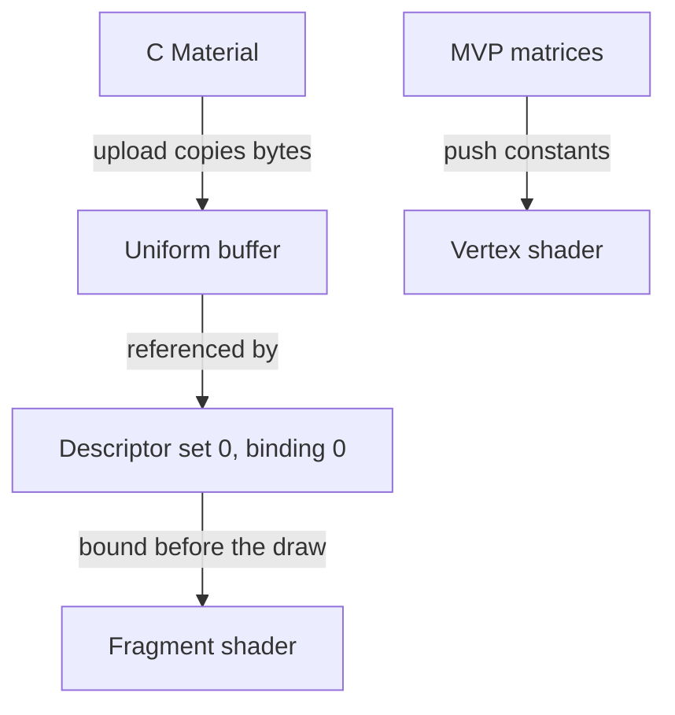

# 12. Uniform buffers and descriptors

*About 720 lines of C; raw Vulkan would need about 1850.*


The cube now turns under the mouse, and its shaders get data in two ways. Vertex attributes give one value per vertex (chapter 6). Push constants give a few bytes per draw, copied into the command buffer (chapter 8).

Some data suits neither route. A texture can be megabytes, and a material or a light is often shared by many draws. Instead of copying such data into every command buffer, we can leave it in GPU memory and let the shader *read it there*. On the route this course uses, a shader finds that kind of resource through a **descriptor**.

This chapter takes the smallest possible example: one color, the material's tint. The fragment shader reads it and multiplies the vertex color by it. A tint would fit in a push constant, but we use it to learn the route, because textures (chapter 14) and lighting (chapter 15) follow the same one. By the end, the cube turns orange.

In this chapter you will:

1. write a fragment shader that reads the tint from a **uniform block**;
2. define a C structure with the same bytes and put it in a **uniform buffer**, a GPU buffer that shaders read;
3. declare, in the pipeline layout, that the fragment shader reads one uniform buffer;
4. create a **descriptor set** that points that declaration at your buffer;
5. bind the descriptor set before the draw.

## Read a tint in the fragment shader

Start with what the shader needs to do. Chapter 11's fragment shader writes the interpolated vertex color. The new one multiplies that color by a tint, and every fragment reads the same tint. Replace `shader.frag` with:

```glsl
#version 450

layout(set = 0, binding = 0) uniform Material { vec4 tint; } material;
layout(location = 0) in vec3 color;
layout(location = 0) out vec4 out_color;

void main()
{
    out_color = vec4(color, 1.0) * material.tint;
}
```

Three declarations matter here:

- `uniform Material { vec4 tint; } material` is a uniform block: read-only data with the same value for every fragment of a draw. The shader reads its member as `material.tint`.
- `layout(set = 0, binding = 0)` names the slot the block comes from. The C side will connect the material buffer to that slot.
- The `location = 0` numbers on `color` and `out_color` are not descriptor slots. As in earlier chapters, they match the vertex shader's output and the color attachment.

The multiplication works per channel. With the orange tint we define in C below, red is kept while green and blue are scaled down, so the cube turns orange and its vertex colors still show. `shader.vert` is unchanged.

Save the file, but don't run the program or press **R** in chapter 11's program yet. This shader reads set 0, binding 0, which the C side only declares and fills later in this chapter. Run it once those changes are done, in [Build and run](#build-and-run).

## Copied or referenced

The shader now reads a tint, so the next question is how the bytes reach it. Push constants are *copied*: the bytes travel inside the command buffer, so you can change them for the next draw without affecting earlier ones. A uniform buffer is *referenced*: the command buffer only says where the bytes are, and the GPU reads them when the draw executes. That makes it cheap for large or shared data, with one consequence: the buffer must stay alive and unchanged until every draw that reads it has finished.

## How a shader finds a buffer

On this route, the shader does not hold a pointer to your buffer. It declares a numbered slot instead, `layout(set = 0, binding = 0)` in `shader.frag`, and Vulkan connects that slot to a resource. Three pieces make this work:

- A **descriptor set layout** describes the slots: binding 0 is one uniform buffer, read by the fragment stage. It becomes part of the pipeline layout, so it is fixed when the pipeline is created.
- A **descriptor set** fills those slots with real resources: binding 0 is this buffer, from this offset, for this many bytes.
- Binding the set in the command buffer selects which filled-in set the following draws use.

A function call is a good analogy: the layout is the function signature, the descriptor set holds the arguments, and binding it before the draw is the call. You can create many sets from one layout, for example one per material, and switch between them with one command.

The numbers are an agreement between C and GLSL. Both must use the same set, binding and descriptor type, and the C side must make the slot visible to the stage that reads it. This **descriptor binding** is unrelated to chapter 6's vertex binding; Vulkan reuses the word.

Figure 1 puts the two routes side by side. The material bytes are copied once into the buffer, and the descriptor set refers to that buffer. The matrix still travels as a push constant, copied into each frame's commands.

<figure class="dvz-course-figure" id="fig-material-route" markdown="1">



<figcaption>Figure 1. The fragment shader reads the material through a descriptor that refers to a buffer; the vertex shader still receives the matrix as a copied push constant.</figcaption>

</figure>

The rest of the chapter builds this route in `main.c`, in program order: define the material, create its buffer, declare the slot, fill and bind the descriptor set, then handle ownership during reload and shutdown.

## Define the material

The shader reads one `vec4`, 16 bytes. On the C side, define a structure with the same bytes. Add it after `Push`:

```c
// The uniform block the fragment shader reads: one vec4 tint, laid out by std140.
typedef struct
{
    float tint[4];
} Material;

_Static_assert(sizeof(Material) == 16, "the material block must match four shader floats");
```

The GPU reads the buffer's bytes with the shader's layout rules, not C's. `shader.frag` gives its block no explicit layout, so it gets `std140`, the default for uniform blocks in Vulkan GLSL. Devices with the right features accept other uniform layouts, but this chapter uses `std140`. Its rules can place members further apart than a C compiler would. For example, `std140` aligns a `vec3` to 16 bytes, while a C compiler typically aligns `float[3]` to 4. A block that mixes `vec3` with other members can therefore need explicit padding, or a deliberate member order on the C side, to match.

We use a `vec4` tint because it is the easy case. It holds red, green, blue and alpha, and in `std140` it is 16 bytes with no padding: exactly four C floats. The assertion stops the build if the structure's size ever stops matching.

The renderer needs three new fields. Creating a buffer takes the GPU memory allocator, which the GPU context owns and you only borrow. Add it after `color_format`:

```c
    DvzVma* allocator;
```

Then, in `Renderer`, add the material buffer after the existing buffers, and a descriptor field after it:

```c
    // Buffers that live for the whole program.
    DvzBuffer* vertex_buffer;
    DvzBuffer* index_buffer;
    DvzBuffer* material_buffer;

    // Built from the pipeline layout, so it belongs to the pipeline group.
    DvzDescriptors* descriptors;
```

The two comments state the ownership rule this chapter relies on. The material buffer lives as long as the program; the descriptor set is rebuilt with each pipeline.

In `main()`, save the allocator next to the device:

```c
    // Both are borrowed from the GPU context, which owns them until teardown.
    renderer.device = dvz_gpu_ctx_device(gpu);
    renderer.allocator = dvz_gpu_ctx_alloc(gpu);
```

## Create and upload the buffer

The new helper, `create_material()`, creates a 16-byte uniform buffer and copies the tint into it. Add it before `keyboard()`. It has four steps:

1. fill a local `Material`;
2. allocate the buffer wrapper;
3. configure and create the buffer;
4. upload the tint.

The function begins with the local value and the wrapper:

```c
static int create_material(Renderer* renderer)
{
    // A local value: the upload copies its bytes, so it may go out of scope afterwards.
    Material material = {.tint = {1.0f, 0.55f, 0.25f, 1.0f}};

    // Allocate the wrapper. The renderer owns it, even if a later step fails.
    renderer->material_buffer = dvz_buffer_create_wrapper();
    if (renderer->material_buffer == NULL)
        return -1;
```

The renderer owns the wrapper as soon as it is stored in `renderer->material_buffer`. If a later step fails, the function returns −1, `main()` jumps to cleanup, and cleanup releases whatever exists.

Next, configure and create the buffer:

```c
    // A 16-byte uniform buffer in memory the CPU can write directly.
    dvz_buffer(renderer->device, renderer->allocator, renderer->material_buffer);
    dvz_buffer_size(renderer->material_buffer, sizeof(Material));
    dvz_buffer_usage(renderer->material_buffer, VK_BUFFER_USAGE_UNIFORM_BUFFER_BIT);
    dvz_buffer_flags(
        renderer->material_buffer, DVZ_ALLOC_MAPPED | DVZ_ALLOC_HOST_ACCESS_SEQUENTIAL_WRITE);
    if (dvz_buffer_create(renderer->material_buffer) != 0)
        return -1;
```

The pattern is chapter 6's vertex buffer with a different usage flag. The same flags ask for memory the CPU can write directly, which suits small data.

Finally, upload the tint:

```c
    // Copy the tint once, before any frame draws. Nothing rewrites it afterwards.
    dvz_buffer_upload(renderer->material_buffer, 0, sizeof(material), &material);
    return 0;
}
```

Once `dvz_buffer_upload()` returns, the bytes are in the buffer and the local `material` can go. The upload happens once, before any draw, so one buffer is safe for every frame. Rewriting it every frame would not be safe: the CPU could change bytes that an earlier frame, still in flight (chapter 3), is reading. Renderers handle that with one buffer region per frame slot, or by waiting. Writing through a mapped pointer gives the CPU access to the memory; it does not synchronize with the GPU.

The descriptor will point at this buffer, so the buffer must exist before the pipeline. Call the helper just before pipeline creation:

```c
    // The descriptor set names the material buffer, so create the buffer before the pipeline.
    int material_result = create_material(&renderer);
    COURSE_CHECK(material_result == 0, "material buffer creation failed");
    int pipeline_result = create_pipeline(&renderer);
    COURSE_CHECK(pipeline_result == 0, "graphics pipeline creation failed");
```

## Declare the slot in the pipeline layout

The descriptor set layout plays the role of the function signature. Since chapter 8, the pipeline layout, `DvzSlots`, has held one entry: the push-constant range. In `create_pipeline()`, add the uniform buffer slot before it:

```c
    // The pipeline layout: a fragment-stage uniform buffer slot and the vertex push range.
    dvz_slots(renderer->device, renderer->slots);
    dvz_slots_binding(
        renderer->slots, 0, 0, 1, VK_SHADER_STAGE_FRAGMENT_BIT,
        VK_DESCRIPTOR_TYPE_UNIFORM_BUFFER);
    dvz_slots_push(renderer->slots, VK_SHADER_STAGE_VERTEX_BIT, 0, sizeof(Push));
```

Read the new call as: in set 0, binding 0, there is 1 descriptor, visible to the fragment shader, and it is a uniform buffer. These are the numbers `shader.frag` declares.

## Fill the descriptor set

The descriptor set holds the arguments. It is allocated from the layout, so this code goes at the end of `create_pipeline()`, once the pipeline exists. The final `dvz_graphics_create()` call no longer returns directly; check it, then fill the set:

```c
    // Create the Vulkan pipeline object from everything above.
    if (dvz_graphics_create(renderer->pipeline) != 0)
        return -1;

    // Allocate a descriptor set from the layout and point set 0, binding 0 at the material.
    renderer->descriptors = dvz_descriptors_create_wrapper();
    if (renderer->descriptors == NULL)
        return -1;
    dvz_descriptors(renderer->slots, renderer->descriptors);
    dvz_descriptors_buffer(
        renderer->descriptors, 0, 0, 0, dvz_buffer_handle(renderer->material_buffer), 0,
        sizeof(Material));
    return dvz_descriptors_handle(renderer->descriptors, 0) != VK_NULL_HANDLE ? 0 : -1;
```

`dvz_descriptors()` allocates descriptor sets that match the slots. `dvz_descriptors_buffer()` fills one entry: set 0, binding 0, array element 0 is this buffer, from offset 0, for `sizeof(Material)` bytes. Nothing is copied. The descriptor records where the bytes are; the bytes stay in the buffer. The last line returns 0 only if set 0 was actually allocated.

As with the other pipeline objects, `renderer` owns the descriptor set as soon as its wrapper is stored, even if the final check fails. `create_pipeline()` reads `renderer->material_buffer` but never owns or destroys it.

Descriptor sets are the other exception to chapter 4's lifecycle. `dvz_descriptors()` allocates them at once from a pool the device owns, and `dvz_descriptors_free()` returns them to that pool and frees the wrapper. There is no separate create or destroy step.

## Bind it and read it

A filled descriptor set is not used until a command binds it. In `draw()`, after the viewport and before the push, add:

```c
    // Following draws read set 0, which refers to the material buffer, not a copy of it.
    dvz_cmd_bind_descriptors(
        renderer->commands, VK_PIPELINE_BIND_POINT_GRAPHICS, renderer->descriptors, 0, 1, 0, NULL);
```

This binds 1 set, starting at set 0, for graphics draws. The last two arguments are dynamic offsets, which this course does not use. Like the push, the binding applies to the draws recorded after it.

This completes the route. When those draws run, the fragment shader you wrote at the start reads `material.tint` through set 0, binding 0, which now refers to the 16 bytes in the material buffer.

## Keep ownership clear during reload and shutdown

Since chapter 5, pressing **R** rebuilds the pipeline from the shader files. The descriptor set is built from the pipeline's layout, so it belongs to the pipeline and is rebuilt with it. The material buffer lives for the whole program and is never rebuilt. The table sums up who owns what:

| Object | Owner | Lives until |
| --- | --- | --- |
| local `material` | `create_material()` | `dvz_buffer_upload()` returns |
| `material_buffer` | `Renderer` | teardown, after the device wait |
| `descriptors` | the current pipeline group | that pipeline is destroyed or replaced |
| pipeline, slots, shaders | the current pipeline group | reload or teardown |

Four places in the program apply these rules, in this order: releasing a pipeline group, building a reload candidate, taking over a successful candidate, and shutting down.

### Release the descriptor set with its pipeline

Because the descriptor set belongs to the pipeline group, `destroy_pipeline()` releases it too. Add at the beginning of `destroy_pipeline()`:

```c
    // Return the descriptor set to the device's pool and free its wrapper.
    dvz_descriptors_free(renderer->descriptors);
    renderer->descriptors = NULL;
```

`dvz_descriptors_free()` accepts `NULL`, so this works for a candidate that failed before allocating its set.

### Let the candidate borrow the material

A reload candidate needs the material buffer to fill its own descriptor set, but it must not take ownership. Give it a borrowed pointer:

```c
            // The candidate borrows the material buffer; it never owns or destroys it.
            Renderer candidate = {
                .device = renderer.device,
                .color_format = renderer.color_format,
                .material_buffer = renderer.material_buffer,
            };
```

`create_pipeline(&candidate)` then builds a new layout and a new descriptor set that points at the same buffer. If it fails, `destroy_pipeline(&candidate)` releases the candidate's descriptor set and pipeline objects. It never touches `material_buffer`, so the current pipeline keeps drawing with the same material.

### Take over the new descriptor set

On success, the renderer takes the candidate's descriptor set along with its other pipeline objects:

```c
                // Wait until no submitted frame uses the old pipeline, then take the new one,
                // including its descriptor set.
                dvz_device_wait(renderer.device);
                destroy_pipeline(&renderer);
                renderer.descriptors = candidate.descriptors;
                renderer.slots = candidate.slots;
```

The device wait comes first because frames already submitted may still read the old descriptor set. Then `destroy_pipeline(&renderer)` frees the old set, and the renderer takes ownership of the new one. The material buffer stays where it was, owned by the renderer throughout.

### Shut down in reference order

At shutdown, order matters. The simplest safe order is to release whatever refers to an object before the object itself: here, the descriptor set before the material buffer it names. At `cleanup:`, move `destroy_pipeline(&renderer);` up to right after the device wait, then destroy the material buffer before the geometry buffers:

```c
    // Release what refers to an object before the object: the pipeline group, including the
    // descriptor set, before the material buffer it names.
    destroy_pipeline(&renderer);
    if (renderer.material_buffer != NULL)
        dvz_buffer_destroy(renderer.material_buffer);
    dvz_buffer_free(renderer.material_buffer);
```

## Build and run

Build and run as before; the capture goes to `chapter12.png`.

=== "Linux"

    ```sh
    cmake --build build
    ./build/vkcourse
    ./build/vkcourse --png chapter12.png
    ```

=== "macOS"

    ```sh
    cmake --build build
    ./build/vkcourse
    ./build/vkcourse --png chapter12.png
    ```

=== "Windows"

    In a Developer PowerShell for Visual Studio, with the `PATH` setup from chapter 1:

    ```powershell
    cmake --build build --config Release
    .\build\Release\vkcourse.exe
    .\build\Release\vkcourse.exe --png chapter12.png
    ```

The cube keeps its shape and controls, now tinted orange. The terminal ends with `validation errors: 0`.

??? tip "Try it"

    1. Change the tint to `{1.0f, 1.0f, 1.0f, 1.0f}` and rebuild. The cube shows chapter 11's colors again: multiplying by white changes nothing.
    2. In `shader.frag`, change `binding = 0` to `binding = 1` and press **R**. Validation reports that the shader uses set 0 binding 1, which the layout does not declare. Pipeline creation may still succeed; drawing with that pipeline is undefined behavior, and some drivers crash. Restore the line, and restart the program if it exited.
    3. Comment out `dvz_cmd_bind_descriptors()` and rebuild. Validation reports at the draw that the pipeline uses descriptor set 0 but none was bound.

??? info "Under the hood: what the descriptor names"

    Raw Vulkan creates a descriptor set layout, includes it in the pipeline layout, allocates a descriptor set from a descriptor pool, and writes a `VkDescriptorBufferInfo` into it with `vkUpdateDescriptorSets`. The descriptor holds a buffer handle, an offset, and a range, never the material bytes.

    **Uniform or storage buffer.** Vulkan has another buffer descriptor type, the **storage buffer**. A uniform buffer is a read-only range of structured data, which suits a small, fixed-layout structure like this material. A storage buffer allows broader access: its range limit is usually far larger, it can end in an array whose length is known only at run time, and shaders can write to it, on devices that support writes from that shader stage. No single size rule decides between them. The choice depends on how shaders access the data, how much there is, how often it changes, who shares it, and the device's limits. This course needs only a uniform buffer.

??? warning "When it goes wrong"

    A validation error about set 0 binding 0 means C and GLSL disagree on its number, type, or stage. An unchanged color means the fragment shader still ignores the tint. Garbled values after adding members point to a C/GLSL layout mismatch; keep members `vec4`-sized and check sizes with `_Static_assert`.

## What carries over

- Every modern GPU API separates *declaring* the resources a shader uses from *supplying* them. Vulkan has descriptor set layouts and sets; WebGPU has bind group layouts and bind groups.
- Copied data, like push constants, is easy to change between draws. Referenced data, like buffers and images, is cheap to share but must stay valid while the GPU may read it.
- Bytes cross from C to GLSL under the shader's layout rules, so match them explicitly and assert the sizes.

## Checkpoint

1. Which operation copies the local `Material` bytes, and which stores only a reference?
2. What is the difference between a descriptor set layout, a descriptor set, and descriptor binding 0?
3. Why can the local `material` variable disappear after upload while `material_buffer` must outlive submitted draws?
4. Why is one upload at startup safe, while rewriting one shared uniform buffer every frame may not be?

??? example "Your `main.c` after chapter 12"

    ```c
    --8<-- "examples/c/vulkan/step12.c"
    ```

??? example "Your `shader.vert` after chapter 12"

    ```glsl
    --8<-- "examples/c/vulkan/step12/shader.vert"
    ```

??? example "Your `shader.frag` after chapter 12"

    ```glsl
    --8<-- "examples/c/vulkan/step12/shader.frag"
    ```

Next: [Uploading a texture](13-texture-upload.md).
