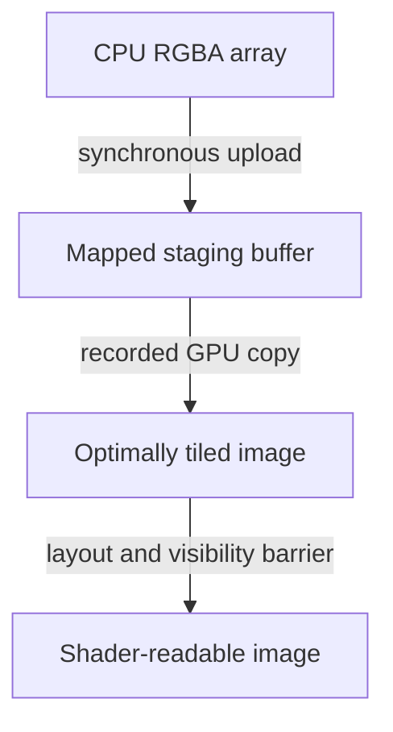

# 13. Uploading a texture

*About 770 lines of C; raw Vulkan would need about 1960.*


The cube turns under the mouse, and its fragment shader reads a tint from a uniform buffer through a descriptor (chapter 12). Every color change across the cube still comes from its vertices: each corner has a value, and the rasterizer blends it across the triangle. A surface cannot show more detail than its corners.

Real surfaces have much finer detail than their geometry: wood grain, printed text, a photograph. Renderers get that detail from a **texture**, an image laid over the surface. Three things are needed: each vertex must say which point of the image it covers, the image must be in GPU memory, and the fragment shader must read it. This chapter does the first two. Chapter 14 does the third.

The upload is the most explicit Vulkan code in the course, so we keep it separate from sampling and check each half on its own. At the end, each face shows its image coordinates as a color gradient, and a checkerboard sits in GPU memory. You will not see the checkerboard yet, because no descriptor points at it and no shader reads it. For now, zero validation errors mean the validation layer reported no API or synchronization problems during the upload. They cannot tell you whether the image holds the pixels you meant; chapter 14 checks that when the checkerboard appears on the cube.

In this chapter you will:

1. give each face its own texture coordinates, and show them as colors;
2. create a GPU **image** to hold a checkerboard;
3. fill it through a **staging buffer** and a copy command;
4. use **barriers** to prepare the image for the copy, then for shader reads.

## Pin an image to a face

To lay an image over a face, each vertex says which point of the image it covers. These are **UV coordinates**, or texture coordinates: `u` runs across the image and `v` down it, both from 0 to 1 whatever the image's size. A vertex at UV `(0.5, 0.5)` covers the middle of the image. Between vertices, the rasterizer interpolates UVs as it interpolated colors, with perspective correction, so every fragment knows which point of the image lies under it.

A UV is one more vertex attribute, next to the position. That causes a problem at the cube's eight shared corners. An index selects a whole vertex, UV included (chapter 7), and each corner belongs to three faces that want a different UV there. So we split the corners: four vertices per face, 24 in total, still drawn as the same 12 triangles.

Before any texture exists, we can check the UVs by drawing them as colors: `u` as red and `v` as green. The next section makes that change in five places:

1. the vertex record;
2. the vertex and index arrays;
3. the pipeline's vertex attribute;
4. the vertex shader, which passes the UV on;
5. the fragment shader and the tint, which turn it into a color.

## Give each face its own UVs

### Replace the vertex record

The UVs replace the vertex colors. Replace `Vertex` with:

```c
// One vertex record: a position and the UV coordinates that pin it to a point of the image.
typedef struct
{
    float position[3];
    float uv[2];
} Vertex;
```

### Split the corners into 24 vertices

Replace `VERTICES` and `INDICES`. Each face runs `(0, 0)`, `(1, 0)`, `(1, 1)`, `(0, 1)` and keeps chapter 9's outward winding, which chapter 10's culling depends on:

```c
// Four vertices per face, each with its own UVs: 24 vertices for the cube's 8 corners.
static const Vertex VERTICES[24] = {
    // Back face.
    {{0.65f, -0.65f, -0.65f}, {0.0f, 0.0f}},
    {{-0.65f, -0.65f, -0.65f}, {1.0f, 0.0f}},
    {{-0.65f, 0.65f, -0.65f}, {1.0f, 1.0f}},
    {{0.65f, 0.65f, -0.65f}, {0.0f, 1.0f}},
    // Front face.
    {{-0.65f, -0.65f, 0.65f}, {0.0f, 0.0f}},
    {{0.65f, -0.65f, 0.65f}, {1.0f, 0.0f}},
    {{0.65f, 0.65f, 0.65f}, {1.0f, 1.0f}},
    {{-0.65f, 0.65f, 0.65f}, {0.0f, 1.0f}},
    // Bottom face.
    {{-0.65f, -0.65f, -0.65f}, {0.0f, 0.0f}},
    {{0.65f, -0.65f, -0.65f}, {1.0f, 0.0f}},
    {{0.65f, -0.65f, 0.65f}, {1.0f, 1.0f}},
    {{-0.65f, -0.65f, 0.65f}, {0.0f, 1.0f}},
    // Top face.
    {{-0.65f, 0.65f, -0.65f}, {0.0f, 0.0f}},
    {{-0.65f, 0.65f, 0.65f}, {1.0f, 0.0f}},
    {{0.65f, 0.65f, 0.65f}, {1.0f, 1.0f}},
    {{0.65f, 0.65f, -0.65f}, {0.0f, 1.0f}},
    // Right face.
    {{0.65f, -0.65f, 0.65f}, {0.0f, 0.0f}},
    {{0.65f, -0.65f, -0.65f}, {1.0f, 0.0f}},
    {{0.65f, 0.65f, -0.65f}, {1.0f, 1.0f}},
    {{0.65f, 0.65f, 0.65f}, {0.0f, 1.0f}},
    // Left face.
    {{-0.65f, -0.65f, -0.65f}, {0.0f, 0.0f}},
    {{-0.65f, -0.65f, 0.65f}, {1.0f, 0.0f}},
    {{-0.65f, 0.65f, 0.65f}, {1.0f, 1.0f}},
    {{-0.65f, 0.65f, -0.65f}, {0.0f, 1.0f}},
};

// Each face winds counter-clockwise when seen from outside the cube.
static const uint16_t INDICES[36] = {
    0,  1,  2,  0,  2,  3,  4,  5,  6,  4,  6,  7,  8,  9,  10, 8,  10, 11,
    12, 13, 14, 12, 14, 15, 16, 17, 18, 16, 18, 19, 20, 21, 22, 20, 22, 23,
};
```

Every face uses the same pattern: four vertices, then two triangles, `0, 1, 2` and `0, 2, 3`, offset by four for each face. The buffer sizes come from `sizeof`, and the draw already uses 36 indices, so neither needs editing.

### Read the UV in the pipeline

The pipeline must now read two floats at the UV's offset instead of three color floats. In `create_pipeline()`, replace the color attribute with the UV attribute:

```c
    dvz_graphics_vertex_attr(
        renderer->pipeline, 0, 1, VK_FORMAT_R32G32_SFLOAT, offsetof(Vertex, uv));
```

Read it as: from vertex binding 0, location 1 is two 32-bit floats, found at the `uv` offset of each record. The topology stays a triangle list.

### Pass the UV through the vertex shader

The vertex shader receives the UV at location 1 and passes it to the fragment shader unchanged. Replace `shader.vert` with:

```glsl
#version 450

layout(push_constant) uniform Push { mat4 mvp; } push_data;
layout(location = 0) in vec3 in_position;
layout(location = 1) in vec2 in_uv;
layout(location = 0) out vec2 uv;

void main()
{
    gl_Position = push_data.mvp * vec4(in_position, 1.0);

    // Pass the UV through unchanged; the rasterizer interpolates it for each fragment.
    uv = in_uv;
}
```

### Show the UV as a diagnostic color

The fragment shader turns the interpolated UV into a color. Replace `shader.frag` with:

```glsl
#version 450

layout(set = 0, binding = 0) uniform Material { vec4 tint; } material;
layout(location = 0) in vec2 uv;
layout(location = 0) out vec4 out_color;

void main()
{
    // Diagnostic colors: u as red, v as green, so each face shows its UV gradient.
    out_color = vec4(uv, 0.0, 1.0) * material.tint;
}
```

With `u` as red and `v` as green, each face runs from black at `(0, 0)` through red and yellow to green. The colors break at the cube's edges because each face has its own corners.

Chapter 12's orange tint would distort that gradient. Set the tint to white in `create_material()` so the gradient keeps its colors:

```c
    Material material = {.tint = {1.0f, 1.0f, 1.0f, 1.0f}};
```

## Why an image is not a buffer

The second half of the chapter puts an image on the GPU. You already know one way to put bytes there: a buffer (chapter 6). So why not store the pixels in a buffer?

A buffer is a linear range of bytes, and only the shader decides what they mean. An **image** is memory that the GPU itself understands as pixels. It has a width and height, a **texel format** (a texel is one pixel of a texture; here, four 8-bit channels per texel), and a **tiling**, the order in which texels sit in memory. Because the GPU knows this, its texture hardware can filter between neighboring texels and handle coordinates outside the image, as chapter 14 shows.

The tiling causes a problem. Row by row is a poor order for a GPU, because a triangle reads texels that are close in 2D, not along one row. GPUs therefore use **optimal tiling**, a private order chosen by the driver that keeps 2D neighbors close in memory. vklite images use it by default, so your texture does too (`dvz_images_tiling()` can change that). Because the order is private, the CPU cannot write pixels into the image directly.

The solution is a **staging buffer**: a temporary buffer the CPU can write, filled with plain rows of pixels. A copy command, run by the GPU, reads those rows and stores them in the image's private order. Once the copy has finished, the staging buffer can be destroyed.

Figure 1 shows the route the pixels take. The first step is a CPU copy that finishes before `dvz_buffer_upload()` returns. The second step is a GPU command that runs only after submission. The barrier at the end makes the copied pixels readable by shaders, as the next section explains.

<figure class="dvz-course-figure" id="fig-texture-upload-route" markdown="1">



<figcaption>Figure 1. The pixels go from a CPU array to a staging buffer, then through a GPU copy and a barrier into a shader-readable image.</figcaption>

</figure>

## Layouts and barriers

Two more ideas complete the upload. Both exist because Vulkan makes you state how the GPU will use an image next.

### Image layouts

An image's memory can be arranged differently for different jobs. An **image layout** names one arrangement: `TRANSFER_DST_OPTIMAL` suits receiving a copy, and `SHADER_READ_ONLY_OPTIMAL` suits sampling. A new image starts in `UNDEFINED`, which means its contents are meaningless. Each kind of use expects a particular layout, so before you use the image in a new way, you change its layout.

### Barriers

The GPU does not wait for one command to finish before starting the next. It overlaps work, so without an ordering rule, a later fragment shader could read the image while the copy is still writing it. A **barrier** is that rule. The steps of GPU work, such as the copy, the vertex shader and the fragment shader, are called **pipeline stages**. A barrier names stages and the memory accesses they make. It sits between two commands, names the work before it and the work after it, and does three things:

1. waits for the listed earlier stages to finish;
2. makes their memory writes visible to the later accesses;
3. changes the image layout.

The upload needs two barriers:

| Barrier | Before | After | Layout change |
| --- | --- | --- | --- |
| before the copy | nothing | copy writes | `UNDEFINED` to `TRANSFER_DST_OPTIMAL` |
| after the copy | copy writes | fragment shader reads | `TRANSFER_DST_OPTIMAL` to `SHADER_READ_ONLY_OPTIMAL` |

The first starts from `UNDEFINED` because the image has no old pixels worth keeping. The second makes every fragment shader that samples the image wait for the copy. The `VK_PIPELINE_STAGE_2_*` and `VK_ACCESS_2_*` names come from the synchronization2 feature the canvas enabled in chapter 2.

## Upload the checkerboard

The upload is one helper, `create_texture()`, built here in the order it runs:

1. make the pixels on the CPU;
2. allocate the wrappers and fill the staging buffer;
3. create the image;
4. start a command buffer the helper owns;
5. record the first barrier;
6. record the copy;
7. record the second barrier;
8. submit and wait;
9. release the staging buffer and the command buffer.

First, two declarations. The checkerboard is 64 × 64 texels. Add this constant beside `WIDTH` and `HEIGHT`:

```c
#define TEXTURE_SIZE 64
```

Add the image beside the buffers in `Renderer`. The renderer owns the image. The allocator from chapter 12 stays borrowed.

```c
    DvzImages* texture;
```

### 1. Make the pixels

Add the helper between `keyboard()` and `draw()`. It starts by filling a CPU array with 64 × 64 RGBA texels in eight-texel tiles, four bytes per texel. The first tile, at row 0 and column 0, is white. A plain checkerboard looks the same flipped or rotated, so this marker shows in chapter 14 which way the image lands.

```c
/**
 * Upload a small checkerboard into a device-local image.
 * @param renderer Renderer that owns the image.
 * @return Zero on success.
 */
static int create_texture(Renderer* renderer)
{
    // CPU pixels: a checkerboard of 8-texel tiles, four bytes (RGBA) per texel.
    uint8_t pixels[TEXTURE_SIZE * TEXTURE_SIZE * 4];
    for (uint32_t y = 0; y < TEXTURE_SIZE; y++)
    {
        for (uint32_t x = 0; x < TEXTURE_SIZE; x++)
        {
            // The first tile is white so the image's orientation stays visible on the cube.
            bool marker = x < 8 && y < 8;
            bool check = ((x / 8 + y / 8) & 1) != 0;
            size_t i = ((size_t)y * TEXTURE_SIZE + x) * 4;
            pixels[i + 0] = marker ? 245 : check ? 235 : 35;
            pixels[i + 1] = marker ? 245 : check ? 170 : 80;
            pixels[i + 2] = marker ? 245 : check ? 55 : 190;
            pixels[i + 3] = 255;
        }
    }
```

The array is a local variable, 16 KiB, and lives on the stack until the helper returns.

### 2. Allocate the wrappers and fill the staging buffer

Next, allocate three wrappers. The staging buffer and the upload commands are local to the helper, which must release them on every path. The image goes straight into the renderer, so `main()`'s cleanup releases it even if a later step fails.

```c
    // The staging buffer and upload commands are local; the renderer owns the image.
    DvzBuffer* staging = dvz_buffer_create_wrapper();
    DvzCommands* upload = dvz_commands_create_wrapper();
    renderer->texture = dvz_images_create_wrapper();
    if (staging == NULL || upload == NULL || renderer->texture == NULL)
        goto error;
```

The helper cannot use `COURSE_CHECK`, so it jumps to its own `error:` label, shown in step 9.

The staging buffer is chapter 6's buffer pattern with a new usage flag: `VK_BUFFER_USAGE_TRANSFER_SRC_BIT` says it will be the source of a copy. The same mapped flags let `dvz_buffer_upload()` copy the CPU `pixels` into it directly.

```c
    // Staging buffer: a mapped copy source. The upload copies the CPU pixels into it now.
    dvz_buffer(renderer->device, renderer->allocator, staging);
    dvz_buffer_size(staging, sizeof(pixels));
    dvz_buffer_usage(staging, VK_BUFFER_USAGE_TRANSFER_SRC_BIT);
    dvz_buffer_flags(staging, DVZ_ALLOC_MAPPED | DVZ_ALLOC_HOST_ACCESS_SEQUENTIAL_WRITE);
    if (dvz_buffer_create(staging) != 0)
        goto error;
    dvz_buffer_upload(staging, 0, sizeof(pixels), pixels);
```

When `dvz_buffer_upload()` returns, the bytes are in the staging buffer. From here on, the GPU copy reads the staging buffer, not `pixels`.

### 3. Create the image

The image is set up like a buffer: describe it, then create it.

```c
    // The image: one 2D sRGB image that can receive a copy and be sampled by shaders.
    dvz_images(renderer->device, renderer->allocator, VK_IMAGE_TYPE_2D, 1, renderer->texture);
    dvz_images_format(renderer->texture, VK_FORMAT_R8G8B8A8_SRGB);
    dvz_images_size(renderer->texture, TEXTURE_SIZE, TEXTURE_SIZE, 1);
    dvz_images_usage(
        renderer->texture, VK_IMAGE_USAGE_TRANSFER_DST_BIT | VK_IMAGE_USAGE_SAMPLED_BIT);
    if (dvz_images_create(renderer->texture) != 0)
        goto error;
```

`dvz_images()` takes a count because a `DvzImages` wrapper holds an array of images. This one holds `1`, and `dvz_image_handle(renderer->texture, 0)` returns it. It is a 2D image of 64 × 64 × 1 texels. As with buffer usage flags, the usage flags list every future use up front: the image will receive a copy (`TRANSFER_DST`) and be sampled by shaders (`SAMPLED`). The format is `VK_FORMAT_R8G8B8A8_SRGB` because the checker values are display colors. Chapter 15 explains what sampling an sRGB image does.

### 4. Start a command buffer you own

Until now, you recorded into the canvas's borrowed command buffer, which the canvas submits (chapter 3). The copy must run once and finish before any draw samples the texture, so the helper runs it before the render loop starts and creates its own `DvzCommands` with one command buffer on the main queue. The helper owns it, so it may begin, end and submit it.

```c
    // Our own command buffer on the main queue: we may begin, end, and submit it.
    dvz_commands(renderer->device, dvz_device_queue(renderer->device, DVZ_QUEUE_MAIN), 1, upload);
    if (dvz_cmd_begin_result(upload) != 0)
        goto error;
```

### 5. Record the first barrier

The first barrier prepares the image for the copy.

```c
    // First barrier: nothing before, copy writes after; UNDEFINED to TRANSFER_DST_OPTIMAL.
    DvzBarriers barriers = {0};
    dvz_barriers(&barriers);
    DvzBarrierImage* image_barrier =
        dvz_barriers_image(&barriers, dvz_image_handle(renderer->texture, 0));
    if (image_barrier == NULL)
        goto error;
    dvz_barrier_image_stage(image_barrier, VK_PIPELINE_STAGE_2_NONE, VK_PIPELINE_STAGE_2_COPY_BIT);
    dvz_barrier_image_access(image_barrier, 0, VK_ACCESS_2_TRANSFER_WRITE_BIT);
    dvz_barrier_image_layout(
        image_barrier, VK_IMAGE_LAYOUT_UNDEFINED, VK_IMAGE_LAYOUT_TRANSFER_DST_OPTIMAL);
    dvz_barrier_image_aspect(image_barrier, VK_IMAGE_ASPECT_COLOR_BIT);
    dvz_cmd_barriers(upload, &barriers);
```

`dvz_barriers_image()` adds one image entry to the barrier set. Read the settings as: before the barrier, nothing (no stage, no access); after it, the copy stage writes; the color aspect of the image moves from `UNDEFINED` to `TRANSFER_DST_OPTIMAL`. `dvz_cmd_barriers()` records the barrier into `upload`.

### 6. Record the copy

The copy reads the staging buffer from offset 0 and writes the image, which is now in `TRANSFER_DST_OPTIMAL`. The region covers the whole 64 × 64 × 1 image.

```c
    // Copy the staging rows into the whole image, which is now in TRANSFER_DST_OPTIMAL.
    DvzImageRegion region = {0};
    dvz_image_region(&region);
    dvz_image_region_extent(&region, TEXTURE_SIZE, TEXTURE_SIZE, 1);
    dvz_cmd_copy_buffer_to_image(
        upload, dvz_buffer_handle(staging), 0, dvz_image_handle(renderer->texture, 0),
        VK_IMAGE_LAYOUT_TRANSFER_DST_OPTIMAL, &region);
```

### 7. Record the second barrier

The second barrier hands the image to the fragment shader. It reuses the same barrier entry with new values, and records it again.

```c
    // Second barrier, same entry: copy writes before, fragment-shader reads after.
    dvz_barrier_image_stage(
        image_barrier, VK_PIPELINE_STAGE_2_COPY_BIT, VK_PIPELINE_STAGE_2_FRAGMENT_SHADER_BIT);
    dvz_barrier_image_access(
        image_barrier, VK_ACCESS_2_TRANSFER_WRITE_BIT, VK_ACCESS_2_SHADER_SAMPLED_READ_BIT);
    dvz_barrier_image_layout(
        image_barrier, VK_IMAGE_LAYOUT_TRANSFER_DST_OPTIMAL,
        VK_IMAGE_LAYOUT_SHADER_READ_ONLY_OPTIMAL);
    dvz_cmd_barriers(upload, &barriers);
```

Read it as: before the barrier, the copy stage's transfer writes; after it, sampled reads in the fragment shader stage; the layout moves from `TRANSFER_DST_OPTIMAL` to `SHADER_READ_ONLY_OPTIMAL`. Any fragment shader that samples this image waits for the copy and sees its writes.

### 8. Submit and wait

So far nothing has run: the helper has only recorded commands. `dvz_cmd_submit_result()` submits the command buffer and blocks until the queue is idle. When it returns, the copy and both barriers have finished.

```c
    // Nothing has run yet. Submitting blocks until the queue is idle, so the copy is done.
    if (dvz_cmd_end_result(upload) != 0 || dvz_cmd_submit_result(upload) != 0)
        goto error;
```

Blocking is acceptable here because it happens once, at startup, before the render loop. In a frame loop, waiting for the whole queue to go idle would stop the CPU until all earlier frames had finished, removing the overlap between CPU and GPU work that several frames in flight allow (chapter 3).

### 9. Release the upload objects

Once the submit has waited, the GPU no longer needs the staging buffer or the command buffer, so the helper destroys both before returning. The `error:` path releases the same local objects. It leaves the image to `main()`, through the renderer.

```c
    // The GPU no longer needs the staging buffer or the upload command buffer.
    dvz_commands_destroy(upload);
    dvz_commands_free(upload);
    dvz_buffer_destroy(staging);
    dvz_buffer_free(staging);
    return 0;

error:
    // Release the local objects; main() releases the image through the renderer.
    if (upload != NULL)
    {
        dvz_commands_destroy(upload);
        dvz_commands_free(upload);
    }
    if (staging != NULL)
    {
        dvz_buffer_destroy(staging);
        dvz_buffer_free(staging);
    }
    return -1;
}
```

## Call the helper and release the image

The helper needs only the device and allocator. In `main()`, upload the texture after the index buffer and before creating the camera:

```c
    // Upload the checkerboard once, before any frame could sample it.
    int texture_result = create_texture(&renderer);
    COURSE_CHECK(texture_result == 0, "texture upload failed");
```

The renderer owns the image, so teardown must release it. At `cleanup:`, release the image after the material buffer and before the index buffer:

```c
    if (renderer.texture != NULL)
        dvz_images_destroy(renderer.texture);
    dvz_images_free(renderer.texture);
```

The pixels have now lived in three places, each for a different length of time:

| Copy of the pixels | Owner | Lives until |
| --- | --- | --- |
| CPU `pixels` array | `create_texture()` | the helper returns |
| staging buffer | `create_texture()` | the submit has waited for the copy |
| image | `Renderer` | teardown, after the device wait |

## Build and run

Build and run as before. The capture goes to `chapter13.png`.

=== "Linux"

    ```sh
    cmake --build build
    ./build/vkcourse
    ./build/vkcourse --png chapter13.png
    ```

=== "macOS"

    ```sh
    cmake --build build
    ./build/vkcourse
    ./build/vkcourse --png chapter13.png
    ```

=== "Windows"

    In a Developer PowerShell for Visual Studio, with the `PATH` setup from chapter 1:

    ```powershell
    cmake --build build --config Release
    .\build\Release\vkcourse.exe
    .\build\Release\vkcourse.exe --png chapter13.png
    ```

Every face shows its UV gradient, and the terminal ends with `validation errors: 0`. The checkerboard does not appear yet. Chapter 14 connects it.

??? tip "Try it"

    1. Comment out the first `dvz_cmd_barriers(upload, &barriers);` call. Validation reports at submission that the copy expects the image in `VK_IMAGE_LAYOUT_TRANSFER_DST_OPTIMAL`, but its layout is still `VK_IMAGE_LAYOUT_UNDEFINED`.
    2. Change `TEXTURE_SIZE` to `32`. Nothing changes on screen and validation stays at zero, because the image size and the copy region both use the constant.
    3. Remove `VK_IMAGE_USAGE_TRANSFER_DST_BIT` from the image usage. Validation reports errors against both barriers and the copy, because the image was not created to receive transfers.

??? info "Under the hood: an image upload"

    Raw Vulkan needs image and buffer creation, memory allocation and binding, a command pool and buffer, two `VkImageMemoryBarrier2` structures, `vkCmdCopyBufferToImage`, a submission, and a fence wait before freeing the staging buffer. vklite still makes you choose the usage flags, stages, access masks, layouts and copy region.

??? warning "When it goes wrong"

    A stretched side face means it still shares corners with its neighbors. A validation error during upload points to image creation, the copy region or a layout mismatch; read it before touching the shaders. An error at teardown can mean the staging buffer was freed before the upload finished; keep the blocking submit before its cleanup.

## What carries over

- A UV is an address into an image that does not depend on the image's size, so the same mesh works with a 64-texel or a 4096-texel texture.
- GPUs keep images in a private memory order, so pixels usually travel through a linear staging buffer and a GPU copy. WebGPU's `writeTexture` and OpenGL's `glTexImage2D` do the same staging for you.
- The GPU overlaps work. Whenever one operation writes what a later one reads, something must order them. In Vulkan you write the barrier yourself; WebGPU and Metal track resource use and insert it for you.

## Checkpoint

1. Why do eight positions become 24 vertices when each face needs its own UVs?
2. Why does this image need a staging buffer while the vertex buffer could be written directly?
3. Which image layout must the image be in during `dvz_cmd_copy_buffer_to_image()`?
4. What three things does each barrier do?

??? example "Your `main.c` after chapter 13"

    ```c
    --8<-- "examples/c/vulkan/step13.c"
    ```

??? example "Your `shader.vert` after chapter 13"

    ```glsl
    --8<-- "examples/c/vulkan/step13/shader.vert"
    ```

??? example "Your `shader.frag` after chapter 13"

    ```glsl
    --8<-- "examples/c/vulkan/step13/shader.frag"
    ```

Next: [Sampling the texture](14-texture-sampling.md).
