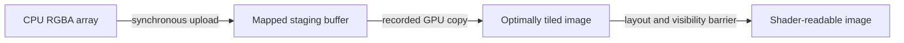

# 13. Uploading a texture

*About 680 lines of C; raw Vulkan would need about 1950.*


The result of this chapter is invisible by design: a checkerboard image lands on the GPU, ready for chapter 14 to sample. Getting it there is the most explicit Vulkan in the course. You generate pixels in C, copy them into a staging buffer, record a copy into an image, and use barriers to move the image between uses. The cube looks exactly as in chapter 12.

## Buffers, images, and barriers

A buffer is a linear range of bytes. An **image** adds dimensions, a texel format, and a tiling.

The texture uses optimal tiling, a GPU-private pixel order the CPU can't write directly; hence the **staging buffer**, a temporary host-visible buffer the CPU fills and the GPU copies from.



An **image layout** is the state an image's memory is arranged in for one kind of access: `TRANSFER_DST_OPTIMAL` for receiving a copy, `SHADER_READ_ONLY_OPTIMAL` for sampling. Moving between them takes a **barrier**, which does three things:

1. waits for the listed pipeline stages to finish,
2. makes their memory writes visible to the next access,
3. changes the image layout.

The upload needs two barriers: `UNDEFINED` to `TRANSFER_DST_OPTIMAL` before the copy (no old pixels to keep), and `TRANSFER_DST_OPTIMAL` to `SHADER_READ_ONLY_OPTIMAL` after it, so the copy finishes before any fragment shader samples. The `VK_PIPELINE_STAGE_2_*` and `VK_ACCESS_2_*` names come from the synchronization2 feature the canvas enabled in chapter 2.

## Add the image and its upload

Add this constant beside `WIDTH` and `HEIGHT`:

```c
#define TEXTURE_SIZE 64
```

Add the image beside the buffers in `Renderer`. The renderer owns it; the allocator from chapter 12 stays borrowed.

```c
    DvzImages* texture;
```

Add this helper between `keyboard()` and `draw()`. It generates 64 × 64 RGBA pixels in eight-pixel tiles, four bytes per texel. The first tile, at row 0 and column 0, is white: a plain checkerboard looks the same flipped or rotated, so this marker shows in chapter 14 which way the image lands.

```c
/**
 * Upload a small checkerboard into a device-local image.
 * @param renderer Renderer that owns the image.
 * @return Zero on success.
 */
static int create_texture(Renderer* renderer)
{
    uint8_t pixels[TEXTURE_SIZE * TEXTURE_SIZE * 4];
    for (uint32_t y = 0; y < TEXTURE_SIZE; y++)
    {
        for (uint32_t x = 0; x < TEXTURE_SIZE; x++)
        {
            // The first tile is white so the image's orientation stays visible on the cube.
            bool marker = x < 8 && y < 8;
            bool check = ((x / 8 + y / 8) & 1) != 0;
            size_t i = ((size_t)y * TEXTURE_SIZE + x) * 4;
            pixels[i + 0] = marker ? 245 : check ? 235 : 35;
            pixels[i + 1] = marker ? 245 : check ? 170 : 80;
            pixels[i + 2] = marker ? 245 : check ? 55 : 190;
            pixels[i + 3] = 255;
        }
    }

    DvzBuffer* staging = dvz_buffer_create_wrapper();
    DvzCommands* upload = dvz_commands_create_wrapper();
    renderer->texture = dvz_images_create_wrapper();
    if (staging == NULL || upload == NULL || renderer->texture == NULL)
        goto error;

    dvz_buffer(renderer->device, renderer->allocator, staging);
    dvz_buffer_size(staging, sizeof(pixels));
    dvz_buffer_usage(staging, VK_BUFFER_USAGE_TRANSFER_SRC_BIT);
    dvz_buffer_flags(staging, DVZ_ALLOC_MAPPED | DVZ_ALLOC_HOST_ACCESS_SEQUENTIAL_WRITE);
    if (dvz_buffer_create(staging) != 0)
        goto error;
    dvz_buffer_upload(staging, 0, sizeof(pixels), pixels);

    dvz_images(renderer->device, renderer->allocator, VK_IMAGE_TYPE_2D, 1, renderer->texture);
    dvz_images_format(renderer->texture, VK_FORMAT_R8G8B8A8_SRGB);
    dvz_images_size(renderer->texture, TEXTURE_SIZE, TEXTURE_SIZE, 1);
    dvz_images_usage(
        renderer->texture, VK_IMAGE_USAGE_TRANSFER_DST_BIT | VK_IMAGE_USAGE_SAMPLED_BIT);
    if (dvz_images_create(renderer->texture) != 0)
        goto error;

    dvz_commands(renderer->device, dvz_device_queue(renderer->device, DVZ_QUEUE_MAIN), 1, upload);
    if (dvz_cmd_begin_result(upload) != 0)
        goto error;
    DvzBarriers barriers = {0};
    dvz_barriers(&barriers);
    DvzBarrierImage* image_barrier =
        dvz_barriers_image(&barriers, dvz_image_handle(renderer->texture, 0));
    if (image_barrier == NULL)
        goto error;
    dvz_barrier_image_stage(image_barrier, VK_PIPELINE_STAGE_2_NONE, VK_PIPELINE_STAGE_2_COPY_BIT);
    dvz_barrier_image_access(image_barrier, 0, VK_ACCESS_2_TRANSFER_WRITE_BIT);
    dvz_barrier_image_layout(
        image_barrier, VK_IMAGE_LAYOUT_UNDEFINED, VK_IMAGE_LAYOUT_TRANSFER_DST_OPTIMAL);
    dvz_barrier_image_aspect(image_barrier, VK_IMAGE_ASPECT_COLOR_BIT);
    dvz_cmd_barriers(upload, &barriers);
    DvzImageRegion region = {0};
    dvz_image_region(&region);
    dvz_image_region_extent(&region, TEXTURE_SIZE, TEXTURE_SIZE, 1);
    dvz_cmd_copy_buffer_to_image(
        upload, dvz_buffer_handle(staging), 0, dvz_image_handle(renderer->texture, 0),
        VK_IMAGE_LAYOUT_TRANSFER_DST_OPTIMAL, &region);
    dvz_barrier_image_stage(
        image_barrier, VK_PIPELINE_STAGE_2_COPY_BIT, VK_PIPELINE_STAGE_2_FRAGMENT_SHADER_BIT);
    dvz_barrier_image_access(
        image_barrier, VK_ACCESS_2_TRANSFER_WRITE_BIT, VK_ACCESS_2_SHADER_SAMPLED_READ_BIT);
    dvz_barrier_image_layout(
        image_barrier, VK_IMAGE_LAYOUT_TRANSFER_DST_OPTIMAL,
        VK_IMAGE_LAYOUT_SHADER_READ_ONLY_OPTIMAL);
    dvz_cmd_barriers(upload, &barriers);
    if (dvz_cmd_end_result(upload) != 0 || dvz_cmd_submit_result(upload) != 0)
        goto error;
    dvz_commands_destroy(upload);
    dvz_commands_free(upload);
    dvz_buffer_destroy(staging);
    dvz_buffer_free(staging);
    return 0;

error:
    if (upload != NULL)
    {
        dvz_commands_destroy(upload);
        dvz_commands_free(upload);
    }
    if (staging != NULL)
    {
        dvz_buffer_destroy(staging);
        dvz_buffer_free(staging);
    }
    return -1;
}
```

`dvz_images()` takes a count because a `DvzImages` wrapper holds an array of images; this one holds `1`, and `dvz_image_handle(renderer->texture, 0)` returns its first. The texture uses `VK_FORMAT_R8G8B8A8_SRGB` because the checker values are display colors; chapter 15 explains what sampling an sRGB image does.

This helper owns its upload command buffer, unlike the canvas's borrowed one, so it may begin, end, and submit it. `dvz_cmd_submit_result()` blocks until the upload finishes; only then does the helper destroy the staging buffer.

## Call the helper and release the image

In `main()`, upload the texture after the index buffer and before creating the camera:

```c
    int texture_result = create_texture(&renderer);
    COURSE_CHECK(texture_result == 0, "texture upload failed");
```

At `cleanup:`, release the image after the material buffer and before the index buffer:

```c
    if (renderer.texture != NULL)
        dvz_images_destroy(renderer.texture);
    dvz_images_free(renderer.texture);
```

The CPU `pixels` array dies when `create_texture()` returns; the image lives until teardown.

## Build and run

Build and run as before; the capture goes to `chapter13.png`.

=== "Linux and macOS"

    ```sh
    cmake --build build
    ./build/vkcourse
    ./build/vkcourse --png chapter13.png
    ```

=== "Windows (Visual Studio)"

    ```powershell
    cmake --build build --config Release
    .\build\Release\vkcourse.exe
    .\build\Release\vkcourse.exe --png chapter13.png
    ```

The capture matches chapter 12, because no shader reads the image yet. The terminal ends with `validation errors: 0`; chapter 14 checks the pixels themselves.

!!! tip "Try it"

    1. Comment out the first `dvz_cmd_barriers(upload, &barriers);` call. Validation reports at submission that the copy expects the image in `VK_IMAGE_LAYOUT_TRANSFER_DST_OPTIMAL`, but its layout is still `VK_IMAGE_LAYOUT_UNDEFINED`.
    2. Change `TEXTURE_SIZE` to `32`. Nothing changes on screen and validation stays at zero: the image size and the copy region both use the constant.
    3. Remove `VK_IMAGE_USAGE_TRANSFER_DST_BIT` from the image usage. Validation reports three errors, against both barriers and the copy: the image was not created to receive transfers.

??? info "Under the hood: an image upload"

    Raw Vulkan needs image and buffer creation, memory allocation and binding, a command pool and buffer, two `VkImageMemoryBarrier2` structures, `vkCmdCopyBufferToImage`, a submission, and a fence wait before freeing the staging buffer. vklite still makes you choose the usage flags, stages, access masks, layouts, and copy region.

!!! warning "When it goes wrong"

    An unchanged cube is expected. A validation error during upload points to image creation, the copy region, or a layout mismatch; read it before touching the shaders. An error at teardown can mean the staging buffer was freed before the upload finished; keep the blocking submit before its cleanup.

## Checkpoint

1. Why does this image need a staging buffer while the vertex buffer could be written directly?
2. Which image layout must the image be in during `dvz_cmd_copy_buffer_to_image()`?
3. What three things does each barrier do?

??? example "Your `main.c` after chapter 13"

    ```c
    --8<-- "examples/c/vulkan/step13.c"
    ```

??? example "Your `shader.vert` after chapter 13"

    ```glsl
    --8<-- "examples/c/vulkan/step13/shader.vert"
    ```

??? example "Your `shader.frag` after chapter 13"

    ```glsl
    --8<-- "examples/c/vulkan/step13/shader.frag"
    ```

Next: [Sampling the texture](14-texture-sampling.md).
