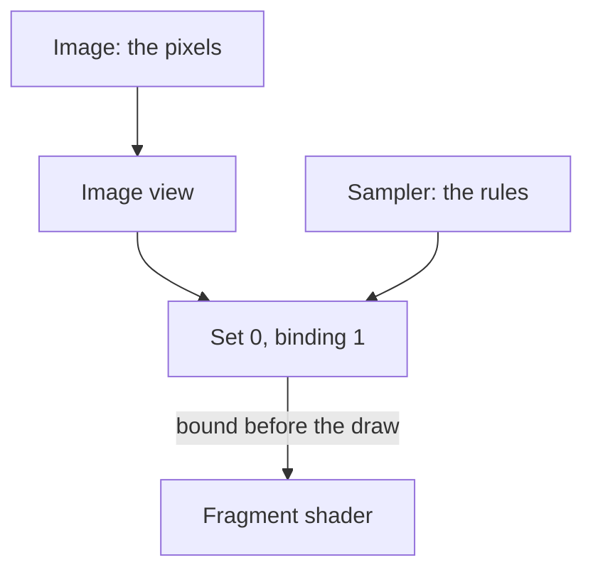

# 14. Sampling the texture

*About 810 lines of C; raw Vulkan would need about 2050.*


Chapter 13 gave each face its own UV coordinates, drawn as color gradients, and uploaded a checkerboard into a GPU image. The image is ready for shaders, in the `SHADER_READ_ONLY_OPTIMAL` layout, but no shader can reach it yet.

This chapter connects the two. The fragment shader reads the image at each fragment's UV, so each gradient becomes a checkerboard. The route is chapter 12's: a slot declared in the pipeline layout, filled by the descriptor set, and read by the shader. Only the kind of resource changes. The texture joins the material in descriptor set 0, at descriptor binding 1.

In this chapter you will:

1. read the texture in the fragment shader;
2. create an **image view** and a **sampler** for the image;
3. declare a texture slot in the pipeline layout and fill it in the descriptor set;
4. keep reload and cleanup in the right order.

## Three objects behind one texture

To read a texture, the GPU needs answers to three questions, and Vulkan gives each answer its own object:

- **Which pixels?** The image from chapter 13: memory, a size and a texel format.
- **Which part of them, seen how?** An **image view** describes how to look at an image: its type (2D here), its aspect (color, as opposed to depth), and which mip levels and array layers it covers. Mip levels are smaller precomputed copies of the image, and array layers are stacked slices; our image has one of each. Shaders and descriptors refer to views, never to images directly. You have used a view since chapter 2: the canvas hands you the frame's image view, not its image. Our view covers the whole texture.
- **Read by which rules?** A **sampler** holds the lookup rules and no pixels. **Filtering** says what to return when a fragment falls between texel centers. **Addressing** says what a UV outside `[0, 1]` means.

These are three objects because they vary independently. One image can have several views, for example one per layer of an image array. One sampler can serve every texture that needs the same rules. Keeping the pixels, the view and the rules apart means none of them is duplicated.

The descriptor that hands a texture to a shader is a **combined image sampler**: one slot that refers to both a view and a sampler. In GLSL it is a `sampler2D`. The view and the sampler stay separate objects; the descriptor only points at both.

Figure 1 shows how the three objects reach the shader. The image feeds the view, and the view and sampler together fill one descriptor slot, which the draw binds.

<figure class="dvz-course-figure" id="fig-texture-objects" markdown="1">



<figcaption>Figure 1. The image view and the sampler fill one combined-image-sampler slot that the fragment shader reads.</figcaption>

</figure>

## Sample the texture

Start with the shader, which states what we want. `shader.vert` is unchanged. Replace `shader.frag` with:

```glsl
#version 450

layout(set = 0, binding = 0) uniform Material { vec4 tint; } material;
layout(set = 0, binding = 1) uniform sampler2D tex;
layout(location = 0) in vec2 uv;
layout(location = 0) out vec4 out_color;

void main()
{
    // Read the texture at this fragment's UV with the sampler's rules, then apply the tint.
    out_color = texture(tex, uv) * material.tint;
}
```

The new `sampler2D` line declares binding 1 of set 0 as a texture. The C side will declare the same numbers.

`texture(tex, uv)` reads the image at the interpolated UV, using the sampler's rules. UV `(0, 0)` reads texel row 0, column 0: the white tile from chapter 13. Each face puts `(0, 0)` on its first vertex, so every face shows the white tile in that corner. Vulkan has no notion of which way up an image is; `v = 0` is simply the first row you wrote. Image files usually store their top row first, so if a loaded picture appears upside down, sample at `1.0 - v` or swap the UVs.

## Create a view and a sampler

The view and sampler describe this one texture, and the descriptor needs both. We create them in `create_texture()`, next to the image, so that reload can reuse them instead of rebuilding them.

### Store them in the renderer

Add two owned fields after `texture`:

```c
    DvzImageViews* texture_view;
    DvzSampler* sampler;
```

The view needs the uploaded image, so the new code goes in `create_texture()` after the checked submit and before `dvz_commands_destroy(upload)`. Start by allocating both wrappers into the renderer. As with the image, `main()`'s cleanup then releases them even if a later step in the helper fails:

```c
    // The renderer owns the view and sampler; main() releases them, even after a failure here.
    renderer->texture_view = dvz_image_views_create_wrapper();
    renderer->sampler = dvz_sampler_create_wrapper();
    if (renderer->texture_view == NULL || renderer->sampler == NULL)
        goto error;
```

### Create the view

```c
    // A view of the whole image: 2D, color aspect, its one mip level and layer.
    dvz_image_views(renderer->texture, renderer->texture_view);
    if (dvz_image_views_create(renderer->texture_view) != 0)
        goto error;
```

`dvz_image_views()` prepares one view per image in the wrapper, and its defaults already fit: a 2D view of the color aspect, covering the image's single mip level and layer. That is the whole texture.

### Create the sampler

```c
    // Lookup rules: nearest texel when magnified or minified, repeat outside [0, 1].
    dvz_sampler(renderer->device, renderer->sampler);
    dvz_sampler_min_filter(renderer->sampler, VK_FILTER_NEAREST);
    dvz_sampler_mag_filter(renderer->sampler, VK_FILTER_NEAREST);
    dvz_sampler_address_mode(
        renderer->sampler, DVZ_SAMPLER_AXIS_U, VK_SAMPLER_ADDRESS_MODE_REPEAT);
    dvz_sampler_address_mode(
        renderer->sampler, DVZ_SAMPLER_AXIS_V, VK_SAMPLER_ADDRESS_MODE_REPEAT);
    if (dvz_sampler_create(renderer->sampler) != 0)
        goto error;
```

The sampler sets two filters. The **magnification** filter applies when one texel covers several screen pixels, as when you zoom in. The **minification** filter applies when several texels fall into one pixel. Nearest filtering, used for both, picks the single closest texel and keeps the checker edges crisp. Repeat addressing, on both axes, wraps coordinates outside `[0, 1]`, so a UV of 1.25 reads the same texel as 0.25.

Figure 2 magnifies these two decisions. Filtering selects a texel; addressing brings an out-of-range coordinate back into the texture. The repeated samples use 0.30 and 1.30, away from the checker tile boundaries.

<figure class="dvz-course-figure" id="fig-nearest-repeat" markdown="1">

<div class="dvz-figure-panels" markdown="0">

--8<-- "docs/images/gpu-graphics/nearest-texel.svg"

--8<-- "docs/images/gpu-graphics/repeat-addressing.svg"

</div>

<figcaption>Figure 2. Nearest filtering selects one texel. Repeat addressing wraps UVs outside the unit square.</figcaption>

</figure>

Neither object copies pixels. The view refers to the image, so the image must outlive the view. The sampler refers to nothing.

## Declare and fill the descriptor

The descriptor takes the same two steps as chapter 12's uniform buffer: declare the slot in the pipeline layout, then fill it in the descriptor set. A third change follows from the second: the texture must now exist before the pipeline.

### Declare the slot in the pipeline layout

In `create_pipeline()`, declare descriptor binding 1 as a combined image sampler for the fragment stage, beside binding 0:

```c
    dvz_slots_binding(
        renderer->slots, 0, 0, 1, VK_SHADER_STAGE_FRAGMENT_BIT, VK_DESCRIPTOR_TYPE_UNIFORM_BUFFER);
    dvz_slots_binding(
        renderer->slots, 0, 1, 1, VK_SHADER_STAGE_FRAGMENT_BIT,
        VK_DESCRIPTOR_TYPE_COMBINED_IMAGE_SAMPLER);
```

Read the second call as: in set 0, binding 1, there is 1 descriptor, visible to the fragment shader, and it is a combined image sampler.

### Fill the slot in the descriptor set

Write the new entry beside the material entry, where the descriptor set is created at the end of `create_pipeline()`:

```c
    // A descriptor set for this layout. It refers to the view, sampler, and buffer; no copies.
    renderer->descriptors = dvz_descriptors_create_wrapper();
    if (renderer->descriptors == NULL)
        return -1;
    dvz_descriptors(renderer->slots, renderer->descriptors);
    dvz_descriptors_image(
        renderer->descriptors, 0, 1, 0, VK_IMAGE_LAYOUT_SHADER_READ_ONLY_OPTIMAL,
        dvz_image_views_handle(renderer->texture_view, 0), dvz_sampler_handle(renderer->sampler));
    dvz_descriptors_buffer(
        renderer->descriptors, 0, 0, 0, dvz_buffer_handle(renderer->material_buffer), 0,
        sizeof(Material));
    return dvz_descriptors_handle(renderer->descriptors, 0) != VK_NULL_HANDLE ? 0 : -1;
```

`dvz_descriptors_image()` fills set 0, binding 1, array element 0 with this view and this sampler. It also names the layout the image will be in when shaders read it, `SHADER_READ_ONLY_OPTIMAL`. That is the layout chapter 13's second barrier left it in, and the two must match.

### Create the texture before the pipeline

The descriptor set now refers to the view and sampler, so the pipeline must be created after the texture. Move the checked pipeline creation to just after `create_texture()`:

```c
    // The texture first: the pipeline's descriptor set refers to its view and sampler.
    int texture_result = create_texture(&renderer);
    COURSE_CHECK(texture_result == 0, "texture upload failed");
    int pipeline_result = create_pipeline(&renderer);
    COURSE_CHECK(pipeline_result == 0, "graphics pipeline creation failed");
```

`draw()` needs no change. It already binds set 0, and binding 1 is part of that set.

## Keep reload and cleanup safe

The new objects have two different lifetimes:

| Object | Owner | Lives until |
| --- | --- | --- |
| image, view, sampler | `Renderer` | teardown, after the device wait |
| descriptor set | the current pipeline group | that pipeline is destroyed or replaced |

### Give the reload candidate the view and sampler

A reload candidate builds a new descriptor set, so it needs the view and sampler. Add them to its initializer:

```c
            // Borrowed: material buffer, view, and sampler. Owned: everything it creates.
            Renderer candidate = {
                .device = renderer.device,
                .color_format = renderer.color_format,
                .material_buffer = renderer.material_buffer,
                .texture_view = renderer.texture_view,
                .sampler = renderer.sampler,
            };
```

The candidate borrows the view and sampler, and owns its pipeline, slots, shaders and descriptor set. The rest of the reload path is unchanged from chapter 12. Reload covers changes to shader calculations within the existing interface. Changing locations, descriptor bindings or the push-constant block also needs C edits and a rebuild.

### Release in reverse order of reference

The simplest safe teardown order is to release whatever refers to an object before the object itself: the descriptor set before the view and sampler it names, and the view before its image. `destroy_pipeline()` already releases the descriptor set first. At `cleanup:`, after the material buffer and before `renderer.texture`, add:

```c
    if (renderer.sampler != NULL)
        dvz_sampler_destroy(renderer.sampler);
    dvz_sampler_free(renderer.sampler);
    if (renderer.texture_view != NULL)
        dvz_image_views_destroy(renderer.texture_view);
    dvz_image_views_free(renderer.texture_view);
```

## Build and run

Build and run as before. The capture goes to `chapter14.png`.

=== "Linux"

    ```sh
    cmake --build build
    ./build/vkcourse
    ./build/vkcourse --png chapter14.png
    ```

=== "macOS"

    ```sh
    cmake --build build
    ./build/vkcourse
    ./build/vkcourse --png chapter14.png
    ```

=== "Windows"

    In a Developer PowerShell for Visual Studio, with the `PATH` setup from chapter 1:

    ```powershell
    cmake --build build --config Release
    .\build\Release\vkcourse.exe
    .\build\Release\vkcourse.exe --png chapter14.png
    ```

Every face shows a square checkerboard, with its white tile where chapter 13 showed black. This is the check that chapter 13's upload put the intended pixels in the image. The terminal ends with `validation errors: 0`.

??? tip "Try it"

    1. Replace both `VK_FILTER_NEAREST` values with `VK_FILTER_LINEAR`, rebuild, and zoom in. The checker edges blur, because linear filtering blends neighboring texels.
    2. On the front face, change the U of its second and third vertices (`(1.0f, 0.0f)` and `(1.0f, 1.0f)`) to `2.0f`. That face shows the checkerboard twice. With `VK_SAMPLER_ADDRESS_MODE_CLAMP_TO_EDGE` on the U axis, the right half instead smears the last texel column.

??? info "Under the hood: descriptor layouts and sets"

    Raw Vulkan creates a `VkImageView` and a `VkSampler`, adds a combined-image-sampler entry to the descriptor set layout, and writes a `VkDescriptorImageInfo` with `vkUpdateDescriptorSets`. `DvzSlots` owns the layout; `DvzDescriptors` owns the set and borrows the slots. The device owns the pool. None of them owns the view or sampler.

??? warning "When it goes wrong"

    A set/binding validation error means the GLSL declaration, the slots or the descriptor write disagree. If **R** fails after the first frame worked, check that the candidate receives the view and sampler.

## What carries over

- GPU APIs keep the pixels, the way of viewing them and the rules for reading them apart. WebGPU has `GPUTexture`, `GPUTextureView` and `GPUSampler`, bound as separate entries; Vulkan's combined image sampler only puts a view and a sampler in one slot.
- Filtering and addressing belong to the lookup, not to the image. The same texture can look crisp, smooth, tiled or clamped depending on the sampler.

## Checkpoint

1. What do the image view, sampler, and descriptor each contribute?
2. Why must reload replace the descriptor set along with its slots?

??? example "Your `main.c` after chapter 14"

    ```c
    --8<-- "examples/c/vulkan/step14.c"
    ```

??? example "Your `shader.vert` after chapter 14"

    ```glsl
    --8<-- "examples/c/vulkan/step14/shader.vert"
    ```

??? example "Your `shader.frag` after chapter 14"

    ```glsl
    --8<-- "examples/c/vulkan/step14/shader.frag"
    ```

Next: [Lighting](15-lighting.md).
