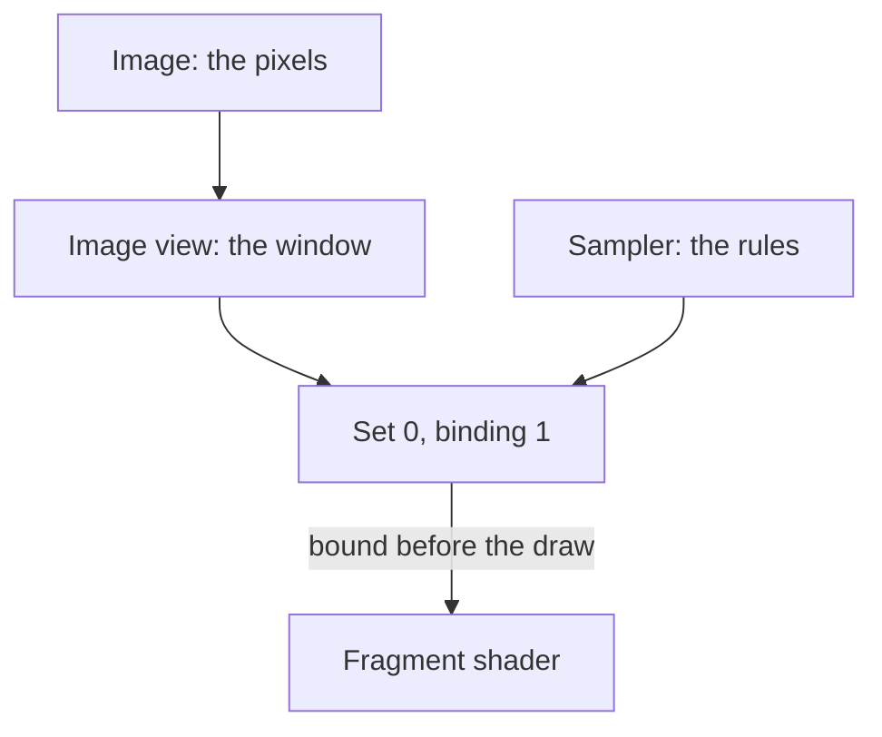

# 14. Sampling the texture

*About 723 lines of C; raw Vulkan would need about 2050.*


Chapter 13 gave each face its own UV coordinates, drawn as color gradients, and uploaded a checkerboard into a GPU image. The image is ready for shaders, in `SHADER_READ_ONLY_OPTIMAL` layout, but no shader can reach it yet.

This chapter connects the two. The fragment shader reads the image at each fragment's UV, so each gradient becomes a checkerboard. The route is chapter 12's: a slot declared in the pipeline layout, filled by the descriptor set, read by the shader. Only the kind of resource changes. The texture joins the material in descriptor set 0, at descriptor binding 1.

In this chapter you will:

1. read the texture in the fragment shader;
2. create an **image view** and a **sampler** for the image;
3. declare a texture slot in the pipeline layout and fill it in the descriptor set;
4. keep reload and cleanup in the right order.

## Three objects behind one texture

To read a texture, the GPU needs answers to three questions, and Vulkan gives each its own object:

- **Which pixels?** The image from chapter 13: memory, a size, and a texel format.
- **Which part of them, seen how?** An **image view** is a window onto an image: its type (2D here), which aspect (color, as opposed to depth), and which mip levels and array layers (mip levels are smaller precomputed copies of the image; array layers are stacked slices; ours has one of each). Shaders and descriptors refer to views, never to images directly. You have used one since chapter 3: the canvas hands you the frame's image view, not its image. Ours covers the whole texture.
- **Read by which rules?** A **sampler** holds the lookup rules, with no pixels at all. **Filtering** says what to return when a fragment falls between texel centers. **Addressing** says what a UV outside `[0, 1]` means.

Why three objects instead of one? They vary independently. One image can have several views, for example one per layer of an image array. One sampler can serve every texture that wants the same rules. Keeping data, window, and rules apart avoids duplicating any of them.

The descriptor that hands a texture to a shader is a **combined image sampler**: one slot that refers to both a view and a sampler. In GLSL it is a `sampler2D`. The view and the sampler remain separate objects; the descriptor only points at both.



## Sample the texture

Start with the shader, which states what we want. `shader.vert` is unchanged. Replace `shader.frag` with:

```glsl
#version 450

layout(set = 0, binding = 0) uniform Material { vec4 tint; } material;
layout(set = 0, binding = 1) uniform sampler2D tex;
layout(location = 0) in vec2 uv;
layout(location = 0) out vec4 out_color;

void main()
{
    out_color = texture(tex, uv) * material.tint;
}
```

The new line declares binding 1 of set 0 as a texture. The C side will declare the same numbers.

`texture(tex, uv)` reads the image at the interpolated UV, using the sampler's rules. UV `(0, 0)` reads texel row 0, column 0: the white tile from chapter 13. Each face puts `(0, 0)` on its first vertex, so every face shows the white tile in that corner. Vulkan has no notion of which way up an image is; `v = 0` is simply the first row you wrote. Image files usually store their top row first, so if a loaded picture appears upside down, sample at `1.0 - v` or swap the UVs.

## Create a view and sampler

The view and sampler describe this one texture, and the descriptor needs both, so create them in `create_texture()` with the image. Reload then reuses them instead of rebuilding them. Add them as owned fields after `texture`:

```c
    DvzImageViews* texture_view;
    DvzSampler* sampler;
```

The view needs the uploaded image, so in `create_texture()` add this after the checked submit and before `dvz_commands_destroy(upload)`:

```c
    renderer->texture_view = dvz_image_views_create_wrapper();
    renderer->sampler = dvz_sampler_create_wrapper();
    if (renderer->texture_view == NULL || renderer->sampler == NULL)
        goto error;
    dvz_image_views(renderer->texture, renderer->texture_view);
    if (dvz_image_views_create(renderer->texture_view) != 0)
        goto error;
    dvz_sampler(renderer->device, renderer->sampler);
    dvz_sampler_min_filter(renderer->sampler, VK_FILTER_NEAREST);
    dvz_sampler_mag_filter(renderer->sampler, VK_FILTER_NEAREST);
    dvz_sampler_address_mode(
        renderer->sampler, DVZ_SAMPLER_AXIS_U, VK_SAMPLER_ADDRESS_MODE_REPEAT);
    dvz_sampler_address_mode(
        renderer->sampler, DVZ_SAMPLER_AXIS_V, VK_SAMPLER_ADDRESS_MODE_REPEAT);
    if (dvz_sampler_create(renderer->sampler) != 0)
        goto error;
```

`dvz_image_views()` prepares one view per image in the wrapper, and its defaults already fit: a 2D view of the color aspect, covering the image's single mip level and layer. That is the whole texture.

The sampler sets two filters. The **magnification** filter applies when one texel covers several screen pixels, as when you zoom in; the **minification** filter applies when several texels fall into one pixel. Nearest filtering, for both, picks the single closest texel, keeping the checker edges crisp. Repeat addressing, on both axes, wraps coordinates outside `[0, 1]`, so a UV of 1.25 reads the same texel as 0.25.

Neither object copies pixels. The view refers to the image, so the image must outlive it.

## Declare and write the descriptor

Now the descriptor, in two steps exactly like chapter 12's: declare the slot, then fill it. In `create_pipeline()`, declare descriptor binding 1 as a combined image sampler for the fragment stage, beside binding 0:

```c
    dvz_slots_binding(
        renderer->slots, 0, 0, 1, VK_SHADER_STAGE_FRAGMENT_BIT, VK_DESCRIPTOR_TYPE_UNIFORM_BUFFER);
    dvz_slots_binding(
        renderer->slots, 0, 1, 1, VK_SHADER_STAGE_FRAGMENT_BIT,
        VK_DESCRIPTOR_TYPE_COMBINED_IMAGE_SAMPLER);
```

Read the second call as: in set 0, binding 1, there is 1 descriptor, visible to the fragment shader, and it is a combined image sampler.

Write it beside the material entry when the descriptor set is created:

```c
    if (dvz_graphics_create(renderer->pipeline) != 0)
        return -1;
    renderer->descriptors = dvz_descriptors_create_wrapper();
    if (renderer->descriptors == NULL)
        return -1;
    dvz_descriptors(renderer->slots, renderer->descriptors);
    dvz_descriptors_image(
        renderer->descriptors, 0, 1, 0, VK_IMAGE_LAYOUT_SHADER_READ_ONLY_OPTIMAL,
        dvz_image_views_handle(renderer->texture_view, 0), dvz_sampler_handle(renderer->sampler));
    dvz_descriptors_buffer(
        renderer->descriptors, 0, 0, 0, dvz_buffer_handle(renderer->material_buffer), 0,
        sizeof(Material));
    return dvz_descriptors_handle(renderer->descriptors, 0) != VK_NULL_HANDLE ? 0 : -1;
```

`dvz_descriptors_image()` fills set 0, binding 1, array element 0 with this view and this sampler. It also names the layout the image will be in when shaders read it, `SHADER_READ_ONLY_OPTIMAL`: the layout chapter 13's second barrier left it in. The two must match.

The descriptor now needs the view and sampler, so the pipeline must be created after the texture. Move the checked pipeline creation to just after `create_texture()`:

```c
    int texture_result = create_texture(&renderer);
    COURSE_CHECK(texture_result == 0, "texture upload failed");
    int pipeline_result = create_pipeline(&renderer);
    COURSE_CHECK(pipeline_result == 0, "graphics pipeline creation failed");
```

`draw()` needs no change: it already binds set 0, and binding 1 is part of it.

## Keep reload and cleanup safe

The new objects split into two lifetimes. The view and sampler belong to the texture: created once, kept until teardown. The descriptor set belongs to the pipeline, as in chapter 12, and is rebuilt on every reload.

A reload candidate builds a new descriptor set, so it needs the view and sampler. Add them to its initializer:

```c
            Renderer candidate = {
                .device = renderer.device,
                .color_format = renderer.color_format,
                .material_buffer = renderer.material_buffer,
                .texture_view = renderer.texture_view,
                .sampler = renderer.sampler,
            };
```

The candidate borrows them and owns its pipeline, slots, shaders, and descriptor set; the rest of the reload path is unchanged from chapter 12. Reload covers shader calculations within the existing interface; changing locations, descriptor bindings, or the push-constant block also needs C edits and a rebuild.

Teardown runs in reverse order of reference: whatever points at an object goes before that object. The descriptor set must go before the view and sampler it names, and the view before its image. At `cleanup:`, after the material buffer and before `renderer.texture`, add:

```c
    if (renderer.sampler != NULL)
        dvz_sampler_destroy(renderer.sampler);
    dvz_sampler_free(renderer.sampler);
    if (renderer.texture_view != NULL)
        dvz_image_views_destroy(renderer.texture_view);
    dvz_image_views_free(renderer.texture_view);
```

## Build and run

Build and run as before; the capture goes to `chapter14.png`.

=== "Linux and macOS"

    ```sh
    cmake --build build
    ./build/vkcourse
    ./build/vkcourse --png chapter14.png
    ```

=== "Windows (Visual Studio)"

    ```powershell
    cmake --build build --config Release
    .\build\Release\vkcourse.exe
    .\build\Release\vkcourse.exe --png chapter14.png
    ```

Every face shows a square checkerboard, its white tile where chapter 13 showed black. The terminal ends with `validation errors: 0`.

!!! tip "Try it"

    1. Replace both `VK_FILTER_NEAREST` values with `VK_FILTER_LINEAR`, rebuild, and zoom in. The checker edges blur, because linear filtering blends neighboring texels.
    2. On the front face, change the U of its second and third vertices (`(1.0f, 0.0f)` and `(1.0f, 1.0f)`) to `2.0f`. That face shows the checkerboard twice. With `VK_SAMPLER_ADDRESS_MODE_CLAMP_TO_EDGE` on the U axis, the right half instead smears the last texel column.

??? info "Under the hood: descriptor layouts and sets"

    Raw Vulkan creates a `VkImageView` and a `VkSampler`, adds a combined-image-sampler entry to the descriptor set layout, and writes a `VkDescriptorImageInfo` with `vkUpdateDescriptorSets`. `DvzSlots` owns the layout; `DvzDescriptors` owns the set and borrows the slots. The device owns the pool. None of them owns the view or sampler.

!!! warning "When it goes wrong"

    A set/binding validation error means the GLSL declaration, the slots, or the descriptor write disagree. If **R** fails after the first frame worked, check that the candidate receives the view and sampler.

## What carries over

- GPU APIs keep the pixels, the window onto them, and the rules for reading them apart. WebGPU has `GPUTexture`, `GPUTextureView`, and `GPUSampler`, bound as separate entries; Vulkan's combined image sampler only puts a view and a sampler in one slot.
- Filtering and addressing belong to the lookup, not the image: the same texture can look crisp, smooth, tiled, or clamped depending on the sampler.

## Checkpoint

1. What do the image view, sampler, and descriptor each contribute?
2. Why must reload replace the descriptor set along with its slots?

??? example "Your `main.c` after chapter 14"

    ```c
    --8<-- "examples/c/vulkan/step14.c"
    ```

??? example "Your `shader.vert` after chapter 14"

    ```glsl
    --8<-- "examples/c/vulkan/step14/shader.vert"
    ```

??? example "Your `shader.frag` after chapter 14"

    ```glsl
    --8<-- "examples/c/vulkan/step14/shader.frag"
    ```

Next: [Lighting](15-lighting.md).
