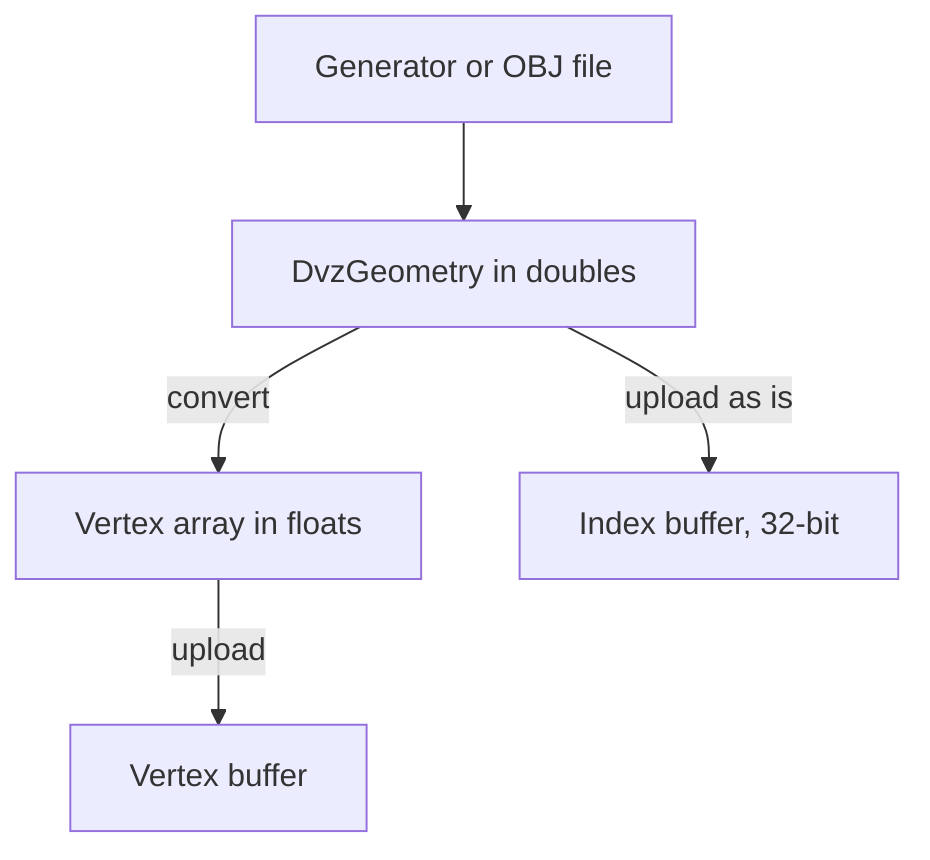

# 16. A real mesh

*About 870 lines of C; raw Vulkan would need about 2200.*


The program now draws a textured, lit cube that turns under the mouse. Its geometry, though, is 24 vertices and 36 indices typed by hand into C arrays (chapters 13 and 15). Real models have thousands of vertices or more. They come from a generator or a file, and their size is known only when the program runs.

This final chapter replaces the cube with a generated sphere, or with a Wavefront OBJ file of your own. Very little else changes: the shaders, texture, descriptors and push constants stay as they are. At the end you have a complete textured, lit, mouse-controlled mesh viewer.

In this chapter you will:

1. generate a sphere, or load an OBJ file, as CPU arrays;
2. convert those arrays to your `Vertex` format and upload them into buffers sized at run time;
3. switch to 32-bit indices and draw as many indices as the mesh has;
4. load a model of your own.

## What the pipeline fixes, and what it leaves open

A **mesh** is CPU-side data: vertex attributes plus the indices that assemble them into triangles. Vulkan has no mesh object. It only sees buffers and a draw command that says how many indices to read.

Look at what the pipeline fixed in earlier chapters: the layout of one vertex record (position, normal and UV at locations 0, 1 and 2, from chapter 15), the triangle-list topology, and the shaders. It fixed nothing about how many vertices there are or what shape they make. So any geometry converted to the same `Vertex` layout draws through the same pipeline.

Three things do change with a real mesh:

- The counts are known only at run time. Buffer sizes and the index count must come from the mesh, not from `sizeof` on a static array.
- The data needs converting. Datoviz's geometry library stores doubles, and the pipeline reads 32-bit floats. Your code converts between the two formats.
- Indices can outgrow 16 bits. A `uint16_t` index stops at 65535 (chapter 7). Large meshes need 32-bit indices, and the index-buffer bind must say so.

Figure 1 shows the two paths the mesh data takes to the GPU. Vertex attributes are converted on the CPU before upload; indices are uploaded as they are.

<figure class="dvz-course-figure" id="fig-mesh-data-path" markdown="1">



<figcaption>Figure 1. Vertex attributes are converted to floats before upload; the 32-bit indices are uploaded unchanged.</figcaption>

</figure>

## Replace the cube arrays

The geometry functions are declared in `<datoviz/geom.h>`, which `<datoviz.h>` already includes, so you need no new include.

Delete `VERTICES` and `INDICES`; keep `Vertex`, `Push` and both size assertions. A generated or loaded mesh knows its size only at run time, so the renderer must remember its index count. Add this field beside the buffers in `Renderer`:

```c
    uint32_t index_count;
```

## Build the mesh in one helper

The vertex and index buffers used to be created in `main()` from the static arrays. Now one helper, `create_mesh()`, does four things in order:

1. get the geometry and check it;
2. convert the vertex attributes to the `Vertex` format;
3. size and create both buffers;
4. upload the data and free the CPU copies.

### 1. Get the geometry and check it

Add the helper between `create_texture()` and `draw()`. It loads an OBJ file when given a path and generates a sphere otherwise:

```c
/**
 * Convert generated CPU geometry to the pipeline's float vertices and uint32 indices.
 * @param renderer Renderer that owns the uploaded GPU buffers.
 * @param obj_path Wavefront OBJ file to load, or NULL for the generated sphere.
 * @return Zero on success.
 */
static int create_mesh(Renderer* renderer, const char* obj_path)
{
    int result = -1;

    // Get the geometry: load the OBJ file, or generate a sphere. We own the result.
    DvzGeometry* geometry = obj_path != NULL
                                ? dvz_geometry_obj(obj_path, NULL)
                                : dvz_geometry_sphere(&(DvzGeometrySphereDesc){
                                      DVZ_STRUCT_INIT_FIELDS(DvzGeometrySphereDesc),
                                      .radius = 0.9,
                                      .rings = 24,
                                      .sectors = 48});
```

The sphere has a radius of 0.9 and a grid of 24 rings by 48 sectors. Datoviz description structs start with a size and a flags field. `DVZ_STRUCT_INIT_FIELDS()` fills them with the struct's size and zero flags, so the library can check that it received the struct layout it expects. Both routes return a `DvzGeometry` that the helper owns and must destroy.

Before using the geometry, the helper checks everything the conversion depends on:

```c
    // Check every array the Vertex format needs, and byte counts that cannot overflow.
    Vertex* vertices = NULL;
    size_t vertex_count = geometry != NULL ? geometry->vertex_count : 0;
    size_t index_count = geometry != NULL ? geometry->index_count : 0;
    if (geometry == NULL || geometry->positions == NULL || geometry->normals == NULL ||
        geometry->texcoords == NULL || geometry->indices == NULL || geometry->vertex_count == 0 ||
        geometry->index_count == 0 || vertex_count > SIZE_MAX / sizeof(*vertices) ||
        index_count > SIZE_MAX / sizeof(DvzIndex))
        goto cleanup;
```

The checks cover three cases:

- the loader or generator failed and returned `NULL`;
- an attribute array the `Vertex` format needs is missing, or the mesh is empty;
- multiplying a count by its record size would overflow `size_t`, so an allocation or byte count would be wrong.

On any failure, the helper jumps to its `cleanup:` label, shown in step 4, with `result` still `-1`.

### 2. Convert the vertex attributes

The geometry stores doubles, and the pipeline expects 32-bit floats. The helper allocates a `Vertex` array sized to this mesh and narrows each component:

```c
    // Convert: narrow each double to the 32-bit float the pipeline reads.
    vertices = (Vertex*)calloc(vertex_count, sizeof(*vertices));
    if (vertices == NULL)
        goto cleanup;
    for (uint32_t i = 0; i < geometry->vertex_count; i++)
    {
        for (uint32_t j = 0; j < 3; j++)
        {
            vertices[i].position[j] = (float)geometry->positions[i][j];
            vertices[i].normal[j] = (float)geometry->normals[i][j];
        }
        vertices[i].uv[0] = (float)geometry->texcoords[i][0];
        vertices[i].uv[1] = (float)geometry->texcoords[i][1];
    }
```

Indices need no conversion. They are `DvzIndex`, a 32-bit unsigned type, and upload as they are.

### 3. Size and create the buffers

The buffer setup is chapter 6's and chapter 7's, except that the sizes now come from the mesh. The helper also stores the index count for `draw()`.

```c
    // Size both buffers from the mesh. The renderer owns them, even if a later step fails.
    DvzSize vertex_bytes = (DvzSize)geometry->vertex_count * sizeof(Vertex);
    DvzSize index_bytes = (DvzSize)geometry->index_count * sizeof(DvzIndex);
    renderer->index_count = geometry->index_count;
    renderer->vertex_buffer = dvz_buffer_create_wrapper();
    renderer->index_buffer = dvz_buffer_create_wrapper();
    if (renderer->vertex_buffer == NULL || renderer->index_buffer == NULL)
        goto cleanup;
    dvz_buffer(renderer->device, renderer->allocator, renderer->vertex_buffer);
    dvz_buffer_size(renderer->vertex_buffer, vertex_bytes);
    dvz_buffer_usage(renderer->vertex_buffer, VK_BUFFER_USAGE_VERTEX_BUFFER_BIT);
    dvz_buffer_flags(
        renderer->vertex_buffer, DVZ_ALLOC_MAPPED | DVZ_ALLOC_HOST_ACCESS_SEQUENTIAL_WRITE);
    dvz_buffer(renderer->device, renderer->allocator, renderer->index_buffer);
    dvz_buffer_size(renderer->index_buffer, index_bytes);
    dvz_buffer_usage(renderer->index_buffer, VK_BUFFER_USAGE_INDEX_BUFFER_BIT);
    dvz_buffer_flags(
        renderer->index_buffer, DVZ_ALLOC_MAPPED | DVZ_ALLOC_HOST_ACCESS_SEQUENTIAL_WRITE);
    if (dvz_buffer_create(renderer->vertex_buffer) != 0 ||
        dvz_buffer_create(renderer->index_buffer) != 0)
        goto cleanup;
```

Both wrappers go straight into the renderer, so `main()`'s cleanup releases them even if this helper fails afterward.

### 4. Upload and free the CPU data

```c
    // Both uploads copy their bytes now, so the CPU arrays may be freed below.
    dvz_buffer_upload(renderer->vertex_buffer, 0, vertex_bytes, vertices);
    dvz_buffer_upload(renderer->index_buffer, 0, index_bytes, geometry->indices);
    result = 0;

cleanup:
    // Free the CPU data on every path; the GPU buffers stay with the renderer.
    free(vertices);
    dvz_geometry_destroy(geometry);
    return result;
}
```

Each upload has copied its bytes into the mapped buffer by the time it returns, so the converted array and the geometry can be freed straight away. The success path and every failure path reach the same `cleanup:` label, so the CPU data is freed exactly once whichever way the helper ends. The GPU buffers stay with `Renderer` until teardown.

## Change initialization and the draw count

Add an `--obj PATH` option. Declare its variable beside `png_path`:

```c
    const char* obj_path = NULL;
```

Add a branch to the argument loop:

```c
        else if (strcmp(argv[argument_index], "--obj") == 0)
            obj_path = argv[++argument_index];
```

The helper now creates both buffers, so the old code in `main()` goes. In `main()`, replace the whole vertex- and index-buffer block, from `renderer.vertex_buffer = ...` through the index upload, with:

```c
    // Vertex and index buffers, sized and filled from the generated or loaded mesh.
    int mesh_result = create_mesh(&renderer, obj_path);
    COURSE_CHECK(mesh_result == 0, "mesh creation failed");
```

The draw must match the new buffers in two ways: the index type and the index count. Geometry indices are 32-bit `DvzIndex` values, and the count comes from the mesh. In `draw()`, replace the index binding and the draw:

```c
    dvz_cmd_bind_index_buffer(renderer->commands, renderer->index_buffer, 0, VK_INDEX_TYPE_UINT32);
    dvz_cmd_draw_indexed(renderer->commands, 0, 0, renderer->index_count, 0, 1);
```

Read the draw as in chapter 7: from index 0, with vertex offset 0, draw `index_count` indices, as 1 instance starting at instance 0. `VK_INDEX_TYPE_UINT32` tells Vulkan to read each index as 4 bytes.

The full listing also accepts `--width`, `--height` and `--time`, which are used only to render the documentation preview. You don't need them, so your file will be shorter.

## Load your own OBJ

Wavefront OBJ is a plain-text format that most 3D tools export. `dvz_geometry_obj()` reads `v`, `vt`, `vn` and polygonal `f` records, splits each polygon into a fan of triangles, and ignores materials and groups. Missing UVs become `(0, 0)`, so the whole mesh samples one texel of chapter 13's white corner tile and shows no checkerboard.

An OBJ face indexes positions, UVs and normals separately, while a Vulkan index selects one whole vertex (chapter 7). The loader bridges the two by writing a separate vertex for each triangle corner.

That choice decides how a file without normals looks. If any corner lacks a `vn` normal, the loader computes normals for the whole mesh. Because no vertex is shared, each triangle gets one flat normal, so curved models look faceted. The generated sphere is different: its triangles share vertices, and the generator supplies smooth normals (see below). For smooth shading of your own model, export normals from your modelling tool.

The loader returns `NULL` for a missing, unreadable or unsupported file, and the program then exits cleanly with `mesh creation failed`. The camera expects a model near the origin, about one unit across. A model far off-center or much larger will be clipped or invisible; check its bounds with `dvz_geometry_bounds()`.

=== "Linux"

    ```sh
    ./build/vkcourse --obj path/to/model.obj
    ./build/vkcourse --obj path/to/model.obj --png model.png
    ```

=== "macOS"

    ```sh
    ./build/vkcourse --obj path/to/model.obj
    ./build/vkcourse --obj path/to/model.obj --png model.png
    ```

=== "Windows"

    In a Developer PowerShell for Visual Studio, with the `PATH` setup from chapter 1:

    ```powershell
    .\build\Release\vkcourse.exe --obj path\to\model.obj
    .\build\Release\vkcourse.exe --obj path\to\model.obj --png model.png
    ```

## Keep the sphere's smooth normals

The cube needed one flat normal per face (chapter 15). A sphere is curved everywhere, so each vertex gets its own normal and the lighting varies smoothly across triangles.

The sphere generator supplies radial normals, each pointing away from the center. Along the texture seam, duplicated vertices share a position and a normal but differ in UV (U = 0 on one side, U = 1 on the other). This is chapter 7's rule applied: split a vertex where its attributes differ, and nowhere else.

For the sphere, keep the generator's normals. `dvz_geometry_compute_normals()` averages only triangles that share an index, so it can show a faint seam (Try it 2).

## Build and run

Build and run as before. The capture goes to `chapter16.png`.

=== "Linux"

    ```sh
    cmake --build build
    ./build/vkcourse
    ./build/vkcourse --png chapter16.png
    ```

=== "macOS"

    ```sh
    cmake --build build
    ./build/vkcourse
    ./build/vkcourse --png chapter16.png
    ```

=== "Windows"

    In a Developer PowerShell for Visual Studio, with the `PATH` setup from chapter 1:

    ```powershell
    cmake --build build --config Release
    .\build\Release\vkcourse.exe
    .\build\Release\vkcourse.exe --png chapter16.png
    ```

You see a smooth sphere with a curved checkerboard and a specular highlight. The tiles shrink toward the poles, where a rectangular image wraps around a point. The terminal ends with `validation errors: 0`.

??? tip "Try it"

    1. Lower `rings` to `8` and `sectors` to `16`, and rebuild. The silhouette turns visibly polygonal.
    2. Recompute the normals: insert this after the geometry checks in `create_mesh()` and rebuild. The capture looks very similar, because averaged triangle normals closely match the radial ones. Each side of the texture seam averages only its own triangles, which is why recomputed normals can differ from the generator's there.

        ```c
            DvzResult normal_result = dvz_geometry_compute_normals(geometry);
            if (normal_result != DVZ_OK)
                goto cleanup;
        ```

    3. Draw a torus: replace the sphere arm of the ternary in `create_mesh()` with the code below. The torus draws with the same pipeline, texture, and lighting; only the vertex and index counts change.

        ```c
                                        : dvz_geometry_torus(&(DvzGeometryTorusDesc){
                                              DVZ_STRUCT_INIT_FIELDS(DvzGeometryTorusDesc),
                                              .major_radius = 0.6,
                                              .minor_radius = 0.25,
                                              .rings = 24,
                                              .sectors = 24});
        ```

??? info "Under the hood: geometry is CPU data"

    Vulkan accepts buffers and draw commands; it has no sphere or mesh. A generator or loader fills arrays, you choose a GPU format, and the draw selects an index range. Changing the geometry leaves the descriptor layout, shaders, attachments and synchronization untouched.

??? warning "When it goes wrong"

    A garbled mesh means the index binding still says `UINT16` while the buffer holds 32-bit values. Missing triangles mean the draw count is still 36. A blank window with an OBJ usually means the model is off-center or far too large; check its bounds. With `--obj`, `mesh creation failed` at startup usually means the file was missing, unreadable or unsupported.

## What carries over

- A pipeline describes the format of one vertex, never the shape. Any geometry converted to that format draws through it, whatever its source or size.
- File formats and GPU formats rarely match. Loading a model ends with a conversion step: choosing precision, building one index per vertex, and sizing buffers at run time.
- Whether an edge looks smooth or sharp depends on the normals, not the triangles. Shared normals blend across an edge; separate ones keep it crisp.

## Checkpoint

1. What had to change to draw generated geometry through the existing pipeline?
2. Why does this chapter switch to 32-bit indices?
3. What does normal recomputation average, and why can that matter at a UV seam?

??? example "Your `main.c` after chapter 16"

    ```c
    --8<-- "examples/c/vulkan/step16.c"
    ```

??? example "Your `shader.vert` after chapter 16"

    ```glsl
    --8<-- "examples/c/vulkan/step16/shader.vert"
    ```

??? example "Your `shader.frag` after chapter 16"

    ```glsl
    --8<-- "examples/c/vulkan/step16/shader.frag"
    ```

Next: [Where to go next](17-next.md).
