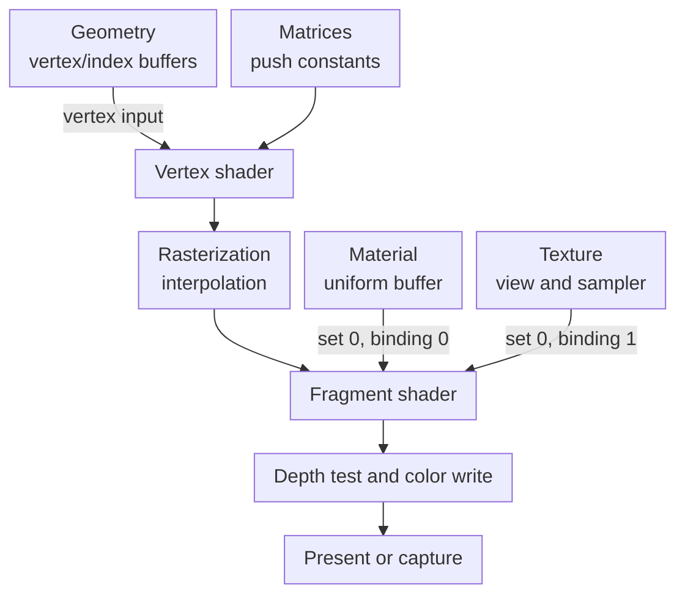

# 17. Where to go next

You started from an empty program and a window (chapters 1 to 3) and wrote the render loop that every later chapter built on: your loop processes events and asks the canvas for a frame, the canvas hands your callback a command buffer to record into, and your loop submits the frame for presentation. You drew a triangle with a pipeline and shaders (chapters 4 and 5), then fed it from vertex and index buffers (chapters 6 and 7).

Then came motion and depth. Push constants animated the square from the CPU every frame (chapter 8), matrices and perspective turned it into a cube (chapter 9), the depth buffer and culling made it solid (chapter 10), and the mouse made it turn (chapter 11). Descriptors gave shaders access to GPU memory (chapter 12). That made a texture possible: uploaded through a staging buffer and barriers (chapter 13), then sampled through a view and a sampler (chapter 14). Normals and a light showed the surface's shape (chapter 15), and a generated or loaded mesh replaced the hand-typed cube without changing the pipeline (chapter 16).

The result is the core loop of a small Vulkan renderer: the CPU prepares resources and records commands, and the GPU turns them into pixels. This chapter looks at the whole program: the paths data takes, what Datoviz did for you, and how often each piece of state changes. It ends with routes for going further, grouped by what you want to do next.

## The complete path

Figure 1 shows how the resources from earlier chapters feed the final draw, from vertex input through the shader stages to the finished frame.

<figure class="dvz-course-figure" id="fig-complete-data-path" markdown="1">

Scroll sideways for the full diagram.

<figcaption>Figure 1. Each input reaches the vertex or fragment shader through its own route: buffers, push constants, a uniform buffer, or an image with a sampler.</figcaption>

</figure>

Vertex input uses the indices to select complete vertex records, then decodes their attributes as in chapters 6 and 7. Push constants carry copies of the matrices. The fragment shader reads the material and texture through the descriptor bindings introduced in chapters 12 and 14.

The arrows mean different things:

- Uploads copy CPU bytes.
- Descriptors store references.
- Bind commands select resources for later draws.
- Submission queues recorded work, and a completion signal says when referenced resources may be changed or destroyed.

## The Vulkan pieces you did not write

Datoviz handled the Vulkan work below for you, grouped by responsibility. Where it matters, each group also says what was still left to you.

### The device and validation

Datoviz first loads the Vulkan loader (chapter 1), which routes each call to the driver and can insert layers. The GPU context then creates the Vulkan instance, chooses a physical device, enables features, selects queue families, and creates the logical device that owns every resource you made.

The validation layer you enabled in chapter 2 checked every call and fed `dvz_gpu_ctx_error_count()`. Validation slows every call, so release builds usually turn it off.

### The window and presentation

The window host processes the operating system's events each time your loop calls `dvz_window_host_poll()`. The window and canvas create the surface and swapchain, acquire images, recover from resizes, and present. `dvz_canvas_frame()` and `dvz_canvas_submit()` wrap that work.

The canvas also allocates the render targets you drew into, including chapter 10's optional depth image, and recreates them when the window is resized. In live mode it copies each finished frame into the acquired swapchain image; with `--png` it reads the frame back instead.

### Frame slots and synchronization

The canvas owns each frame slot's command pool, command buffer, semaphores and fence. Semaphores order GPU operations such as acquisition, rendering and presentation. Fences (chapter 3) tell the CPU that submitted work has finished. Together they say when a frame slot is safe to reuse and, when several slots are available, let the CPU record one frame while the GPU executes another. When that work overlaps, CPU and GPU times do not simply add up; chapter 3 explains how to compare them with a frame budget such as 16.7 ms at 60 FPS.

### Recording and descriptors

The rendering wrapper records dynamic rendering with color and depth attachments. Raw Vulkan can also use classic render passes and framebuffers; either way, attachments and image layout transitions must agree.

`DvzSlots` and `DvzDescriptors` stand in for descriptor set layouts, pipeline layouts, descriptor pools and `vkUpdateDescriptorSets`. You still choose every set and descriptor binding; the device manages the pool.

### Memory

The VMA-backed allocator chooses memory types and binds memory. You still decide which resources are host-visible or device-local, how bytes reach them, and when they are safe to change or destroy.

## The loop you wrote

The outer loop was yours from chapter 2 on: a `while` loop that polls events, asks the canvas for a frame, and submits it. Writing it out kept each stage in view, so later additions had an obvious place. Chapter 3's animation reads the clock in the callback, chapter 5's shader reload runs between polling and frame preparation, and chapter 11's arcball receives mouse events during polling.

Writing that loop did not mean writing an event system or Vulkan synchronization. The window host still talked to the operating system, and the canvas still handled image acquisition, fences, semaphores and presentation. Your loop only decided when to call them.

Datoviz's higher-level App API can run the loop for you. There you create a `DvzApp` and its views rather than a canvas, and `dvz_app_run(app, 0)` runs the interactive loop. It follows the app's scheduling settings: in on-demand mode it waits for input, a resize or a frame request before rendering, and in continuous mode it keeps rendering. It returns when the app's exit policy is met, such as when its windows close, or when `dvz_app_stop()` is called. When a GUI toolkit such as Qt or SDL already owns the event loop, the toolkit decides when to render and calls `dvz_view_render_once()` or `dvz_app_render_once()` to draw one frame.

These are different API levels and host arrangements, and App views render through a canvas internally. An explicit loop like yours suits learning and low-level programs that manage their own frames. `dvz_app_run()` suits applications built with the App API, and the render-once calls suit programs where another toolkit runs the loop.

## What changes when

The final program sorts its state by how often it changes. That grouping is a useful starting point for larger renderers.

| Frequency | State in this course | Delivery |
| --- | --- | --- |
| Per frame | current frame target and extent; camera and arcball result | borrowed canvas frame values and newly recorded commands |
| Per draw | projection and model-view matrices | push constants copied into the command buffer |
| When material or scene data changes | tint and lighting coefficients | bytes in the uniform buffer referenced by set 0 binding 0; safe updates require synchronization |
| When texture content or sampling changes | image pixels, image view, filtering, and addressing | staged image upload and set 0 binding 1 |
| When geometry changes | vertex records, indices, and draw count | vertex and index buffer uploads |
| Rarely | shader stages, vertex layout, topology, depth, culling, attachment formats, descriptor layouts | graphics pipeline and pipeline layout creation |

## Where to go next

The next step depends on what you want to do.

### Go deeper into Vulkan

These experiments extend the program you wrote:

- Write a compute shader that fills a storage image, then add a barrier and sample the image in a graphics pass.
- Add a second pipeline for a wireframe or outline pass.
- Enable MSAA, then study blending and transparency.
- Add an ImGui overlay for camera and material controls.

Each one reuses something you already know. The barrier between a compute write and a fragment read is chapter 13's barrier with different stages and access masks. A wireframe pass is a second pipeline built like chapter 4's, with chapter 10's line polygon mode.

### Draw in a browser

The program you wrote in this course is low-level C on Vulkan, and it does not run in a browser. Browsers use WebGPU, a different GPU API. Most of what you learned carries over to it: graphics pipelines become render pipelines, descriptor set layouts and sets become bind group layouts and bind groups, and command buffers are recorded through command encoders. WebGPU inserts most barriers for you.

Datoviz's own browser route works at a higher level. It runs selected Scene API examples, not vklite programs or custom shaders. The [WebGPU subset](../reference/webgpu-subset.md) lists what it covers.

### Build applications with less code

When the renderer itself is no longer what you are working on, move up to the [Scene API](../how-to/create-a-scene.md). It runs on the same GPU foundations but manages resources, visuals and cameras for you. You can still use the low-level path when a custom pipeline is worth the extra control.

## Checkpoint

1. Which objects coordinate image acquisition and presentation?
2. Why do fences matter even when command recording has already finished?
3. For each final shader input, can you identify where its bytes originate, how Vulkan interprets them, whether they are copied or referenced, and how long the source or resource must live?
4. Which part of the course would you replace with the Scene API in a larger application?
