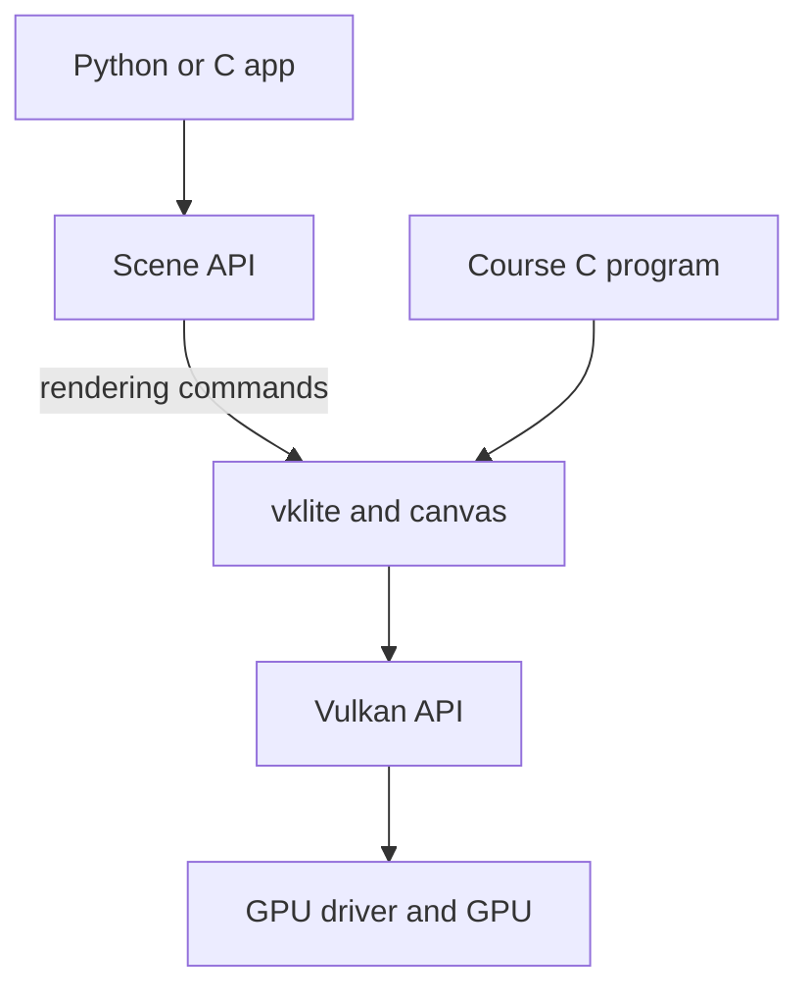

# Modern GPU Graphics in Vulkan

Datoviz is a GPU visualization engine for scientific data. In normal use, you work with the Scene API from Python or C: you create figures and panels, add visuals such as points, lines, images or meshes, and give them your arrays. Datoviz then renders the result on the GPU. The [Quickstart](../start/quickstart.md) and the [first C program](../start/first-c-program.md) show this route.

This course explores the rendering foundation underneath. It teaches modern GPU graphics in C, using the native Vulkan layers that Datoviz renders with.

## Under the Scene API

Rendering splits work between two processors. The CPU runs your program, which prepares data and records a list of commands. The GPU executes those commands on many vertices or pixels at once and produces the image. The native path that this course teaches reaches the GPU through **Vulkan**, an explicit C API implemented by the GPU driver, in which you state formats, memory, ordering and lifetimes yourself. [Chapter 3](03-frame.md) explains how the CPU and GPU share the work of a frame.

Datoviz builds a shared foundation on top of Vulkan. Its vklite layer wraps Vulkan objects, such as buffers, textures and pipelines, in small C types, and its canvas prepares, presents and synchronizes each frame. The Scene API turns your scene into frame plans and rendering commands that run on this foundation, as the [runtime overview](../advanced/runtime-internals.md) describes. The course program uses the foundation directly: it is a C program that calls vklite and the canvas. Figure 1 shows both routes.

<figure class="dvz-course-figure" id="fig-course-layers" markdown="1">

Scroll sideways for the full diagram.

<figcaption>Figure 1. Ordinary Datoviz programs reach vklite and the canvas through the Scene API. The course program calls them directly. Both routes then go through Vulkan and the driver to the GPU.</figcaption>

</figure>

## Who this course is for

Ordinary Scene API use, including large arrays and interactive 3D views, does not require this course or any Vulkan code. The course is for C programmers who want to understand the level below:

- You want to learn how GPUs and Vulkan work by writing a program yourself.
- You need specialized rendering that the supplied visuals do not provide, and you want to know what a custom renderer involves.
- You want to reason about shaders, resource lifetimes and rendering performance.
- You want to contribute to Datoviz's rendering internals.

The examples focus on a standalone native renderer.

You need to read and write C. You do not need any Vulkan or graphics experience beyond knowing what a pixel is.

What you learn also applies outside Vulkan. WebGPU, Metal and Direct3D 12 use the same kinds of objects: devices, command buffers, pipelines, buffers, textures and descriptors. Each chapter points out what carries over to them.

## What you build

You build a small interactive 3D mesh viewer in C, one step at a time, in a project of your own. The first chapters open a window and draw a triangle. The middle chapters add a 3D camera that you control with the mouse, and depth testing so that near surfaces hide far ones. The last chapters upload a texture, add per-fragment lighting, and replace the hand-typed cube with generated or loaded geometry.

<picture>
  <source media="(prefers-reduced-motion: no-preference)" srcset="../assets/gpu-graphics/16-mesh-animated.webp">
  
</picture>

*The final course project: the textured, lit mesh viewer from chapter 16, built on Datoviz's low-level Vulkan layers.*

## What you write, and what is handled for you

Before a raw Vulkan program can draw its first triangle, it needs an instance, a physical device, a queue family, a logical device, a window surface, a swapchain and its image views, a command pool, and synchronization for every frame in flight. That can take around 1000 lines, and none of them describes the triangle. In this course, vklite and the canvas own that setup, so from chapter 2 onward you work on shaders, pipelines, buffers, textures, matrices and lighting. The table shows the split.

| Handled for you | Yours to write |
| --- | --- |
| Instance, physical-device selection, logical device, queues | Both shader stages, in GLSL |
| Window, surface, swapchain, image acquisition, presentation | Pipeline state: topology, vertex layout, depth, and culling |
| Per-frame semaphores and fences, resize recovery | Vertex and index data, and the GPU buffers holding it |
| Window-system event processing | The render loop: when to process events and render a frame |
| Command-pool and command-buffer allocation | Command recording: passes, binds, draws |
| Depth-image allocation, screenshot and video capture | Textures: staging, image layout transitions, samplers, descriptors |
| GPU memory allocation | Matrices, camera, and lighting math |

Nothing in the left column is hidden from you. From chapter 2 on, each coding chapter has an *Under the hood* box that explains what raw Vulkan would need at that point. The raw-Vulkan line counts at the top of each chapter are rough estimates, not measurements. By the end, you will know what a swapchain and a fence are for without having written either one by hand.

The code in the right column is still Vulkan programming. You call Datoviz functions, but Vulkan's own types and flags, such as `VkFormat`, appear directly in your code. The course writes shaders in GLSL; Vulkan itself receives compiled SPIR-V, and [chapter 4](04-triangle.md) explains the step between them.

You also write the outer loop yourself: a short `while` loop that processes input, prepares a frame, records commands and submits them. Seeing each stage shows where later additions go, such as animation and live shader reloading. Inside those calls, Datoviz still does the window-system work and Vulkan's frame synchronization. Datoviz's higher-level App API has `dvz_app_run()`, which runs the loop for you, but it drives App views, not the canvas you create here. [Chapter 2](02-window.md) explains the loop, and [chapter 17](17-next.md) compares the two approaches.

vklite and the canvas are advanced, low-level interfaces, and they can change between Datoviz releases. Use the Datoviz version that [chapter 1](01-setup.md) sets up.

## What you need

- A C11 compiler and CMake 3.21 or newer.
- A Vulkan-capable GPU with a working driver.
- A Datoviz v0.4 build that is compatible with the course. Chapter 1 says which one and walks through the installation.

Some linear algebra helps from chapter 9 onward, but the course explains the matrices it uses.

## How the chapters work

You keep one file, `main.c`, open in your editor for the whole course, and each chapter adds to it. From chapter 5 onward, you also have `shader.vert` and `shader.frag`, which you can edit while the program runs.

From chapter 2 on, every coding chapter ends with a complete listing of each file as it should look at that point. If something breaks, you can paste the listing to get back in sync.

### Reading conventions

- Commands that differ between systems appear in Linux, macOS and Windows tabs. Choose your system once and the site keeps that choice on the other pages.
- Diagrams are numbered figures with a caption, and the text next to each one explains it.
- From chapter 2 on, each coding chapter ends with three optional boxes, closed by default. **Try it** has small experiments with a predicted result, which help you check your understanding. **Under the hood** shows the raw Vulkan you avoided. **When it goes wrong** lists the symptoms you are most likely to hit in that chapter, and their causes.

Anything you need in order to continue, such as ownership rules or how to read validation errors, is in the main text, never only in a closed box.

## The chapters

The parts follow the order in which a renderer grows: first a frame that reaches the screen; then a triangle, the pipeline that draws it, and geometry from your own memory; then 3D, with matrices, depth and a camera; and last, textures and light, which make a surface look real.

**Part 1: A window and a frame**

1. [Setup](01-setup.md): an empty program that links Datoviz, and a build you trust.
2. [Your first window](02-window.md): a window, a GPU, a render loop, and a color of your choosing.
3. [How a frame works](03-frame.md): what the CPU records, what the GPU executes, and when.

**Part 2: Triangles, shaders, pipeline, and vertex data**

<ol start="4" markdown>
<li markdown>[Your first triangle](04-triangle.md): shaders, a pipeline, and a draw call.</li>
<li markdown>[Shaders in their own files](05-shader-files.md): SPIR-V, compiler errors, and live reloading.</li>
<li markdown>[Vertex buffers](06-vertex-buffers.md): geometry from your own memory.</li>
<li markdown>[Index buffers](07-index-buffers.md): the same shape with fewer vertices.</li>
</ol>

**Part 3: Into 3D**

<ol start="8" markdown>
<li markdown>[Push constants](08-push-constants.md): getting changing values into a shader.</li>
<li markdown>[Matrices and perspective](09-matrices.md): model, view, projection, and a cube that looks wrong.</li>
<li markdown>[Depth and culling](10-depth-culling.md): why it looked wrong, and how to fix it.</li>
<li markdown>[Mouse control](11-mouse-control.md): a camera and arcball controller.</li>
</ol>

**Part 4: Surfaces, textures, and light**

<ol start="12" markdown>
<li markdown>[Uniform buffers and descriptors](12-uniform-buffers.md): shader data shared across draws.</li>
<li markdown>[Uploading a texture](13-texture-upload.md): UV coordinates, staging buffers, image layouts, and barriers.</li>
<li markdown>[Sampling the texture](14-texture-sampling.md): image views, samplers, and descriptors.</li>
<li markdown>[Lighting](15-lighting.md): normals, diffuse, and specular.</li>
<li markdown>[A real mesh](16-mesh.md): from a hand-typed cube to generated or loaded geometry.</li>
</ol>

The course closes with [what Datoviz handled for you and where to go next](17-next.md).

Start with [Setup](01-setup.md).

## Acknowledgment

This course was written with the help of OpenAI Codex and Claude Code.
