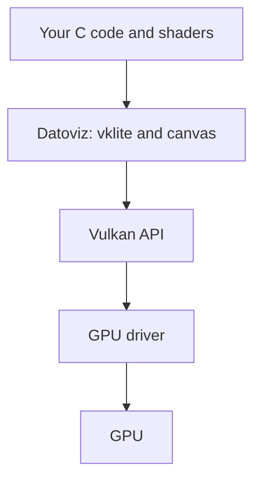

# Modern GPU Graphics in Vulkan

This course teaches modern GPU graphics in C, with Vulkan running underneath.

You start with an empty file and end with an interactive 3D mesh viewer: a perspective camera you control with the mouse, depth-tested geometry, a texture you upload yourself, and per-fragment lighting. You write the program line by line in a small project of your own.

<picture>
  <source media="(prefers-reduced-motion: no-preference)" srcset="../assets/gpu-graphics/16-mesh-animated.webp">
  
</picture>

## Why this course exists

Vulkan gives you direct control over a GPU, but that control creates a steep starting point. Before a raw Vulkan program can draw its first triangle, it needs an instance, a physical device, a queue family, a logical device, a window surface, a swapchain and its image views, a command pool, and synchronization for every frame in flight. By then you may have written around 1000 lines, and none of them describes the triangle.

The course explains those concepts without asking you to implement the platform machinery. Datoviz's low-level layers (vklite and its canvas) own that code, so from chapter 2 onward you can work on shaders, pipelines, buffers, textures, matrices, and lighting. These advanced low-level APIs are still evolving and may change between releases. Use the Datoviz version given in the setup chapter; the course does not promise compatibility with other releases.

## How the pieces fit

A computer that draws has two processors. The CPU runs your C program, one step after another. The GPU is a separate processor with its own memory, built for one kind of work: running the same small program on many items at once, such as every vertex of a shape or every pixel of an image. It does not run your C code. Your program prepares data and a list of commands, hands them over, and the GPU produces the image.

**Vulkan** is the interface between the two. It is a C API, specified by the Khronos Group and implemented by each GPU vendor's driver, through which a program creates GPU objects, records commands, and submits them. Vulkan is explicit: the driver makes few decisions for you, so you state formats, memory, ordering, and lifetimes yourself. That makes it fast and predictable, and long to set up.

Datoviz sits between your program and Vulkan. Its vklite layer wraps Vulkan objects in small C types, and its canvas runs the window and the frame loop. You call Datoviz functions, but Vulkan's own types and flags, such as `VkFormat`, appear directly in your code, so what you learn is Vulkan.

The ideas are not specific to Vulkan either. WebGPU, Metal, and Direct3D 12 are built on the same objects: devices, command buffers, pipelines, buffers, textures, and descriptors. Each chapter points out what carries over to them.

## What you write, and what is handled for you

| Handled for you | Yours to write |
| --- | --- |
| Instance, physical-device selection, logical device, queues | Both shader stages, in GLSL |
| Window, surface, swapchain, image acquisition, presentation | Pipeline state: topology, vertex layout, depth, and culling |
| Per-frame semaphores and fences, frame pacing, resize recovery | Vertex and index data, and the GPU buffers holding it |
| Command-pool and command-buffer allocation | Command recording: passes, binds, draws |
| Depth-image allocation, screenshot and video capture | Textures: staging, image layout transitions, samplers, descriptors |
| GPU memory allocation | Matrices, camera, and lighting math |

Nothing in the left column is hidden from you. Each coding chapter has an *Under the hood* aside that explains what raw Vulkan would need at that point. Its raw-Vulkan line counts are rough comparisons, not measurements. By the end, you will know what a swapchain and a fence are for without having written either one by hand.

## What you need

- A C11 compiler and CMake 3.21 or newer.
- A Vulkan-capable GPU with a working driver.
- Datoviz v0.4 installed: chapter 1 walks through it.
- No Vulkan experience. No graphics experience beyond knowing what a pixel is.

Some linear algebra helps from chapter 9 onward, but the course explains the matrices it uses.

## How the chapters work

You keep one file, `main.c`, open in your editor for the whole course. Each chapter adds to it. From chapter 5 onward, you also have `shader.vert` and `shader.frag`, which you can edit while the program runs.

Every coding chapter ends with a complete listing of the file as it should look at that point. If something breaks, you can resynchronize with one paste. Along the way:

- **Try it**: small experiments with a predicted result. Do them; they are where the understanding settles.
- **Under the hood**: the raw Vulkan you just avoided.
- **When it goes wrong**: the symptoms you are most likely to hit in that chapter, and their causes.

## The chapters

The parts follow the order in which a renderer grows. First, a frame that reaches the screen. Then a triangle and the pipeline that draws it, with geometry from your own memory. Then 3D: matrices, depth, and a camera. Last, what makes a surface look real: textures and light.

**Part 1: A window and a frame**

1. [Setup](01-setup.md): an empty program that links Datoviz, and a build you trust.
2. [Your first window](02-window.md): a window, a GPU, a render loop, and a color of your choosing.
3. [How a frame works](03-frame.md): what the CPU records, what the GPU executes, and when.

**Part 2: Triangles, shaders, pipeline, and vertex data**

<ol start="4" markdown>
<li markdown>[Your first triangle](04-triangle.md): shaders, a pipeline, and a draw call.</li>
<li markdown>[Shaders in their own files](05-shader-files.md): SPIR-V, compiler errors, and live reloading.</li>
<li markdown>[Vertex buffers](06-vertex-buffers.md): geometry from your own memory.</li>
<li markdown>[Index buffers](07-index-buffers.md): the same shape with fewer vertices.</li>
</ol>

**Part 3: Into 3D**

<ol start="8" markdown>
<li markdown>[Push constants](08-push-constants.md): getting changing values into a shader.</li>
<li markdown>[Matrices and perspective](09-matrices.md): model, view, projection, and a cube that looks wrong.</li>
<li markdown>[Depth and culling](10-depth-culling.md): why it looked wrong, and how to fix it.</li>
<li markdown>[Mouse control](11-mouse-control.md): a camera and arcball controller.</li>
</ol>

**Part 4: Surfaces, textures, and light**

<ol start="12" markdown>
<li markdown>[Uniform buffers and descriptors](12-uniform-buffers.md): shader data shared across draws.</li>
<li markdown>[Uploading a texture](13-texture-upload.md): UV coordinates, staging buffers, image layouts, and barriers.</li>
<li markdown>[Sampling the texture](14-texture-sampling.md): image views, samplers, and descriptors.</li>
<li markdown>[Lighting](15-lighting.md): normals, diffuse, and specular.</li>
<li markdown>[A real mesh](16-mesh.md): from a hand-typed cube to generated geometry.</li>
</ol>

The course closes with [what Datoviz handled for you and where to go next](17-next.md).

Start with [Setup](01-setup.md).

## Acknowledgment

This course was written with the help of OpenAI Codex and Claude Code.
