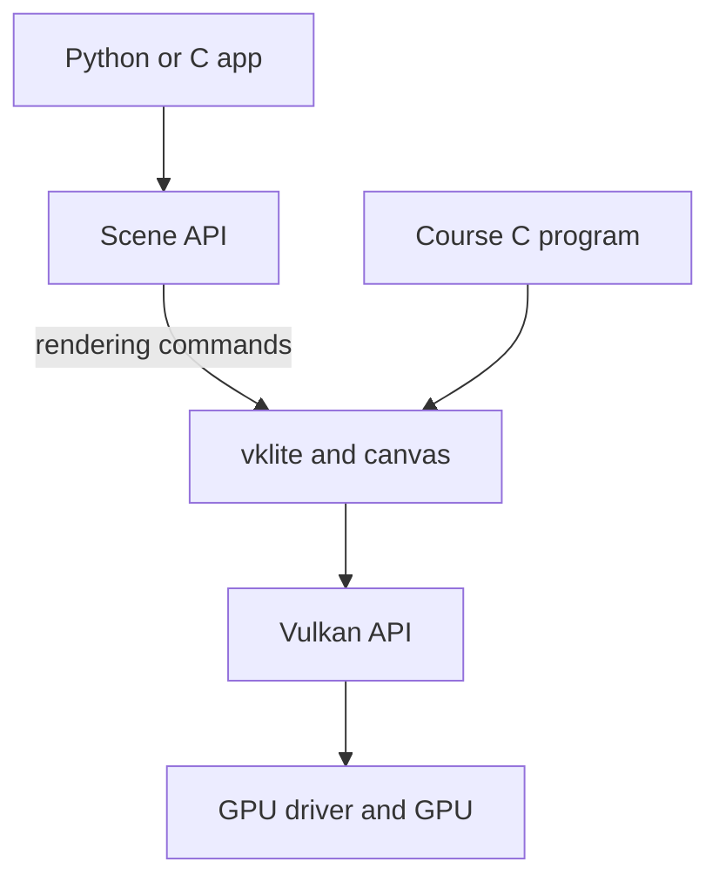

# Modern GPU Graphics in Vulkan

Datoviz is a GPU visualization engine for scientific data. With its Scene API, you create figures and panels from Python or C, add visuals such as points, lines, images or meshes, and supply your arrays. The [Quickstart](../start/quickstart.md) and the [first C program](../start/first-c-program.md) show how.

This course teaches GPU graphics and Vulkan in C. You build a small renderer step by step, and Datoviz's native helpers take care of the platform setup.

<picture>
  <source media="(prefers-reduced-motion: no-preference)" srcset="../assets/gpu-graphics/16-mesh-animated.webp">
  
</picture>

*The final course project: the textured, lit mesh viewer from chapter 16, built on Datoviz's low-level Vulkan layers.*

## Who this course is for

- **Learning Vulkan:** build a renderer with Datoviz's native helpers. No previous Datoviz experience is needed.
- **Using Datoviz:** learn the Vulkan foundation beneath the Scene API, if you want to understand or work on its rendering internals.

Ordinary Scene API use does not require Vulkan code.

You need to read and write C. You do not need any Vulkan or graphics experience. Most of the ideas carry over to WebGPU, Metal and Direct3D 12, and each chapter points out what does.

## What you build

You build an interactive 3D mesh viewer in C. Starting with a window and a triangle, you add a camera controlled with the mouse, depth testing, a texture, lighting, and generated or loaded geometry.

## What you write, and what is handled for you

- Datoviz's vklite and canvas handle the native setup: the Vulkan device, the window and swapchain, and per-frame synchronization. Each chapter's *Under the hood* box explains what raw Vulkan would need for that part.
- You write the graphics: shaders in GLSL, compiled to SPIR-V ([chapter 4](04-triangle.md)); pipelines, buffers, textures and descriptors; the commands that draw each frame; and the loop that drives it all ([chapter 2](02-window.md)). Writing the loop yourself shows where each stage of a frame happens.

Vulkan's own types and flags, such as `VkFormat`, appear directly in your code. Datoviz's App API has a separate loop, `dvz_app_run()`, for App views; [chapter 17](17-next.md) compares it with the canvas loop you write here.

How the course relates to the Scene API

If you already use Datoviz, Figure 1 shows how the course relates to the Scene API. The Scene API turns your scene into rendering commands that run on vklite and the canvas, as the [runtime overview](../advanced/runtime-internals.md) describes. The course program calls vklite and the canvas directly.

<figure class="dvz-course-figure" id="fig-course-layers" markdown="1">

Scroll sideways for the full diagram.

<figcaption>Figure 1. Ordinary Datoviz programs reach vklite and the canvas through the Scene API. The course program calls them directly. Both routes then go through Vulkan and the driver to the GPU.</figcaption>

</figure>

## What you need

- A C11 compiler and CMake 3.21 or newer.
- A Vulkan-capable GPU with a working driver.
- A compatible Datoviz v0.4 build. [Chapter 1](01-setup.md) says which one and how to install it. vklite and the canvas are advanced interfaces that can change between releases, so build against that version.

Some linear algebra helps from chapter 9 onward, and the course explains the matrices it uses.

## How the chapters work

You keep one `main.c` for the whole course, and each chapter adds to it. From chapter 5 onward, the shaders live in `shader.vert` and `shader.frag`, which you can edit while the program runs. Every coding chapter from chapter 2 on ends with complete listings, so you can get back in sync if something breaks.

Commands that differ between systems appear in Linux, macOS and Windows tabs; choose your system once and the site keeps that choice on other pages. Each coding chapter also ends with three optional boxes, closed by default: *Try it*, *Under the hood* and *When it goes wrong*. Anything you need in order to continue, such as ownership rules or how to read validation errors, is in the main text.

## The chapters

The parts follow the order in which a renderer grows: first a frame that reaches the screen; then a triangle, the pipeline that draws it, and geometry from your own memory; then 3D, with matrices, depth and a camera; and last, textures and light, which make a surface look real.

**Part 1: A window and a frame**

1. [Setup](01-setup.md): an empty program that links Datoviz, and a build you trust.
2. [Your first window](02-window.md): a window, a GPU, a render loop, and a color of your choosing.
3. [How a frame works](03-frame.md): what the CPU records, what the GPU executes, and when.

**Part 2: Triangles, shaders, pipeline, and vertex data**

<ol start="4" markdown>
<li markdown>[Your first triangle](04-triangle.md): shaders, a pipeline, and a draw call.</li>
<li markdown>[Shaders in their own files](05-shader-files.md): SPIR-V, compiler errors, and live reloading.</li>
<li markdown>[Vertex buffers](06-vertex-buffers.md): geometry from your own memory.</li>
<li markdown>[Index buffers](07-index-buffers.md): the same shape with fewer vertices.</li>
</ol>

**Part 3: Into 3D**

<ol start="8" markdown>
<li markdown>[Push constants](08-push-constants.md): getting changing values into a shader.</li>
<li markdown>[Matrices and perspective](09-matrices.md): model, view, projection, and a cube that looks wrong.</li>
<li markdown>[Depth and culling](10-depth-culling.md): why it looked wrong, and how to fix it.</li>
<li markdown>[Mouse control](11-mouse-control.md): a camera and arcball controller.</li>
</ol>

**Part 4: Surfaces, textures, and light**

<ol start="12" markdown>
<li markdown>[Uniform buffers and descriptors](12-uniform-buffers.md): shader data shared across draws.</li>
<li markdown>[Uploading a texture](13-texture-upload.md): UV coordinates, staging buffers, image layouts, and barriers.</li>
<li markdown>[Sampling the texture](14-texture-sampling.md): image views, samplers, and descriptors.</li>
<li markdown>[Lighting](15-lighting.md): normals, diffuse, and specular.</li>
<li markdown>[A real mesh](16-mesh.md): from a hand-typed cube to generated or loaded geometry.</li>
</ol>

The course closes with [what Datoviz handled for you and where to go next](17-next.md).

Start with [Setup](01-setup.md).

## Acknowledgment

This course was written with the help of OpenAI Codex and Claude Code.
