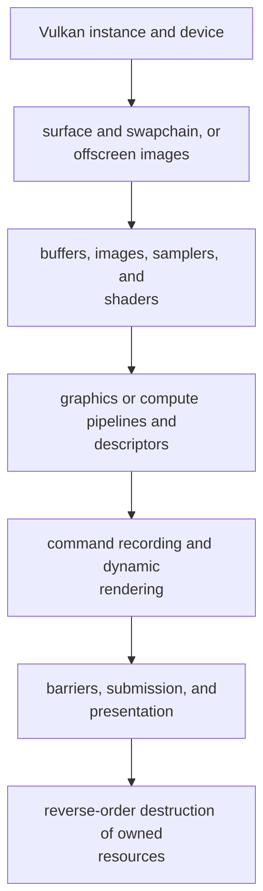

# Runtime and low-level C APIs

The low-level C reference is split by subsystem. These APIs sit below the retained scene and app
surfaces and are primarily intended for renderer development, native integration, and debugging.
Most applications should start with the [Scene API](scene.md) or
[App, window, and I/O API](app.md).

!!! warning "Advanced ownership contracts"

    Low-level objects expose Vulkan resources and explicit lifetimes. A function that accepts a
    wrapper or borrowed handle does not transfer ownership unless its API documentation says so.
    Do not destroy, reset, submit, or transition borrowed resources.

## Choose a subsystem

| Reference | Use it for | Main headers |
| --- | --- | --- |
| [Runtime shaders](runtime-shader.md) | External GLSL compilation, provider preflight, target profiles, diagnostics, and SPIR-V ownership | `include/datoviz/shader.h` |
| [vklite](runtime-vklite.md) | Rendering resources, pipelines, command recording, dynamic rendering, and synchronization | `include/datoviz/vklite/**` |
| [Vulkan foundation](runtime-vulkan.md) | Instances, devices, queues, GPU contexts, allocation, and memory interop | `include/datoviz/vk/**` |
| [Low-level controllers](runtime-controllers.md) | Camera, panzoom, arcball, fly, and turntable records below the scene API | `include/datoviz/controller/**` |
| [Math](runtime-math.md) | Boxes, vectors, animation curves, random generation, and statistics | `include/datoviz/math/**` |
| [Common and utilities](runtime-utilities.md) | Common support, file I/O, resources, fonts, diagnostics, and shared helpers | `include/datoviz/common/**`, `include/datoviz/fileio/**` |

## vklite lifecycle

A typical direct vklite integration follows this dependency order:

<figure class="dvz-course-figure" id="fig-runtime-1" markdown="1">

<figcaption>Figure 1. Create runtime resources, record and submit work, then release owned resources in reverse order.</figcaption>

</figure>

Within the [vklite reference](runtime-vklite.md), symbols are grouped around those workflows:
device and presentation, resources, pipelines and bindings, commands and rendering, and
synchronization and submission.

## Related documentation

- [Runtime internals](../../advanced/runtime-internals.md)
- [DRP2 command streams](../../advanced/drp2-command-streams.md)
- [Debug rendering](../../how-to/debug-rendering.md)
- [Profile performance](../../how-to/profile-performance.md)
- [Objects and lifetimes](../objects-and-lifetimes.md)

The subsystem pages and [C types](types.md) are generated from the extracted public headers. To
change symbol classification, update `spec/api/C_API_REFERENCE_POLICY.yaml` and run
`just api-docs`.
